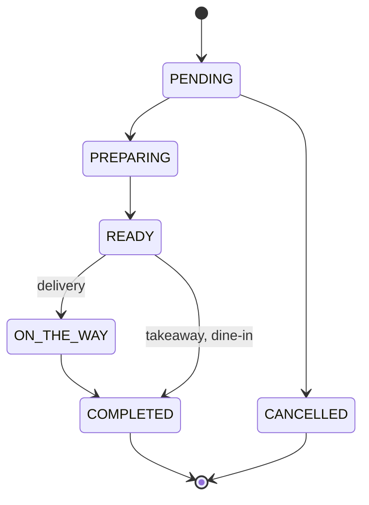

# Requirements

- The requirements must explain __what__ (not how) the software being produced should do. 
    * you should not focus on the particular problems, but exclusively on what you want the application to do.

- Requirements must be clearly identified, and possibly numbered

- Requirements are divided into:
    - **Functional**: some functionality the software should provide to the user
    - **Non-functional**: requirements that do not directly concern behavioural aspects, such as consistency, availability, etc.
    - **Implementation**: constrain the entire phase of system realization, for instance by requiring the use of a specific programming language and/or a specific software tool
        + these constraints should be adequately justified by political / economic / administrative reasons...
        + ... otherwise, implementation choices should emerge _as a consequence of_ design

- If there are domain-specific terms, these should be explained in a glossary

- Each requirement must have its own __acceptance criteria__
    + these will be important for the validation phase

---

# Requirements of Munchies

This chapter states what _Munchies_ must do. How each requirement is met belongs to the [design](../03-design/design.md)
chapter; the acceptance criteria below are the ones verified in the [validation](../05-validation/acceptance-test.md)
chapter.

Requirements are identified as follows:

| Prefix | Group                                 |
|--------|---------------------------------------|
| `FR-A` | Functional: accounts and access       |
| `FR-R` | Functional: restaurants and catalogue |
| `FR-O` | Functional: orders                    |
| `FR-P` | Functional: payments                  |
| `FR-N` | Functional: notifications             |
| `FR-T` | Functional: table reservations        |
| `NFR`  | Non-functional                        |
| `IR`   | Implementation                        |

Each requirement has a status, reflecting the system at the time of writing. Statuses are derived from the code and
from the available test results; the final verdict belongs to the validation chapter. Reasons for every status other
than _Done_ are listed under [Known gaps](#known-gaps).

| Status    | Meaning                                                                         |
|-----------|---------------------------------------------------------------------------------|
| _Done_    | The behaviour is available and all its acceptance criteria hold                 |
| _Partial_ | The behaviour exists, but at least one acceptance criterion does not hold yet   |
| _Planned_ | The behaviour is part of the product scope, but is not available yet            |

## Glossary

### Domain terms

| Term              | Definition                                                                                                                 |
|-------------------|----------------------------------------------------------------------------------------------------------------------------|
| User              | A registered person, who is either a customer or a manager                                                                 |
| Customer          | A user who browses restaurants, orders food and books tables                                                               |
| Manager           | A user who creates and administers one or more restaurants, and who can also do everything a customer can                  |
| Restaurant        | An establishment owned by exactly one manager                                                                              |
| Menu              | A named listing of categories and items belonging to one restaurant                                                        |
| Category          | A named grouping of menu items inside a menu                                                                               |
| Menu Item         | A single orderable dish, with a name, a description and a price                                                            |
| Variation         | A priced customization option (e.g. size) configured by the manager on a category or menu item, and chosen by the customer |
| Validity          | The time window during which a menu or menu item can be ordered (e.g. a seasonal menu)                                     |
| Order             | A customer's request to buy a set of items from one restaurant                                                             |
| Fulfilment Type   | How an order reaches the customer: delivery, takeaway or dine-in                                                           |
| Order Status      | The position of an order in its lifecycle, as defined by `FR-O5`                                                           |
| Payment           | The record of money changing hands for one order                                                                           |
| Notification      | A message informing a user of something that happened in the system                                                       |
| Table Reservation | A customer's booking of a restaurant table for a given time                                                                |
| One-Time Key      | A single-use secret proving that a user owns the email address on their profile                                            |

### Distributed systems terms

| Term                 | Definition                                                                                              |
|----------------------|---------------------------------------------------------------------------------------------------------|
| Service              | A part of the system that can be deployed, scaled and restarted independently of the others             |
| Replica              | One of the running instances of the same service                                                        |
| Partial Failure      | A situation in which some parts of the system are unavailable while the others keep running             |
| Horizontal Scaling   | Handling more load by adding replicas, rather than by giving more resources to a single instance        |
| Eventual Consistency | The guarantee that, once updates stop, every part of the system converges to the same state             |
| Read-Your-Own-Writes | The guarantee that a client always observes the effects of its own completed writes                     |
| p95 Latency          | The response time under which 95% of the requests complete                                              |

## Functional Requirements

### Accounts and access

| ID      | Requirement                                                                                                             | Acceptance criteria                                                                                                                                                                                       | Status    |
|---------|-------------------------------------------------------------------------------------------------------------------------|-----------------------------------------------------------------------------------------------------------------------------------------------------------------------------------------------------------|-----------|
| `FR-A1` | A person can register as a customer or as a manager                                                                     | Given valid data, the account is created and the person is logged in. Registration with incomplete data, or with an email or username already in use, is refused.                                        | _Partial_ |
| `FR-A2` | A user can log in with their credentials and log out                                                                    | Valid credentials open a session giving access to protected features. Wrong credentials are refused. After logging out, protected features are refused.                                                  | _Done_    |
| `FR-A3` | A user can verify their email address                                                                                   | A correct one-time key marks the email as verified. A wrong key leaves it unverified.                                                                                                                     | _Done_    |
| `FR-A4` | The account is temporarily locked after repeated failed logins                                                          | After 3 consecutive failed attempts, login is refused for one hour, even with correct credentials. After that hour, login works again.                                                                  | _Partial_ |
| `FR-A5` | A user can view and update their profile and change their password                                                      | The updated data is visible on the next read. A password change requires the current password.                                                                                                           | _Done_    |
| `FR-A6` | A user can permanently delete their account                                                                             | After deletion, the account can neither log in nor be read.                                                                                                                                               | _Done_    |
| `FR-A7` | Each feature is available only to the roles allowed to use it                                                           | Protected features refuse anonymous requests. Manager features refuse customers. Customer features are available to managers.                                                                             | _Done_    |
| `FR-A8` | A user can only access their own personal data and orders                                                               | A customer who requests another customer's orders is refused. A manager can only access orders of their own restaurants.                                                                                 | _Partial_ |

### Restaurants and catalogue

| ID      | Requirement                                                                                     | Acceptance criteria                                                                                                                                                                   | Status    |
|---------|-------------------------------------------------------------------------------------------------|---------------------------------------------------------------------------------------------------------------------------------------------------------------------------------------|-----------|
| `FR-R1` | A manager can create, update and delete their restaurants, and list the ones they own           | The changes are visible on the next read. The list contains only that manager's restaurants. A manager cannot change a restaurant owned by someone else.                             | _Done_    |
| `FR-R2` | A manager can create, update and delete the menus of a restaurant                               | The changes are visible on the next read. A menu can be given a validity.                                                                                                             | _Done_    |
| `FR-R3` | A manager can create, update and delete the categories of a menu                                | The changes are visible on the next read. Variations set on a category are offered on all its items.                                                                                  | _Done_    |
| `FR-R4` | A manager can create, update and delete menu items, with price, variations and validity         | The changes are visible on the next read.                                                                                                                                             | _Done_    |
| `FR-R5` | A customer can browse the restaurants available on the platform, starting from the closest ones | The customer gets a list of restaurants sorted by distance from a given position.                                                                                                     | _Planned_ |
| `FR-R6` | A customer can view a restaurant, its menus, categories, items and variations                   | The customer sees the details and the price of each item.                                                                                                                             | _Done_    |
| `FR-R7` | A manager can configure the business hours of a restaurant                                      | The configured hours are shown to customers. Orders outside business hours are refused.                                                                                              | _Planned_ |

### Orders

| ID      | Requirement                                                                                                              | Acceptance criteria                                                                                                                                                                                   | Status    |
|---------|--------------------------------------------------------------------------------------------------------------------------|-------------------------------------------------------------------------------------------------------------------------------------------------------------------------------------------------------|-----------|
| `FR-O1` | A customer can place an order for delivery, takeaway or dine-in                                                          | The order is created in `PENDING` status and holds the details of its fulfilment type: address, bell name and phone for delivery; pickup time and name for takeaway; table and guests for dine-in.    | _Done_    |
| `FR-O2` | An order only accepts valid items                                                                                        | An order with no items, or with an invalid quantity, is refused. Items that do not exist, or that are outside their validity, are refused.                                                           | _Partial_ |
| `FR-O3` | A customer can choose when the order must be delivered or picked up                                                      | The chosen time is stored in the order. A slot exceeding the capacity of the restaurant is refused.                                                                                                   | _Partial_ |
| `FR-O4` | A customer can change the items and the fulfilment details of a pending order                                            | The changes are visible on the next read. Any change is refused once the order has left `PENDING`.                                                                                                    | _Partial_ |
| `FR-O5` | The status of an order progresses through its lifecycle, as shown below                                                  | Each advance moves the order to the next status of its fulfilment type. Advancing a completed or cancelled order is refused. Only the staff of the restaurant can advance an order.                  | _Partial_ |
| `FR-O6` | A customer can cancel an order while it is pending                                                                       | The order moves to `CANCELLED` and stays readable. Cancelling is refused in any other status.                                                                                                         | _Done_    |
| `FR-O7` | A customer can follow the status of their order, and a manager can list orders by restaurant, customer and status        | A customer who reads an order after a status change sees the new status. The list holds exactly the orders matching the filters.                                                                      | _Partial_ |
| `FR-O8` | The system keeps the full history of each order                                                                          | Every change to an order is retained, including for cancelled orders, and the current state can be rebuilt from it.                                                                                   | _Done_    |

The lifecycle required by `FR-O5` and `FR-O6` is the following, `ON_THE_WAY` being reached by delivery orders only:

### Payments

| ID      | Requirement                                                     | Acceptance criteria                                                                                                                                      | Status    |
|---------|-----------------------------------------------------------------|----------------------------------------------------------------------------------------------------------------------------------------------------------|-----------|
| `FR-P1` | A customer can pay for an order, choosing a payment method      | A successful payment ends in `COMPLETED` and the order is marked as paid. A rejected payment ends in `FAILED` and the order is left unpaid.              | _Partial_ |
| `FR-P2` | An order cannot be paid twice                                   | A second payment attempt on a paid order is refused and the customer is not charged again.                                                              | _Partial_ |
| `FR-P3` | The system keeps a record of each payment attempt               | Each attempt is retained with its order, amount, currency, method and final status, whatever the outcome.                                                | _Done_    |

### Notifications

| ID      | Requirement                                                                 | Acceptance criteria                                                                                                                          | Status    |
|---------|-----------------------------------------------------------------------------|----------------------------------------------------------------------------------------------------------------------------------------------|-----------|
| `FR-N1` | A user who registers receives their email verification key                  | After registration, the key reaches the user at the address they provided.                                                                   | _Partial_ |
| `FR-N2` | A customer is notified when their payment succeeds                          | After a successful payment, the customer receives a message with the order and the amount. No message is sent for a failed payment.         | _Partial_ |
| `FR-N3` | The customer and the restaurant are notified when the order status changes  | After each status change, the customer and the restaurant receive a message with the order and its new status.                               | _Partial_ |

### Table reservations

| ID      | Requirement                                                   | Acceptance criteria                                                                                                      | Status    |
|---------|---------------------------------------------------------------|--------------------------------------------------------------------------------------------------------------------------|-----------|
| `FR-T1` | A customer can reserve a table for a given time and party size | If a table is free, the reservation is created. If none is free at that time, the reservation is refused.               | _Planned_ |
| `FR-T2` | A customer can view and cancel their reservations             | A cancelled reservation frees the table for that time.                                                                   | _Planned_ |

## Non-Functional Requirements

### Scalability and performance

| ID     | Requirement                                                                                                | Acceptance criteria                                                                                                                                       | Status |
|--------|------------------------------------------------------------------------------------------------------------|-----------------------------------------------------------------------------------------------------------------------------------------------------------|--------|
| `NFR1` | The services handling user traffic scale horizontally with the load, since demand peaks around meal times  | During a load test, each of these services (gateway, user, order, restaurant) adds replicas under load and removes them afterwards, with no manual step. | _Partial_ |
| `NFR2` | The system stays responsive at peak load                                                                   | During a load test with 150 concurrent virtual users, p95 latency stays below 1500 ms and fewer than 5% of the requests fail.                             | _Partial_ |

### Availability and fault tolerance

| ID     | Requirement                                                                                  | Acceptance criteria                                                                                                                                                                     | Status    |
|--------|----------------------------------------------------------------------------------------------|-----------------------------------------------------------------------------------------------------------------------------------------------------------------------------------------|-----------|
| `NFR3` | A failed replica is replaced with no human intervention                                      | After a replica is killed, a new one is running and ready, and it receives traffic only once ready.                                                                                     | _Done_    |
| `NFR4` | A partial failure stays confined to the features depending on the failed service             | With one service down, the features that do not depend on it keep working. Those that depend on it return an error within 10 seconds, rather than hanging.                              | _Partial_ |
| `NFR5` | A repeatedly failing service is isolated, so that it does not exhaust its callers            | While a service keeps failing, its callers stop waiting on it and answer with an immediate error, and they resume once it has recovered.                                               | _Planned_ |
| `NFR6` | Notifications are not lost if the notification service is temporarily down                   | Events produced during an outage are delivered once the service is back. Placing orders and paying keep working during the outage.                                                     | _Done_    |
| `NFR7` | Data survives the restart of a service or of its database                                    | After restarting a service and its database, all the data written before the restart can be read.                                                                                      | _Done_    |

### Data consistency

| ID      | Requirement                                                                                                | Acceptance criteria                                                                                                                                       | Status    |
|---------|------------------------------------------------------------------------------------------------------------|-----------------------------------------------------------------------------------------------------------------------------------------------------------|-----------|
| `NFR8`  | Concurrent updates to the same order never get lost or produce an invalid state                            | When two conflicting updates are sent concurrently, at most one succeeds, and the other is refused without effect.                                        | _Done_    |
| `NFR9`  | Each service alone owns its data: another service can only reach it through that service's public interface | No service reads or writes the database of another service.                                                                                               | _Done_    |
| `NFR10` | The order lists may lag behind the latest changes for a short time, but must converge                      | Once updates stop, lists show the latest state of each order. A customer placing an order gets it back immediately, as read-your-own-writes.              | _Done_    |
| `NFR11` | A business operation spanning several services ends in a consistent state, even if one of its steps fails  | If marking the order as paid fails after a completed payment, the system eventually either marks the order as paid or refunds the payment.                | _Planned_ |

### Security

| ID      | Requirement                                                                                   | Acceptance criteria                                                                                                                                         | Status    |
|---------|-----------------------------------------------------------------------------------------------|-------------------------------------------------------------------------------------------------------------------------------------------------------------|-----------|
| `NFR12` | Internal services can only be reached through a single public entry point                     | Every client request goes through the gateway, and only the gateway and the frontend are exposed outside the cluster.                                       | _Partial_ |
| `NFR13` | Passwords are never stored or logged in clear, and sessions cannot be read by page scripts    | Stored credentials do not contain the password, and identical passwords produce different stored values. Logs do not contain request payloads. The session token cannot be read from JavaScript. | _Done_    |
| `NFR14` | A session expires, and cannot be forged or used after logout                                  | Tokens that are expired, tampered with or belonging to a closed session are refused. A session lasts at most 7 days.                                       | _Partial_ |

### Observability and operability

| ID      | Requirement                                                                     | Acceptance criteria                                                                                                                       | Status |
|---------|---------------------------------------------------------------------------------|-------------------------------------------------------------------------------------------------------------------------------------------|--------|
| `NFR15` | Operators can see the state of each service                                     | Each service exposes its health and its metrics, and they can be consulted from a single dashboard.                                       | _Done_ |
| `NFR16` | Operators can follow a request across services                                  | The logs and the trace of a request can be found in a single place, for all the services it went through.                                 | _Done_ |
| `NFR17` | Each service can be built, deployed and upgraded independently of the others    | Deploying a new version of a service does not require redeploying any other service.                                                      | _Done_ |
| `NFR18` | The APIs of the services are documented and consistent with their clients       | Every REST API has an OpenAPI description. A contract change that is incompatible with the gateway breaks the build.                      | _Partial_ |

### Usability

| ID      | Requirement                                                                             | Acceptance criteria                                                                                   | Status    |
|---------|-----------------------------------------------------------------------------------------|-------------------------------------------------------------------------------------------------------|-----------|
| `NFR19` | The application can be used from the browsers of smartphones, tablets and desktops      | Every feature is usable at phone, tablet and desktop widths, with no native app to install.           | _Partial_ |

## Implementation Requirements

Only the constraints imposed from outside the project are listed here. Every other technological choice, such as the
message broker, the database or the architectural patterns, is a consequence of the design and is discussed there.

| ID    | Requirement                                                              | Justification                                                                                                                                  | Acceptance criteria                                                               | Status |
|-------|--------------------------------------------------------------------------|------------------------------------------------------------------------------------------------------------------------------------------------|-----------------------------------------------------------------------------------|--------|
| `IR1` | The backend is written in Kotlin with Micronaut and in Node.js with Express.js | Administrative: _Munchies_ is a single project shared by several courses, whose requirements it must fulfil at once                      | Every backend service uses one of these two stacks                                | _Done_ |
| `IR2` | The frontend is a web application written in Vue.js                      | Administrative: same as `IR1`                                                                                                                  | The frontend is built with Vue.js and runs in a browser                           | _Done_ |
| `IR3` | The whole system can run on a single developer machine, on free software | Economic: this is a university project with no budget for cloud resources or licences                                                          | The system is started locally on Docker and Kubernetes, with no paid service      | _Done_ |
| `IR4` | Payments are simulated                                                   | Economic and administrative: a real payment provider needs a merchant account and handles real money, neither of which is justified here        | No real transaction takes place, and the simulation can produce both outcomes     | _Done_ |

## Known gaps

The table below explains every requirement that is not _Done_ yet.

| Requirement             | Gap                                                                                                                                                  |
|-------------------------|------------------------------------------------------------------------------------------------------------------------------------------------------|
| `FR-A1`                 | Duplicates are detected by email only: a new account can reuse an existing username with a different email                                           |
| `FR-A4`                 | The attempts counter is not reset when the lock expires, so each new login renews the lock, and the account stays locked                             |
| `FR-A8`                 | Orders can be read by any logged user, and the list filters are chosen by the caller, so nothing ties a request to the owner of the data             |
| `FR-R5`                 | No feature lists all the restaurants, and restaurants have no geographic position to sort by                                                         |
| `FR-R7`                 | Business hours are not modelled: only menus and menu items have a validity                                                                           |
| `FR-O2`                 | Emptiness and quantity are checked, but the order service does not check items against the catalogue, nor their validity                             |
| `FR-O3`                 | The chosen time is stored, but no capacity is checked: the service that should schedule deliveries is not implemented                                |
| `FR-O4`                 | Changes to the items of an order are not limited to the `PENDING` status                                                                             |
| `FR-O5`                 | Advancing an order only requires the customer role, so it is not limited to the staff of the restaurant                                               |
| `FR-O7`                 | Orders can be read and listed, but the frontend has no order list, and no customer order tracking view                                                |
| `FR-P1`, `FR-P2`        | Payment and marking an order as paid are separate paths: the public "pay order" route marks it as paid with no payment, and the payment service is not exposed through the gateway. The amount of a payment comes from the request, and is not checked against the order |
| `FR-N1`                 | The key is handed to a simulated mailer, so no message reaches the user. The related event is published after verification, not at registration       |
| `FR-N2`, `FR-N3`        | Events reach the notification service, but they are only logged: no message reaches the user                                                         |
| `FR-T1`, `FR-T2`        | The table reservation service is an empty skeleton                                                                                                   |
| `NFR1`, `NFR2`          | Load tests only cover the health endpoint of the gateway: there, p95 latency stayed below 80 ms with no failed request, and the service scaled out. Business endpoints and the other services are untested |
| `NFR4`                  | Timeouts apply to calls going through the gateway, but the behaviour with a service down has not been verified                                       |
| `NFR5`                  | No circuit breaker has been implemented                                                                                                              |
| `NFR11`                 | A failure after the payment is only logged, as no compensation exists                                                                                |
| `NFR12`                 | Some services are published as `NodePort`, so they can be reached without going through the gateway                                                  |
| `NFR14`                 | Logging out only removes the cookie: a copy of the token stays valid until it expires, since revocation is not checked when a token is validated. The signing key is fixed in the configuration, and a public route returns a valid token to anyone |
| `NFR18`                 | The restaurant service has no OpenAPI description                                                                                                    |
| `NFR19`                 | Responsiveness has not been verified on all the views                                                                                                |
