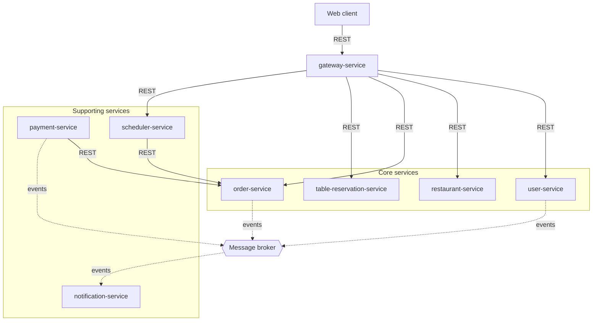
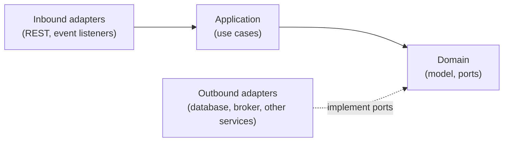

# Architecture

- Which architectural style?
    + why?

---

# Architecture of Munchies

## Architectural style

_Munchies_ follows a **microservices** architecture: the backend is a set of independently deployable services, each
one implementing a single bounded context and owning its data. A single **API Gateway** is the entry point for clients.

Three more styles are applied inside this frame, each one only where it is needed:

| Style                        | Where                      | Why there                                                                      |
|------------------------------|----------------------------|--------------------------------------------------------------------------------|
| Hexagonal (Ports & Adapters) | Inside each service        | It keeps the domain independent of frameworks, databases and other services    |
| Event-driven                 | `notification-service`     | Notifications must not slow down or depend on the operations that trigger them |
| Event sourcing + CQRS        | `order-service`, on orders | Orders are the only data needing a full history, under concurrent updates      |

## Why microservices

The main reason is the shape of the load. Demand is bursty and concentrated around meal times, and it does not grow
evenly across the system: with separate services, ordering can scale at lunchtime without also replicating, for
instance, catalogue administration (`NFR1`).

The split also limits the impact of a failure, since a failed service only takes down the features that depend on it
(`NFR4`), and it allows each service to be deployed with no coordination with the others (`NFR17`).

Finally, bounded contexts map directly onto services, which gives each piece of data a single owner: no service touches
the data of another (`NFR9`). Each context can therefore choose the persistence model that suits it, such as event
sourcing for orders only.

### Costs of the choice

The style brings the typical problems of distributed systems: partial failures, no transactions across services, and
data duplicated across contexts. The following sections address them, in particular
[Data and Consistency Issues](data-and-consistency-issues.md) and [Fault-Tolerance](fault-tolerance.md).

## Components

Solid arrows are synchronous calls, dashed arrows are asynchronous events. Databases are omitted: each service with
persistent state owns one, as described in [Infrastructure](infrastructure.md).

| Component                   | Bounded context | Responsibility                                                         | State                  |
|-----------------------------|-----------------|------------------------------------------------------------------------|------------------------|
| Web client                  | -               | Presents the application to customers and managers                     | Session flag and cart  |
| `gateway-service`           | -               | Authenticates, authorizes and routes requests; holds no business logic | None that is required  |
| `user-service`              | Identity        | Accounts, credentials, email verification                              | Persistent             |
| `restaurant-service`        | Catalogue       | Restaurants, menus, categories, items, variations                      | Persistent             |
| `order-service`             | Ordering        | Order lifecycle and history                                            | Persistent (event log) |
| `payment-service`           | Payments        | Processes payments and keeps their record                              | Persistent             |
| `notification-service`      | Notifications   | Reacts to events to inform users                                       | None                   |
| `scheduler-service`         | Scheduling      | _Planned_: capacity and delivery slots                                 | -                      |
| `table-reservation-service` | Reservations    | _Planned_: table bookings                                              | -                      |

## Internal structure of a service

Each service is organized in three layers, with dependencies pointing inwards: the domain does not know the outside
world, and technology is confined to adapters.

The gateway has no domain and application layers, since it holds no business logic. `notification-service` has no
application layer, since it reacts to events directly, with no use cases to orchestrate.
