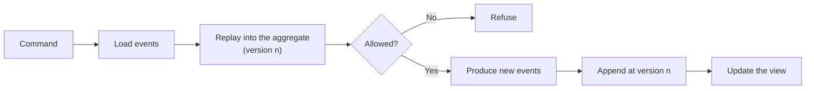
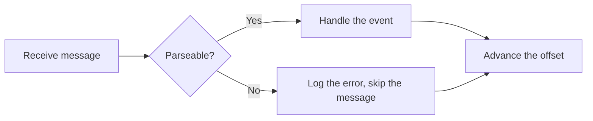
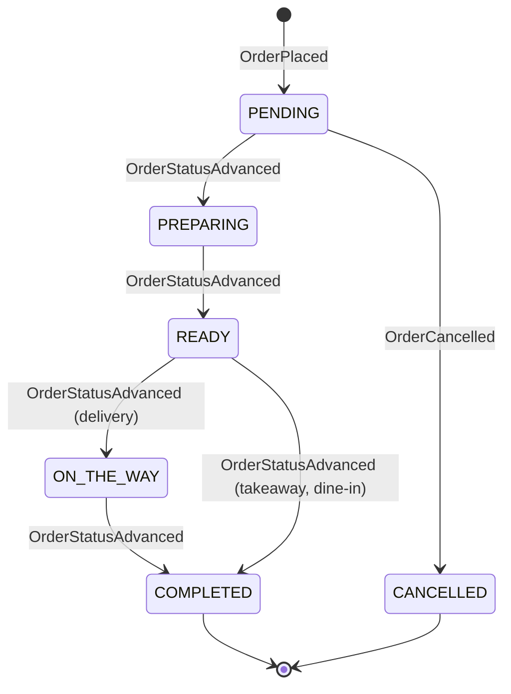
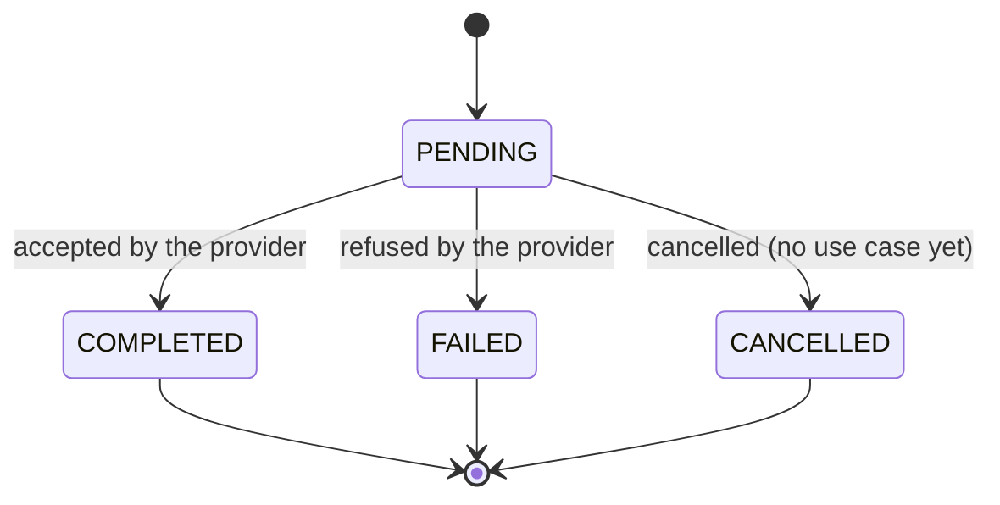
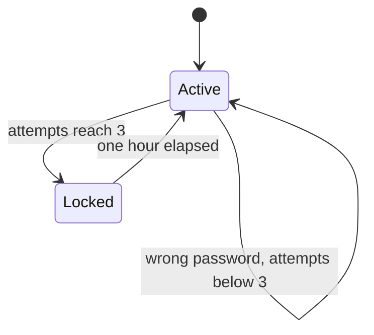

# Behaviour

## Component behaviour

| Component              | Kind      | Behaviour                                                                                                                                                            |
|------------------------|-----------|----------------------------------------------------------------------------------------------------------------------------------------------------------------------|
| Web client             | Stateful  | Renders server data and keeps the cart locally. On a `401`, it asks the user to log in again                                                                         |
| `gateway-service`      | Stateless | For each request, it verifies the token and the role if the route requires them, then forwards the request and returns the answer. Any replica can serve any request |
| `user-service`         | Stateless | Handles each request against its database, where all account state lives                                                                                             |
| `restaurant-service`   | Stateless | Same as above. It enforces that only the owner of a restaurant can change it                                                                                         |
| `order-service`        | Stateless | Rebuilds the order from its events on each command, decides, and appends new events. No order is kept in memory between requests                                     |
| `payment-service`      | Stateless | Runs one payment attempt per request, with the steps shown in [Interaction](interaction.md)                                                                          |
| `notification-service` | Stateless | Runs as an agent: it has no use cases, and reacts to each event it receives. Topics are consumed independently, so a slow or failing topic does not block the others |

Stateless here means that replicas hold no data of their own: state lives in the databases and the broker, so replicas
are interchangeable, and can be added, removed or replaced at any time (`NFR1`, `NFR3`).

### The order service

Handling a command follows the same steps for every use case:

The aggregate never changes on its own. Deciding produces events, and applying an event produces the next state. Since
replay uses the same code path, the state rebuilt from the log is always the state that was decided.

Queries take a separate path: they read the view directly, and never touch the log.

### The notification agent

For each message, the agent runs the same loop:

Skipping a malformed message keeps it from blocking its topic forever. Every step is non-blocking, so that the agent
keeps up with all its topics at once. Handling an event means updating a metric and logging it: delivering the
notification to the user is _planned_.

## State machines

### Order

The status of an order follows the lifecycle defined in `FR-O5`. The successor of a status depends on the fulfilment
type: this is decided by each type of order, so that the rule cannot be applied to the wrong one.

Being paid is orthogonal to the status: it is a separate flag set by `OrderPaid`, and an order can be paid only once.

### Payment

A payment is `PENDING` only while its attempt is running: it is stored once the provider has answered, so every stored
payment is either `COMPLETED` or `FAILED`. `CANCELLED` is part of the model, but no use case reaches it yet.

### Account access

## Who updates the state

| State                 | Updated by                    | When                                  | How                                               |
|-----------------------|-------------------------------|---------------------------------------|---------------------------------------------------|
| Accounts              | `user-service`                | On a command                          | Update in place                                   |
| Login attempts        | `user-service`                | On each login                         | Update in place                                   |
| Restaurants and menus | `restaurant-service`          | On a command from the manager         | Update in place of the whole aggregate            |
| Order event log       | `order-service`               | On a command                          | Append only, conditional on the version read      |
| Order views           | Projector, in `order-service` | After each append                     | Folds new events, and is the only writer of views |
| Payments              | `payment-service`             | Once, when the provider has answered  | Insert with the final status                      |
| Consumer offsets      | `notification-service`        | Periodically, after handling messages | Committed to the broker                           |

No service updates the state of another directly. A change in another context is always requested through that
service's API, as `payment-service` does to mark an order as paid.
