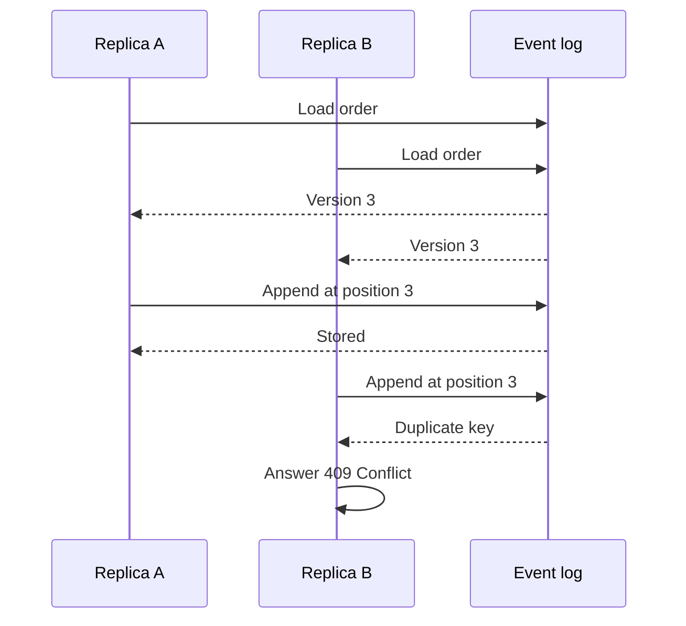

# Data and Consistency Issues

- Is there any data that needs to be stored?
    * _what_ data? _where_? _why_?

- how should _persistent data_ be __stored__?
    * e.g. relations, documents, key-value, graph, etc.
    * why?

- Which components perform queries on the database?
    * _when_? _which_ queries? _why_?
    * concurrent read? concurrent write? why?

- Is there any data that needs to be shared between components?
    * _why_? _what_ data?

---

# Data and Consistency Issues of Munchies

## Stored data

| Data                  | Where                | Why it must be stored                                                    |
|-----------------------|----------------------|--------------------------------------------------------------------------|
| Profiles              | `user-service`       | Identity of the users, and their role                                    |
| Credentials           | `user-service`       | Authentication, and lockout after failed attempts                        |
| Restaurants and menus | `restaurant-service` | Catalogue shown to customers                                             |
| Order events          | `order-service`      | Source of truth for orders, and their full history (`FR-O8`)             |
| Order views           | `order-service`      | Efficient reads and filters on orders (`FR-O7`), derived from the events |
| Payments              | `payment-service`    | Record of every attempt (`FR-P3`)                                        |
| Integration events    | Broker               | Temporary buffer, so that notifications survive an outage (`NFR6`)       |

Each service with persistent state has its own database, and no other component can access it (`NFR9`). This keeps services independently
deployable, and allows a schema to change with no coordination. The cost is that joins and transactions across
services are not available.

## Storage model

Persistent data is stored in **document** form:

- Aggregates map naturally onto documents. A menu, with its nested categories, items and variations, is loaded and
  saved as a whole, as a single atomic write, with no joins.
- The structure varies across entities of the same kind: the three kinds of order, for instance, have different
  fields, and so do their events. A document model handles this with no sparse tables.
- Cross-aggregate relations are few and go across services, so a relational model would give little benefit.

Inside this model, two strategies are used:

| Strategy       | Used for                     | Why                                                                                                                                                                         |
|----------------|------------------------------|-----------------------------------------------------------------------------------------------------------------------------------------------------------------------------|
| Current state  | Users, restaurants, payments | Only the latest state matters, and updates are infrequent or single-writer                                                                                                  |
| Event sourcing | Orders                       | An order is updated by several actors, and its history must be kept (`FR-O8`). Appending a new event also turns write conflicts into a simple check on the version (`NFR8`) |

An event log is expensive to query, so orders use **CQRS**: commands work on the log, queries on a denormalized view
with one document per order.

## Database access

| Component            | Operation                                                     | When                        | Concurrency                                                                   |
|----------------------|---------------------------------------------------------------|-----------------------------|-------------------------------------------------------------------------------|
| `user-service`       | Find user by id, email or username                            | Login, profile reads        | Concurrent reads                                                              |
| `user-service`       | Update credentials                                            | Login, password change      | Concurrent writes on one account are possible, and not protected              |
| `restaurant-service` | Find restaurant, list by manager, find menus                  | Browsing and administration | Heavy concurrent reads, as a catalogue is read far more than written          |
| `restaurant-service` | Save restaurant or menu as a whole                            | Manager's actions           | Rare, with a single expected writer. The last write wins                      |
| `order-service`      | Load events of one order                                      | Each command                | Concurrent reads                                                              |
| `order-service`      | Append events                                                 | Each command                | Concurrent writes on one order are expected, and resolved through the version |
| `order-service`      | Find view by id, or filter by restaurant, customer and status | Queries                     | Concurrent reads, backed by indexes on these fields                           |
| `order-service`      | Save view                                                     | After each append           | Written by the projector only                                                 |
| `payment-service`    | Insert payment                                                | End of each attempt         | No conflicts: each attempt is a new document                                  |

### Concurrent commands on an order

Each event has a position in the stream of its order, and the pair (order, position) is unique. A command reads the
stream up to version `n`, and appends at position `n`:

This works across replicas with no locks and no coordination between them, since the check is performed by the
database. The losing client can read the order again, and retry if the command still makes sense.

## Consistency model

| Scope                    | Guarantee                                                                                                                                     |
|--------------------------|-----------------------------------------------------------------------------------------------------------------------------------------------|
| Inside one aggregate     | Strong: each change is atomic, and one database instance orders all writes                                                                    |
| Order log and order view | Eventual: the view is normally updated within the same request, but a failure leaves it behind                                                |
| Placing an order         | Read-your-own-writes: the response is built from the state rebuilt from the event, not from the view (`NFR10`)                                |
| Across services          | Eventual at best: a change in one service reaches another only through a later call or event, and nothing undoes a partial workflow (`NFR11`) |

A view left behind by a failed projection repairs itself: when the next event of that order arrives, the projector
notices the gap in the versions, and rebuilds the view from the log. Applying the same batch twice has no effect, since
already projected versions are skipped.

## Shared data

Services never share a database. Whatever crosses a boundary does so in one of these forms:

| What                     | Between                              | Why                                                  |
|--------------------------|--------------------------------------|------------------------------------------------------|
| Identifiers              | All services                         | Referencing entities owned by another context        |
| The caller's id and role | Gateway and downstream services      | Knowing who is acting, with no need to handle tokens |
| Event payloads           | Producers and `notification-service` | Letting the consumer work without calling back       |
| API and event contracts  | Each service and its callers         | Compile-time agreement on paths and message schemas  |
| The token signing key    | Replicas of the gateway              | Any replica must be able to verify any token         |
