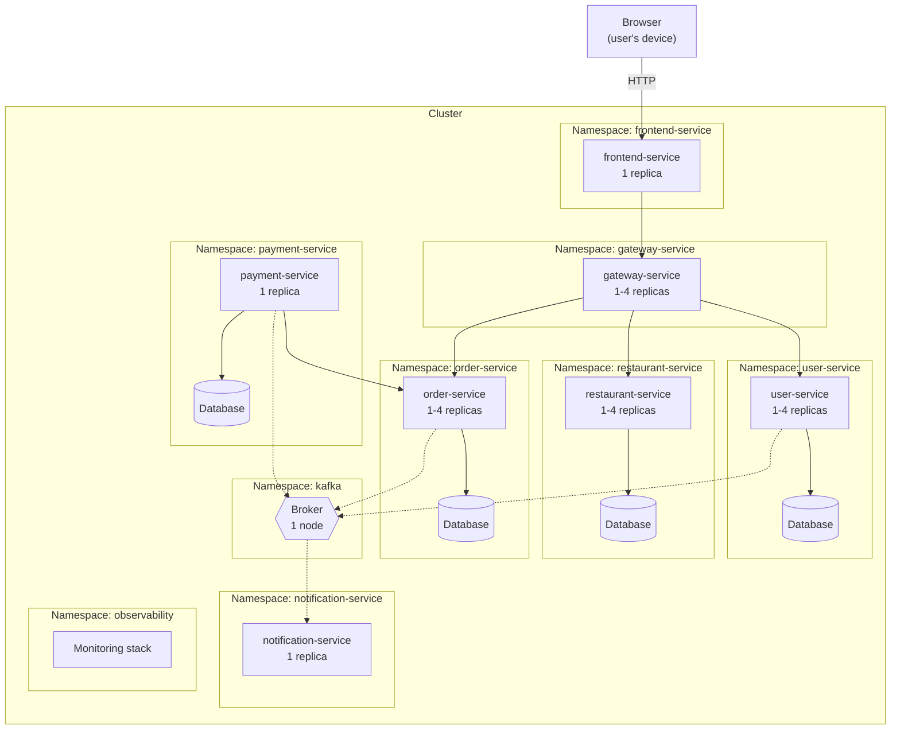

# Infrastructure

## Infrastructural components

| Component            | How many                                                                                         | Purpose                                                      |
|----------------------|--------------------------------------------------------------------------------------------------|--------------------------------------------------------------|
| Web client           | One per user                                                                                     | Runs in the user's browser                                   |
| Web server           | 1 replica                                                                                        | Serves the client, and forwards its API calls to the gateway |
| API gateway          | 1 to 4 replicas                                                                                  | Single entry point                                           |
| Application services | 1 to 4 replicas for user, restaurant and order services; 1 for payment and notification services | Business logic                                               |
| Databases            | One per service with persistent state                                                            | Isolated persistence                                         |
| Message broker       | 1 node                                                                                           | Delivers events to `notification-service`                    |
| Load balancing       | One virtual address per service                                                                  | Spreads requests across replicas, provided by the platform   |
| Service registry     | Provided by the platform                                                                         | Keeps track of the running replicas                          |
| Monitoring stack     | One of each: metrics store, log store, trace store, log collector, dashboards                    | Observability (`NFR15`, `NFR16`)                             |

No cache, CDN, or dedicated firewall is used: see [Availability](availability.md) for the first, and
[Security](security.md) for the last.

## Distribution over the network

The monitoring stack observes every namespace; the corresponding arrows are omitted for clarity.

Clients sit outside, on the users' devices and networks. All the rest runs in a single cluster, on the same network
and in the same location: calls between services are frequent and synchronous, so keeping them close limits latency.

**Each service has its own namespace**, which makes the boundary of a bounded context visible in the infrastructure as
well. A service and its database always sit together, since the database has no other client.

The design does not depend on a specific number of nodes. Replicas are placed on any available node of the cluster,
and the project runs on a single-node cluster, as `IR3` requires. A production deployment would use several nodes, in
different failure zones.

## Service discovery and naming

Components find each other through the platform, with no dedicated registry to operate:

- Each service is published under a **stable logical name**, resolved by the cluster DNS, made of the name of the
  service and of its namespace.
- The name stands for all the replicas of that service: the platform tracks which ones are alive and ready, and each
  request reaches one of them. Callers do not know how many replicas exist, nor where (`NFR1`).
- Names are not part of the code: each service receives the addresses of its dependencies through its configuration.

The same code therefore runs unchanged in any environment. On a developer machine, the same configuration points to
the names of the containers.

Brokers and consumers are decoupled in the same way: producers and consumer only need to agree on the name of the
topic, which is defined by the shared contract of the event. Topics are named after their event, such as
`order_status_changed_topic`, and `notification-service` creates the ones it consumes when it starts.

## Limits of the current design

- Every backend service is also published on a port of the cluster nodes, and no rule limits traffic between
  namespaces, so the gateway is not the only way in (`NFR12`). Only the web server, the databases and the broker are
  not published this way.
- The database and the broker run on a single node, which makes them single points of failure
  (see [Fault-Tolerance](fault-tolerance.md)).
- `payment-service` and `notification-service` are not autoscaled.
- No component terminates TLS, so traffic reaches the gateway unencrypted, and the `secure` cookie only works on
  `localhost` or behind a TLS proxy (see [Security](security.md)).
