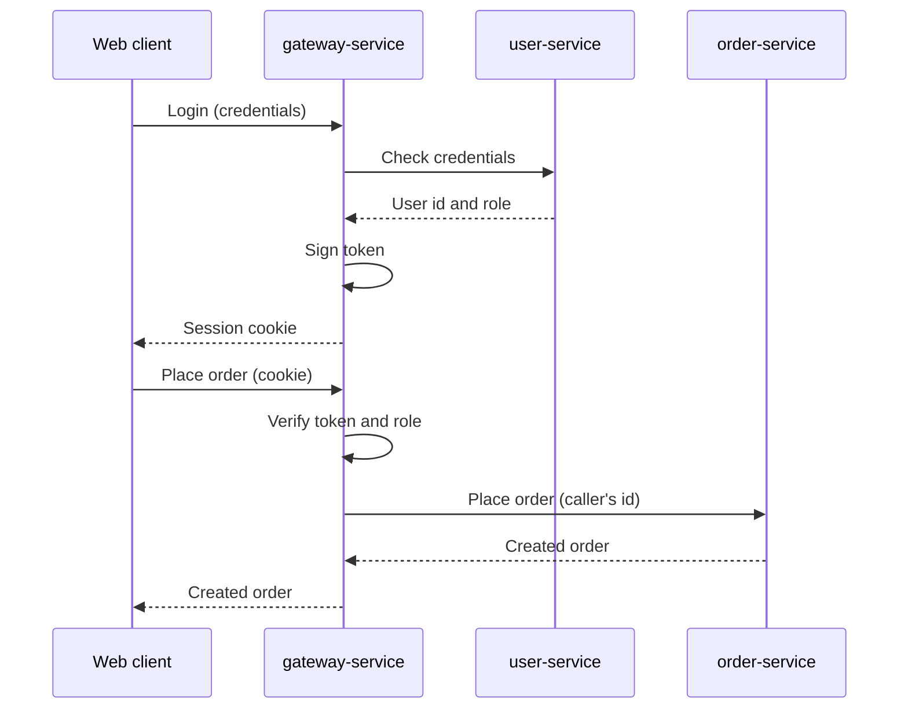
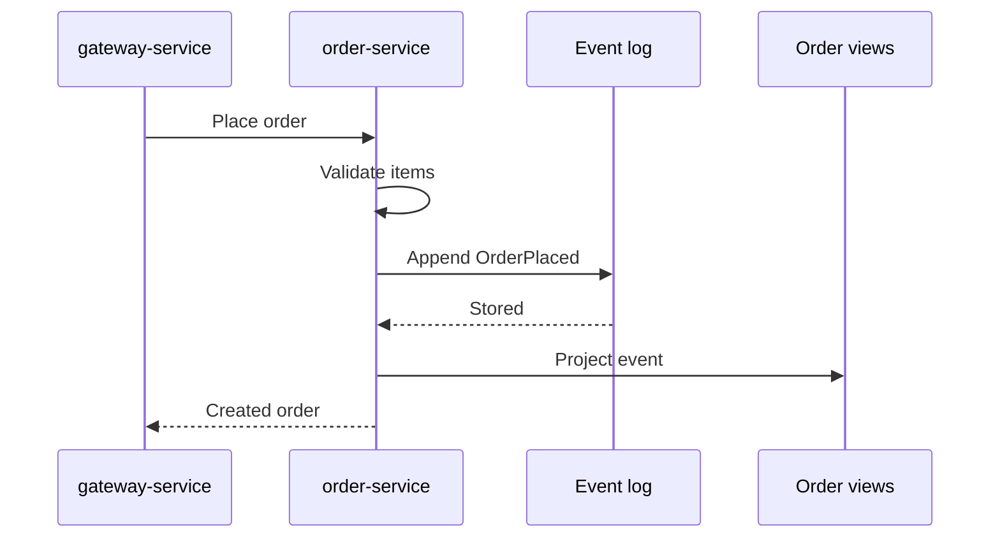
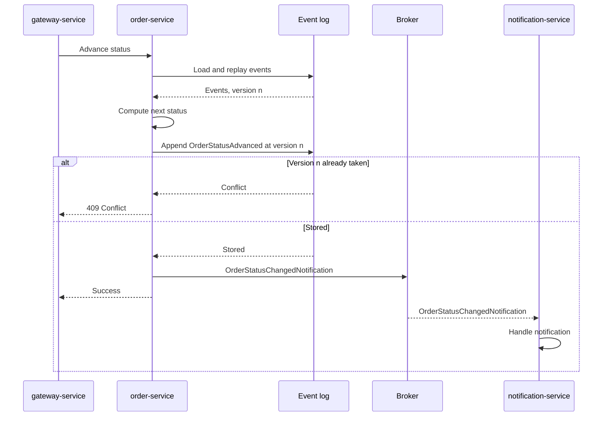
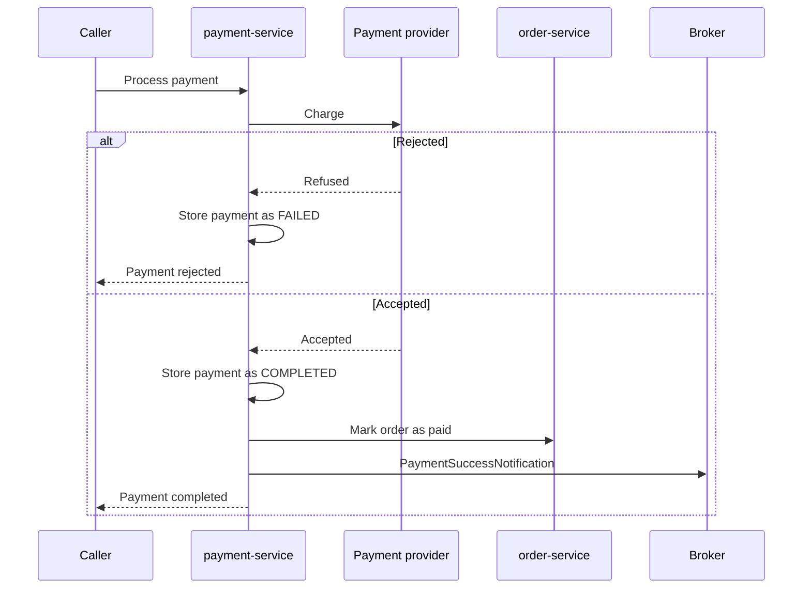

# Interaction

## Communication overview

| From              | To                                                    | Channel      | Style             | When                             | What                                                  |
|-------------------|-------------------------------------------------------|--------------|-------------------|----------------------------------|-------------------------------------------------------|
| Web client        | `gateway-service`                                     | REST         | Request-response  | On every user action             | Commands and queries                                  |
| `gateway-service` | `user-service`, `restaurant-service`, `order-service` | REST         | Request-response  | On every authorized request      | The same command or query, plus the caller's identity |
| `payment-service` | `order-service`                                       | REST         | Request-response  | After a completed payment        | Mark the order as paid                                |
| `user-service`    | Broker                                                | Asynchronous | Publish-subscribe | After an email is verified       | `UserEmailConfirmationNotification`                   |
| `payment-service` | Broker                                                | Asynchronous | Publish-subscribe | After a completed payment        | `PaymentSuccessNotification`                          |
| `order-service`   | Broker                                                | Asynchronous | Publish-subscribe | After a status change            | `OrderStatusChangedNotification`                      |
| Broker            | `notification-service`                                | Asynchronous | Publish-subscribe | As soon as an event is available | All the events above                                  |

The rule for choosing a channel follows from who needs the answer:

- **Synchronous**, when the caller cannot go on without the result. A customer placing an order must know right away
  whether it was accepted.
- **Asynchronous**, when the producer does not depend on the outcome. A payment is valid whether or not the email has
  been sent, so a slow or absent consumer must not affect it (`NFR6`).

Asynchronous communication is limited to notifications: other services do not exchange events, in order to keep
workflows explicit and easy to follow.

## Interaction patterns

| Pattern                      | Where                                    | Why                                                                                                                              |
|------------------------------|------------------------------------------|----------------------------------------------------------------------------------------------------------------------------------|
| API Gateway                  | Client towards services                  | A single entry point, with authentication handled once (`FR-A7`, `NFR12`)                                                        |
| Request-response             | All REST calls                           | Immediate outcome for commands and queries                                                                                       |
| Publish-subscribe            | Producers towards `notification-service` | Producers and consumer do not know each other, and do not need to be up at the same time                                         |
| Event-carried state transfer | Integration events                       | The event holds everything needed, so the consumer never calls back the producer, and a failure of the latter does not affect it |
| Shared contract              | Between each service and its callers     | Paths and payloads are defined once by the owning service, so callers cannot drift from them (`NFR18`)                           |
| Optimistic concurrency       | Concurrent commands on the same order    | The loser gets a conflict and can retry, with no locks held across requests (`NFR8`)                                             |

## Main interactions

### Login and authenticated requests

Credentials are only checked by `user-service`, while tokens are only handled by the gateway. Downstream services
receive requests that are already authenticated.

### Placing an order

A command is accepted once its event is stored. The read model is updated in the same request, but its failure does
not fail the command, since the event is already durable.

### Advancing an order

### Processing a payment

The payment is made durable first. The two following steps are independent of each other, and a failure of either
does not change the result of the payment. No compensation exists yet (`NFR11`).

