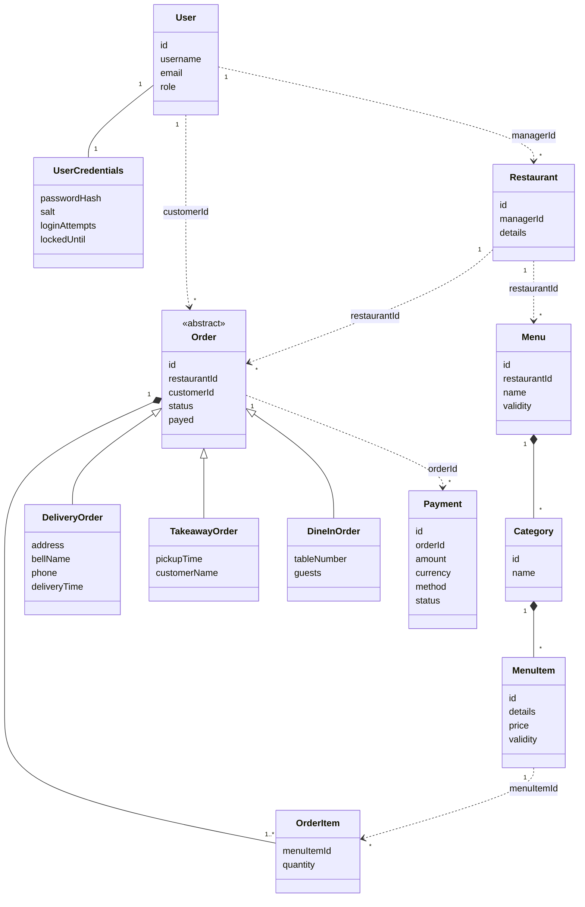

# Modelling

- which __domain entities__ are there?
    * e.g. _users_, _products_, _orders_, _etc._

- how do _domain entities_ __map to__ _infrastructural components_?
    * e.g. state of a video game on central server, while inputs/representations on clients
    * e.g. where to store messages in an IM app? for how long?

- which __domain events__ are there?
    * e.g. _user registered_, _product added to cart_, _order placed_, _etc._

- which sorts of __messages__ are exchanged?
    * e.g. _commands_, _events_, _queries_, _etc._

- what information does the __state__ of the system comprehend
    * e.g. _users' data_, _products' data_, _orders' data_, _etc._

> Class diagram are welcome here

---

# Modelling of Munchies

## Domain entities

| Entity           | Kind         | Owner                | Description                                                      |
|------------------|--------------|----------------------|------------------------------------------------------------------|
| User             | Aggregate    | `user-service`       | Identity and profile: username, email, role, verification status |
| User Credentials | Entity       | `user-service`       | Password hash and salt, failed attempts, lock expiry             |
| Restaurant       | Aggregate    | `restaurant-service` | Details of an establishment, and the manager owning it           |
| Menu             | Aggregate    | `restaurant-service` | Named listing with a validity, containing categories             |
| Category         | Entity       | `restaurant-service` | Group of items inside a menu, with its variations                |
| Menu Item        | Entity       | `restaurant-service` | Orderable dish with a price, a validity and its variations       |
| Variation        | Value object | `restaurant-service` | Priced customization option                                      |
| Order            | Aggregate    | `order-service`      | Delivery, takeaway or dine-in request, with its items and status |
| Order Item       | Value object | `order-service`      | Reference to a menu item, and its quantity                       |
| Payment          | Aggregate    | `payment-service`    | Amount, currency, method and final status of an attempt          |

Aggregates are the unit of consistency: each one is changed atomically, and only through its root.

Solid lines stay inside a service. Dashed lines cross a service boundary, and are therefore plain identifiers rather
than references: no foreign key exists across services, and nothing guarantees that the identified entity still exists.

## Mapping to infrastructural components

| Domain concept        | Lives on                                            | For how long                                                           |
|-----------------------|-----------------------------------------------------|------------------------------------------------------------------------|
| Users and credentials | Database of `user-service`                          | Until the account is deleted                                           |
| Restaurants and menus | Database of `restaurant-service`                    | Until the manager deletes them                                         |
| Order events          | Database of `order-service`, as the source of truth | Forever: the log is append-only                                        |
| Order views           | Database of `order-service`, as a derived copy      | Always rebuildable from the events                                     |
| Payments              | Database of `payment-service`                       | Forever, whatever the outcome                                          |
| Integration events    | Broker                                              | Until the retention of the broker expires                              |
| Session               | Token stored in the browser as a cookie             | At most 7 days                                                         |
| Cart being composed   | Browser storage                                     | Until the order is placed, so that an expired session does not lose it |

Business rules run on the server only. The client holds no authoritative state: it only renders what services return.

## Domain events

Two families of events exist, and they have different purposes.

**Internal events** are the source of truth of an order. They are stored in its log, and never leave `order-service`.

| Event                 | Raised when                            | Changes                           |
|-----------------------|----------------------------------------|-----------------------------------|
| `OrderPlaced`         | A customer places an order             | Creates the order, in `PENDING`   |
| `OrderStatusAdvanced` | The order moves to the next status     | Status                            |
| `OrderCancelled`      | A pending order is cancelled           | Status, which becomes `CANCELLED` |
| `OrderPaid`           | The order is marked as paid            | Paid flag                         |
| `OrderItemsUpdated`   | The items of the order change          | Items                             |
| `DeliveryInfoUpdated` | The details of a delivery order change | Delivery information              |
| `TakeawayInfoUpdated` | The details of a takeaway order change | Takeaway information              |

**Integration events** are published on the broker, with one topic per event, for `notification-service`.

| Event                               | Producer          | Raised when                 | Payload                                          |
|-------------------------------------|-------------------|-----------------------------|--------------------------------------------------|
| `UserEmailConfirmationNotification` | `user-service`    | An email has been verified  | User id, confirmation key                        |
| `PaymentSuccessNotification`        | `payment-service` | A payment has completed     | Payment id, order id, amount, currency           |
| `OrderStatusChangedNotification`    | `order-service`   | An order has changed status | Order id, restaurant id, customer id, new status |

Keeping the two families separate means that the internal structure of an order can evolve freely, without affecting
consumers.

## Messages

| Kind    | Meaning                                               | Expects an answer | Examples                                                  |
|---------|-------------------------------------------------------|-------------------|-----------------------------------------------------------|
| Command | A request to change state, which can be refused       | Yes               | Place order, advance status, process payment, update menu |
| Query   | A request for data, with no side effects              | Yes               | Get order, list orders, get menu, get user                |
| Event   | A fact that already happened, which cannot be refused | No                | `OrderPlaced`, `PaymentSuccessNotification`               |

Commands and queries travel over REST, integration events travel through the broker.

## State of the system

The state of the system is the union of the states of the services, with no global view:

- accounts, credentials and verification status, in `user-service`;
- restaurants and catalogues, in `restaurant-service`;
- the event log of each order and its derived view, in `order-service`;
- payment attempts, in `payment-service`;
- undelivered events and consumer offsets, in the broker.
