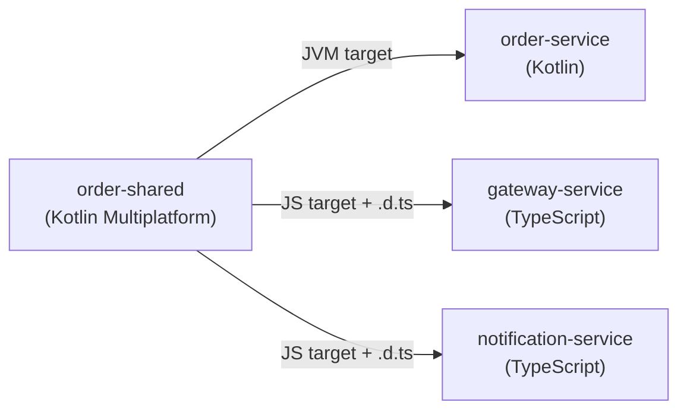

# Technological details

## Technology stack

| Area          | Technology                       | Version    | Used for                                         |
|---------------|----------------------------------|------------|--------------------------------------------------|
| Backend       | Kotlin, on Java                  | 1.9, 21    | `user`, `restaurant` and `order` services        |
| Backend       | Micronaut                        | 4.6        | HTTP server, dependency injection, data access   |
| Backend       | TypeScript, on Node.js           | 5, 24      | `gateway`, `payment` and `notification` services |
| Backend       | Express.js                       | 4          | HTTP server                                      |
| Frontend      | Vue.js, Pinia, Vue Router, Vite  | 3, 2, 4, 6 | Single-page application                          |
| Frontend      | nginx                            | 1.28       | Serving the application, and proxying API calls  |
| Shared code   | Kotlin Multiplatform             | 1.9        | API contracts and messages                       |
| Database      | MongoDB                          | 7          | Persistent state of each service                 |
| Messaging     | Apache Kafka, in KRaft mode      | 4          | Events towards `notification-service`            |
| Clients       | Micronaut Kafka, KafkaJS         | -, 2       | Kafka producers and consumers                    |
| Clients       | Axios                            | 1          | HTTP calls from Node.js and from the browser     |
| Security      | `jsonwebtoken`                   | 9          | Signing and verifying tokens                     |
| API           | OpenAPI, Micronaut OpenAPI, tsoa | -          | Generation of the API descriptions               |
| Containers    | Docker, Kubernetes, Helm         | -          | Packaging and orchestration                      |
| Observability | Prometheus, Grafana, Loki, Tempo | -          | Metrics, dashboards, logs and traces             |
| Observability | OpenTelemetry, Pino, Alloy       | -          | Tracing, structured logging, log collection      |
| Build         | Gradle, with convention plugins  | -          | Builds of all modules, in both stacks            |

The choice of Kotlin and Node.js comes from `IR1`, and the one of Vue.js from `IR2`. Everything listed is free of charge,
and the whole system can run on a single machine (`IR3`).

## Shared contracts with Kotlin Multiplatform

This is the most distinctive technical choice of the project. Services are written in two languages, and without care
their contracts would drift apart, with errors appearing only at runtime.

Each service therefore has a `*-shared` module, written once in Kotlin Multiplatform and compiled to two targets:

- for the JVM, it is a normal dependency of the Kotlin services;
- for JavaScript, it is packaged as an npm tarball, with TypeScript declarations, and imported by the Express services.

A module holds the requests, responses and notifications, along with the path, method and required role of each API.
The same class encodes the message on one side and decodes it on the other, so changing a field breaks the compilation
of the clients using it, instead of failing in production. This is what mainly supports `NFR18`.

`commons` follows the same approach for what all services need, such as the base `API` class, the error response, the
user roles and the JSON configuration.

The frontend is not included: it calls the gateway through hand-written TypeScript types, so it can drift from the
contracts.

## Micronaut

Micronaut resolves dependency injection at compile time, through annotation processing with KSP, so the services do not
rely on runtime reflection and they start fast, which helps when the autoscaler adds a replica.

- `@Requires(env = ["prod"])` selects the MongoDB adapters in production, while tests can swap them, thanks to the
  ports of the hexagonal architecture.
- `@KafkaClient` and `@Topic` turn an annotated interface into a producer, with no boilerplate.
- `ApplicationEventPublisher` delivers `OrderEventsAppended` to the projector, synchronously and in the same process.
- Micrometer exposes `/prometheus`, with latency histograms, so that percentiles can be aggregated across replicas.

## Node.js and Express

Node.js runs a single event loop, which suits services mostly waiting on I/O, such as the gateway and
`notification-service`. It is also why every call in a Kafka message handler has to be non-blocking: a blocking call
would stop the processing of all the other topics.

KafkaJS is used by `notification-service`, with one consumer per topic, and by `payment-service`, with a producer opened
at the first use and then reused. `notification-service` creates its topics when it starts, and it retries until the
broker is ready, since a consumer cannot subscribe to a topic that does not exist yet.

The gateway reads bodies with `express.raw`, leaving them as bytes, because each route parses them through the shared
contract rather than as generic JSON. Each request to a service goes through one Axios client, with a timeout of 10
seconds.

## nginx

The frontend is a set of static files once built, so it needs no application server: its image compiles the Vue
application in a first stage, then copies the result into an nginx image, which holds no Node.js. nginx also forwards
`/users`, `/restaurants`, `/restaurant` and `/orders` to the gateway, so that the browser only sees one origin, which
keeps the session cookie same-site. Any other path falls back to `index.html`, since client-side routes have no
matching file.

The address of the gateway comes from `GATEWAY_URL`, and it is resolved on each request. Otherwise nginx would refuse to
start until the gateway exists, which would tie the frontend to the order in which services are deployed.

## Observability

- **Logs:** Pino on Node.js and Logback on the JVM write to stdout, and Alloy collects these lines and pushes them to
  Loki.
- **Metrics:** `prom-client` on Node.js and Micrometer on the JVM expose the data scraped by Prometheus.
- **Traces:** OpenTelemetry instruments HTTP, Express and KafkaJS. The W3C `traceparent` header carries the trace id
  across HTTP calls, and traces are exported to Tempo. In the Express services, tracing has to be the first import of
  the entry point, since it patches the libraries as they are loaded.
- **Dashboards:** Grafana is provisioned from `observability/`, with one dashboard each for scaling, services and logs.

## Build and packaging

Gradle orchestrates the whole repository, Node.js modules included, through the convention plugins in `build-logic`.
Each module declares what kind it is, such as `micronaut-server` or `express-server`, and inherits everything else.
Docker images are produced by Gradle too, and deployment relies on one Helm chart, `helm/munchies-service`, with a
values file for each service. `payment-service` and `notification-service` still use plain manifests in `k8s/`.
