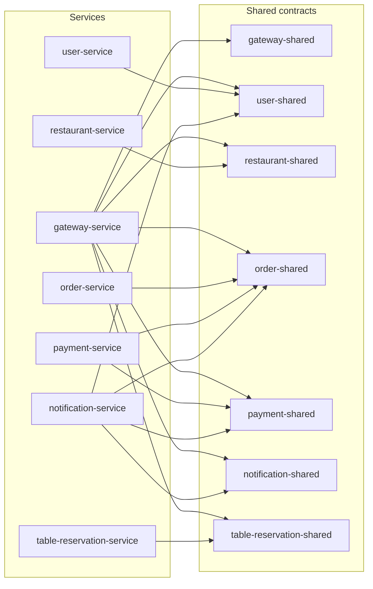
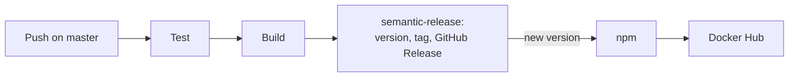

# Release

- how where components organized into _inter-dependant modules_ or just a single monolith?
    * provide a _dependency graph_ if possible

- were modules distributed as a _single archive_ or _multiple ones_?
    * why?

- how were archive versioned?

- were archive _released_ onto some archive repository (e.g. Maven, PyPI, npm, etc.)?
    * how to _install_ them?

---

# Release of Munchies

## Modules

Munchies is not a monolith: the repository is a single Gradle multi-project build, holding many inter-dependent modules.
Keeping them in one repository lets a change to a contract and to its clients land in the same commit.

| Module               | Kind         | Purpose                                                         |
|----------------------|--------------|-----------------------------------------------------------------|
| `*-service`          | Executable   | One microservice, deployed on its own                           |
| `*-shared`           | Library      | API contracts and messages of a service, for its clients        |
| `commons`            | Library      | Base classes for APIs, errors, roles and JSON encoding          |
| `micronaut-commons`  | Library      | Code common to the Micronaut services                           |
| `architecture-rules` | Test library | Architecture checks, reused by the tests of the Kotlin services |
| `e2e-test`           | Test suite   | End-to-end tests of the whole system                            |

`frontend-service` depends on no other module: it only reaches the gateway at runtime, and Gradle only builds its image.
`scheduler-service` is not part of the build, as it only holds its offline analysis.

### Dependency graph

The graph shows build-time dependencies, which are not the same as the runtime calls described in
[architecture](../03-design/architecture.md). A service depends on the `*-shared` module of whatever service it talks
to, so the arrows follow the contracts. For readability, the dependencies below are left out:

- every service and almost every `*-shared` module depend on `commons`;
- the Micronaut services also depend on `micronaut-commons`, and in their tests on `architecture-rules`;
- `e2e-test` depends on `commons`, `order-shared` and `user-shared`.



`gateway-service` depends on all the contracts, as it routes towards all the services. `notification-service` depends
on the contracts of the services producing its events, since the shared classes also describe Kafka messages.

## Archives

Modules are distributed as **multiple archives**, in the format that suits who consumes them.

| Archive        | Number | Content                                              | Repository |
|----------------|--------|------------------------------------------------------|------------|
| Docker images  | 7      | One backend service each                             | Docker Hub |
| npm packages   | 8      | `commons` and the `*-shared` modules, compiled to JS | npm        |
| GitHub Release | 1      | Generated notes, and `scripts/deploy.sh`             | GitHub     |

A single archive would go against the architecture. Services have to be deployed, scaled and replaced independently of
each other (`NFR17`), which requires one image each. The libraries are published separately so that a client of a
service can import its contract alone, with no need for the code of the service, and in its own language.

Kotlin libraries used to be published on Maven Central too, but it is no longer a release target: the limits Maven has
introduced on the number and size of uploads are too strict for a project publishing this many modules at each
release. Versions up to `0.22.2` are still available there, while newer ones are only distributed through npm.

## Versioning

All archives of a release share **one version**, following Semantic Versioning, even though they could evolve at
different speeds. The version is computed by `semantic-release` from the Conventional Commits merged into `master`:

| Commit          | Effect on the version | Example            |
|-----------------|-----------------------|--------------------|
| `fix`           | Patch                 | `2.1.0` to `2.1.1` |
| `feat`          | Minor                 | `2.1.0` to `2.2.0` |
| Breaking change | Major                 | `2.1.0` to `3.0.0` |

No version number is kept by hand. The Git tag, such as `v2.1.0`, is the only source of truth, and the publish step
passes it to each tool: `npm version` for the packages, and the image tag on Docker Hub.

A single version was chosen for compatibility: the modules of a release have been built and tested together, so there
is no need for a matrix telling which version of a contract works with which version of a service. The cost is that
releases are not independent: a change to one service gives a new version to all of them, including the unchanged ones.

## Release process

Releases are fully automated, and they start from a push on `master`, which only receives changes from `develop`.



If the merged commits require no new version, no tag is created and nothing is published. Commit messages are therefore
checked twice, by a Git hook and by `commitlint` in the CI, since a wrong type would produce a wrong version.

## Installation

### Services

Images are public on [Docker Hub](https://hub.docker.com/u/maggicomunchies), one repository per service:

```bash
docker pull maggicomunchies/order-service:2.1.0
```

The instructions to run the whole system are in [deployment](../07-deployment/deployment.md).

### Contracts

Packages are public on [npm](https://www.npmjs.com/~maggico-munchies), named `munchies-commons` and
`munchies-<service>-service-shared`:

```bash
npm install munchies-payment-service-shared
```

```ts
import {PaymentSuccessNotification} from "munchies-payment-service-shared/kotlin/payment-modules";
```
