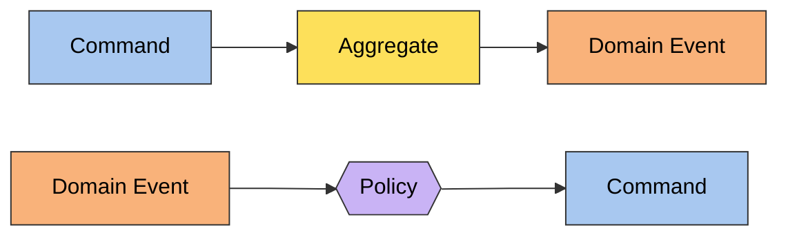
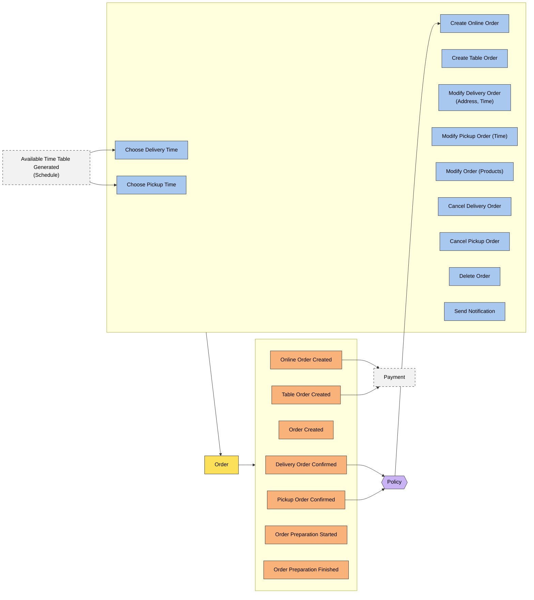
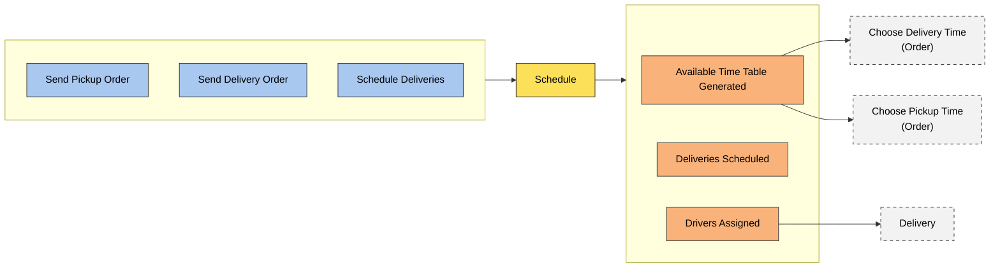
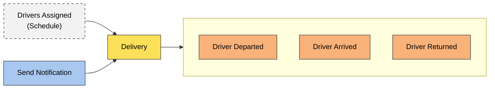
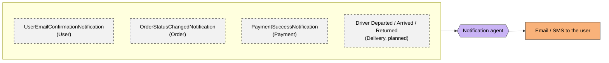
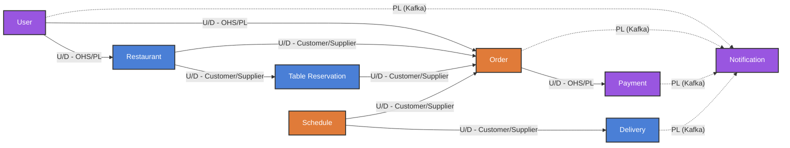

# Bounded Contexts

Starting from the pivotal points and the aggregates that emerged during the [Event Storming](event-storming.md), the
domain of _Munchies_ has been split into the following bounded contexts:

- **User**
- **Restaurant**
- **Table Reservation**
- **Order**
- **Schedule**
- **Delivery**
- **Payment**
- **Notification**

The contexts can be grouped into three areas:

- **Restaurant setup** (`Restaurant`, `Table Reservation`): everything a manager configures before customers can
  interact with a restaurant, and the bookings that depend on that configuration.
- **Ordering flow** (`Order`, `Schedule`, `Payment`): the heart of the system, where an order is scheduled, created,
  paid and prepared. Most of the policies discovered during the Event Storming live here.
- **Standalone contexts** (`User`, `Delivery`): identity on one side, the physical delivery run on the other.

`Notification` did not emerge as a context on the Event Storming board because it does not own any domain command: it
only reacts to events produced by the other contexts (see [Notification](#notification)).

## Subdomain classification

| Bounded Context   | Subdomain  | Rationale                                                                                       |
|-------------------|------------|-------------------------------------------------------------------------------------------------|
| Order             | Core       | Orders are the main value delivered to customers and restaurants                                |
| Schedule          | Core       | Delivery and pickup scheduling is the distinguishing feature of _Munchies_                      |
| Restaurant        | Supporting | Needed to describe what can be ordered, but not a differentiator on its own                     |
| Table Reservation | Supporting | Feeds dine-in orders, with business rules specific to restaurants                               |
| Delivery          | Supporting | Tracks the driver run; its logic is driven by the decisions taken in `Schedule`                 |
| Payment           | Generic    | Delegated to external payment gateways                                                          |
| User              | Generic    | Registration, authentication and authorization follow well-known patterns                       |
| Notification      | Generic    | Email/SMS dispatch with no domain decisions of its own                                          |

## Contexts

Each context is described by a diagram that follows the Event Storming notation: the commands it accepts, the
aggregate that handles them, the domain events it emits and the policies that react to them. Dashed grey nodes belong
to another context and show where the context is connected to the rest of the system.

### User

Manages user accounts, their profile and their role (`Customer` or `Manager`), and authenticates them.

- **Aggregate**: `User`
- **Microservice**: `user-service`

```mermaid
flowchart LR

    subgraph cmd[" "]
        direction TB
        c1["Register Customer User"]:::command
        c2["Register Manager User"]:::command
        c3["Log In"]:::command
        c4["Update User Info"]:::command
        c5["Update User Password"]:::command
    end
    agg["User"]:::aggregate
    subgraph evt[" "]
        direction TB
        e1["Email Confirmed"]:::event
        e2["Customer User Logged In"]:::event
        e3["Manager User Logged In"]:::event
    end
    cmd --> agg --> evt
    classDef command fill: #a8c8f0, stroke: #333, color: #000
    classDef aggregate fill: #fde05a, stroke: #333, color: #000
    classDef event fill: #f9b27a, stroke: #333, color: #000
    classDef policy fill: #c9b3f5, stroke: #333, color: #000
    classDef external fill: #f2f2f2, stroke: #333, stroke-dasharray: 5 5, color: #000
```

### Restaurant

Manages the restaurant site and its configuration: tables, menu, kitchen output and the drivers available to the
restaurant.

- **Aggregate**: `Restaurant`
- **Microservice**: `restaurant-service`

```mermaid
flowchart LR

    subgraph cmd[" "]
        direction TB
        c1["Create Restaurant"]:::command
        c2["Configure Tables"]:::command
        c3["Configure Restaurant Menu"]:::command
        c4["Configure Kitchen Output"]:::command
        c5["Configure Restaurant Drivers"]:::command
    end
    agg["Restaurant"]:::aggregate
    subgraph evt[" "]
        direction TB
        e1["Restaurant Site Deployed"]:::event
        e2["Configuration Updated"]:::event
    end
    cmd --> agg --> evt
    classDef command fill: #a8c8f0, stroke: #333, color: #000
    classDef aggregate fill: #fde05a, stroke: #333, color: #000
    classDef event fill: #f9b27a, stroke: #333, color: #000
    classDef policy fill: #c9b3f5, stroke: #333, color: #000
    classDef external fill: #f2f2f2, stroke: #333, stroke-dasharray: 5 5, color: #000
```

### Table Reservation

Manages the booking of a table in a restaurant for a given time slot.

- **Aggregate**: `Table Reservation`
- **Microservice**: `table-reservation-service` (currently a stub)

```mermaid
flowchart LR

    subgraph cmd[" "]
        direction TB
        c1["Choose Table Reservation Time"]:::command
        c2["Send Table Reservation"]:::command
        c3["Modify Table Reservation"]:::command
        c4["Cancel Table Reservation"]:::command
    end
    agg["Table Reservation"]:::aggregate
    subgraph evt[" "]
        direction TB
        e1["Table Reservation Accepted"]:::event
        e2["Table Reservation Modified"]:::event
        e3["Table Reservation Canceled"]:::event
    end
    cmd --> agg --> evt
    classDef command fill: #a8c8f0, stroke: #333, color: #000
    classDef aggregate fill: #fde05a, stroke: #333, color: #000
    classDef event fill: #f9b27a, stroke: #333, color: #000
    classDef policy fill: #c9b3f5, stroke: #333, color: #000
    classDef external fill: #f2f2f2, stroke: #333, stroke-dasharray: 5 5, color: #000
```

### Order

Manages the lifecycle of an order, whatever its fulfilment type (delivery, pickup/takeaway, dine-in), from its creation
to the end of its preparation. The `Order` aggregate is persisted with Event Sourcing.

- **Aggregate**: `Order`
- **Microservice**: `order-service`
- **Policy**: whenever a `Delivery Order Confirmed` or `Pickup Order Confirmed` event occurs, an online order is
  created (`Create Online Order`).

### Schedule

Computes the available time slots for pickup and delivery and plans the delivery runs, assigning drivers to them. It
acts as a middleware between the customer and the `Order` context.

- **Aggregate**: `Schedule`
- **Microservice**: `scheduler-service` (not implemented yet)

### Delivery

Tracks the physical delivery run performed by a driver.

- **Aggregate**: `Delivery`
- **Microservice**: none yet

### Payment

Handles the payment of an order, either online through an external payment gateway or offline at the restaurant.

- **Aggregate**: `Payment`
- **Microservice**: `payment-service`
- **Policy**: whenever an `Online Order Created` or `Table Order Created` event occurs, the payment of that order is
  requested.

```mermaid
flowchart LR

    subgraph orders[" "]
        direction TB
        ord1["Online Order Created<br/>(Order)"]:::external
        ord2["Table Order Created<br/>(Order)"]:::external
    end
    subgraph cmd[" "]
        direction TB
        c1["Process Online Payment"]:::command
        c2["Process Offline Payment"]:::command
    end
    agg["Payment"]:::aggregate
    subgraph evt[" "]
        direction TB
        e1["Online Payment Processed"]:::event
        e2["Offline Payment Processed"]:::event
        e3["Order Payed"]:::event
    end
    orders --> cmd --> agg --> evt
    classDef command fill: #a8c8f0, stroke: #333, color: #000
    classDef aggregate fill: #fde05a, stroke: #333, color: #000
    classDef event fill: #f9b27a, stroke: #333, color: #000
    classDef policy fill: #c9b3f5, stroke: #333, color: #000
    classDef external fill: #f2f2f2, stroke: #333, stroke-dasharray: 5 5, color: #000
```

### Notification

Sends notifications (email/SMS) to customers and restaurant staff. It owns no aggregate and accepts no command: it is
an event-driven agent that only reacts to the events published by the other contexts.

- **Aggregate**: none
- **Microservice**: `notification-service`

## Context Map

Each arrow goes from the upstream (U) to the downstream (D) context. Solid arrows are synchronous REST integrations,
dashed arrows are asynchronous Kafka integrations. Colors follow the subdomain classification: orange for core, blue
for supporting, purple for generic.

Each context is isolated in its own microservice with its own database. Contexts never share domain classes: the only
code they share is the `*-shared` module of the upstream service, which acts as the **Published Language** of that
context (DTOs, response types and notification payloads), exposed through an **Open Host Service** (the REST API
documented with OpenAPI).

Two integration styles are used:

- **Synchronous (REST)** between the business contexts, routed through the API Gateway. The downstream context calls
  the upstream one through an outbound adapter implementing a domain port, so the upstream model never leaks into the
  downstream domain (e.g. `payment-service` calls `order-service` through `OrderServiceHttpClient` to mark an order as
  paid).
- **Asynchronous (Kafka)** only towards `Notification`. Every event follows the **event-carried state transfer**
  style: the payload contains everything `Notification` needs, so it never calls back into the source context.

### Relationships

| Upstream          | Downstream        | Pattern                       | Description                                                                                                       |
|-------------------|-------------------|-------------------------------|-------------------------------------------------------------------------------------------------------------------|
| User              | Restaurant, Order | Open Host Service / PL        | The identity and role of the user (via the gateway's auth middleware) define who is a manager and who a customer  |
| Restaurant        | Order             | Customer/Supplier             | An order references the restaurant and its menu items by id (`RestaurantId`, `MenuItemId`)                        |
| Restaurant        | Table Reservation | Customer/Supplier             | Reservations are bound to the tables configured by the manager                                                    |
| Table Reservation | Order             | Customer/Supplier             | An accepted reservation enables the creation of a dine-in order (`Create Table Order`)                            |
| Schedule          | Order             | Customer/Supplier             | `Available Time Table Generated` drives the `Choose Delivery Time` and `Choose Pickup Time` commands              |
| Schedule          | Delivery          | Customer/Supplier             | `Drivers Assigned` starts the delivery run                                                                        |
| Order             | Payment           | Open Host Service / PL        | `Online Order Created`/`Table Order Created` trigger the payment; on success Payment marks the order as paid       |
| User              | Notification      | Published Language (Kafka)    | Email confirmation after registration                                                                             |
| Order             | Notification      | Published Language (Kafka)    | Order status changes                                                                                              |
| Payment           | Notification      | Published Language (Kafka)    | Successful payment                                                                                                |
| Delivery          | Notification      | Published Language (Kafka)    | Driver progress (planned)                                                                                         |

### User Context

Inbound events:

- None.

Outbound events (Kafka, topic `user_email_confirmation_topic`):

- `UserEmailConfirmationNotification`: a user registered and must confirm their email address. Carries the user id
  and the confirmation key.

### Restaurant Context

Inbound events:

- None.

Outbound events:

- None published on Kafka. `Restaurant Site Deployed` and `Configuration Updated` are exposed to downstream contexts
  through the REST API (Open Host Service).

### Table Reservation Context

Inbound events:

- None. It reads the table configuration from `Restaurant` through its REST API.

Outbound events:

- `Table Reservation Accepted`, `Table Reservation Modified`, `Table Reservation Canceled` (not implemented yet).

### Order Context

Inbound events:

- From `Schedule`: `Available Time Table Generated`, used to choose the delivery or pickup time.
- From `Table Reservation`: `Table Reservation Accepted`, used to create a dine-in order.
- From `Payment`: `Order Payed`, received as a REST call that marks the order as paid.

Outbound events (Kafka, topic `order_status_changed_topic`):

- `OrderStatusChangedNotification`: the status of an order changed. Carries the order id, restaurant id, customer id
  and the new status.

The other events (`Online Order Created`, `Table Order Created`, ...) are internal to the event-sourced `Order`
aggregate and are exposed to `Payment` only through the REST API.

### Schedule Context

Inbound events:

- From `Order`: `Delivery Order Confirmed`, `Pickup Order Confirmed`, to include the order in the plan.

Outbound events:

- `Available Time Table Generated`, `Deliveries Scheduled`, `Drivers Assigned` (not implemented yet).

### Delivery Context

Inbound events:

- From `Schedule`: `Drivers Assigned`, starting the delivery run.

Outbound events:

- `Driver Departed`, `Driver Arrived`, `Driver Returned`, notification-bound (not implemented yet).

### Payment Context

Inbound events:

- From `Order`: `Online Order Created`, `Table Order Created`, through the policy that requests the payment.

Outbound events (Kafka, topic `payment_success_topic`):

- `PaymentSuccessNotification`: a payment completed. Carries the payment id, the order id, the amount and the
  currency.

### Notification Context

Inbound events:

- From `User`: `UserEmailConfirmationNotification` (`user_email_confirmation_topic`).
- From `Order`: `OrderStatusChangedNotification` (`order_status_changed_topic`).
- From `Payment`: `PaymentSuccessNotification` (`payment_success_topic`).

Outbound events:

- None. Each event is turned into a notification sent to the interested user; every step of the consume/process
  pipeline is non-blocking, so a slow topic never stalls the others.
