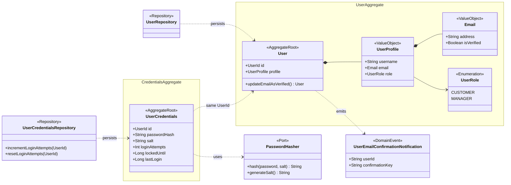
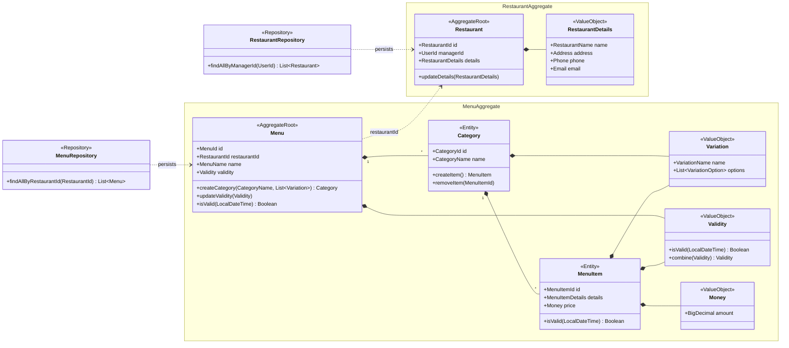
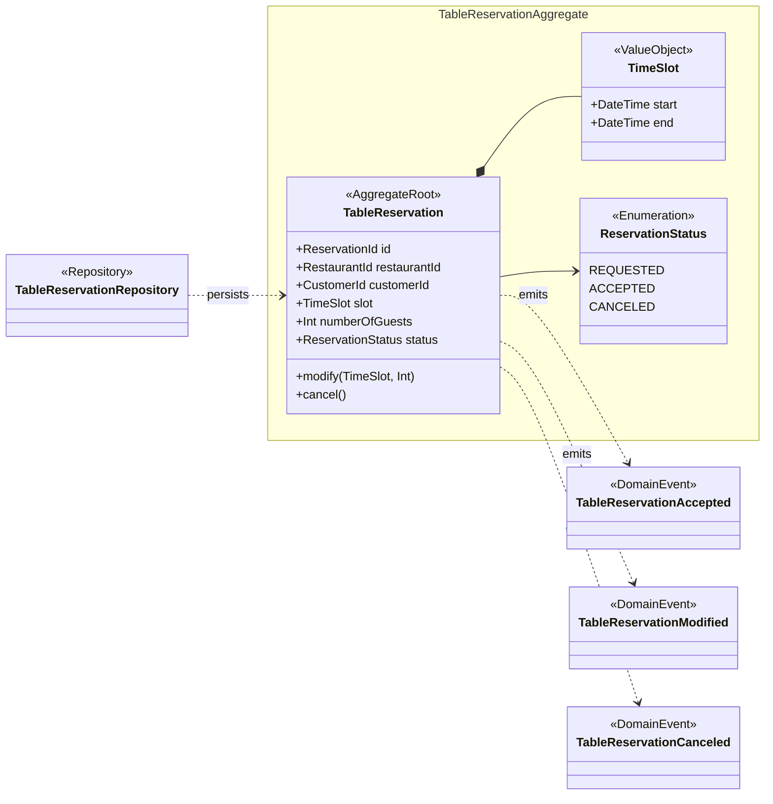
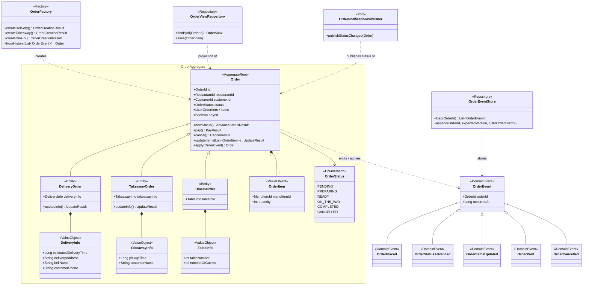
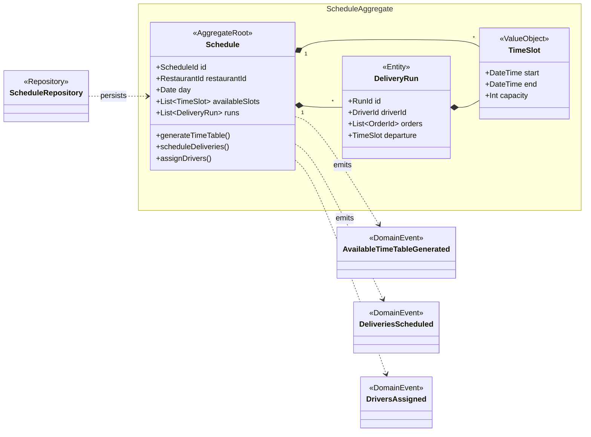
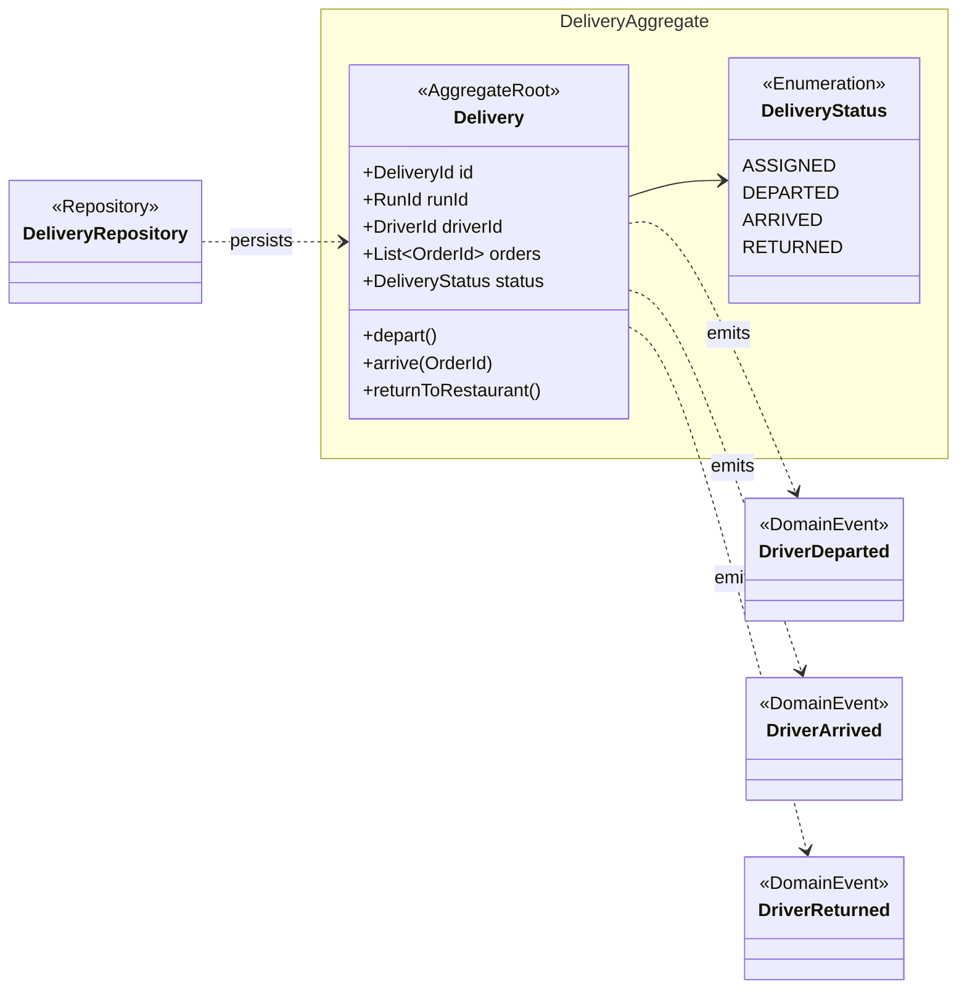
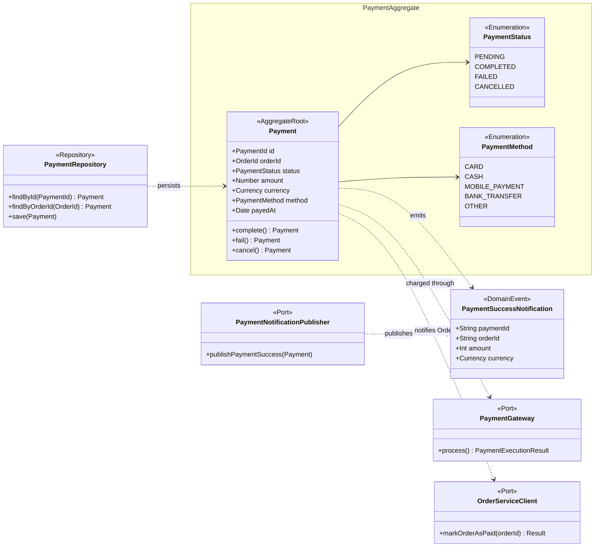
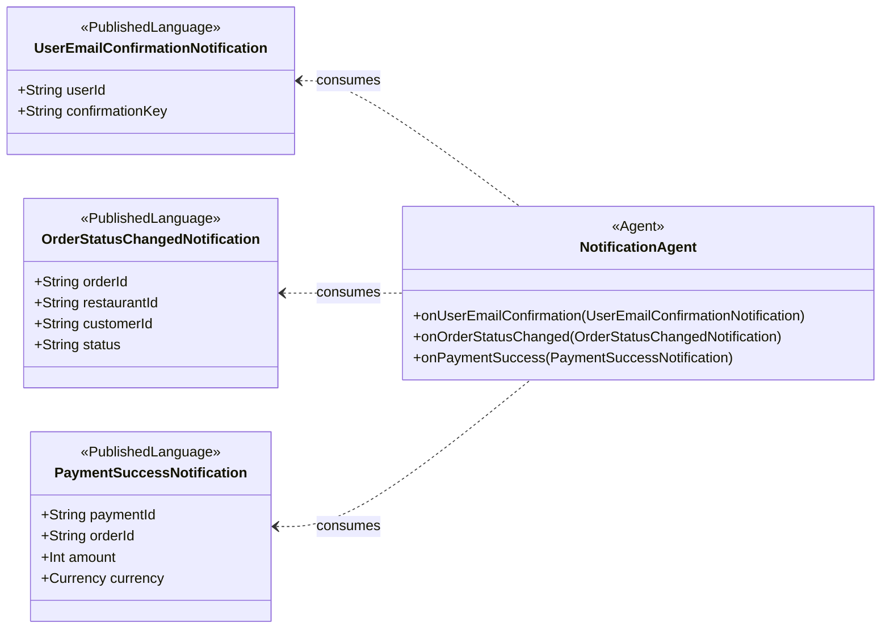

# Bounded Contexts

Starting from the pivotal points and the aggregates that emerged during the [Event Storming](event-storming.md), the
domain of _Munchies_ has been split into the following bounded contexts:

- **User**
- **Restaurant**
- **Table Reservation**
- **Order**
- **Schedule**
- **Delivery**
- **Payment**
- **Notification**

The contexts can be grouped into three areas:

- **Restaurant setup** (`Restaurant`, `Table Reservation`): everything a manager configures before customers can
  interact with a restaurant, and the bookings that depend on that configuration.
- **Ordering flow** (`Order`, `Schedule`, `Payment`): the heart of the system, where an order is scheduled, created,
  paid and prepared. Most of the policies discovered during the Event Storming live here.
- **Standalone contexts** (`User`, `Delivery`): identity on one side, the physical delivery run on the other.

`Notification` did not emerge as a context on the Event Storming board because it does not own any domain command: it
only reacts to events produced by the other contexts (see [Notification](#notification)).

### User

Manages user accounts, their profile and their role (`Customer` or `Manager`), and authenticates them.

### Restaurant

Manages the restaurant site and its configuration: details, menus, categories and menu items.

### Table Reservation

Manages the booking of a table in a restaurant for a given time slot.

### Order

Manages the lifecycle of an order, whatever its fulfilment type (delivery, takeaway, dine-in), from its creation to its
completion.

### Schedule

Computes the available time slots for pickup and delivery and plans the delivery runs, assigning drivers to them. It
acts as a middleware between the customer and the `Order` context.

### Delivery

Tracks the physical delivery run performed by a driver.

### Payment

Handles the payment of an order, either online through an external payment gateway or offline at the restaurant.

### Notification

Sends notifications (email/SMS) to customers and restaurant staff. It owns no aggregate and accepts no command: it is
an event-driven agent that only reacts to the events published by the other contexts, and its model is the set of
event payloads it consumes.

