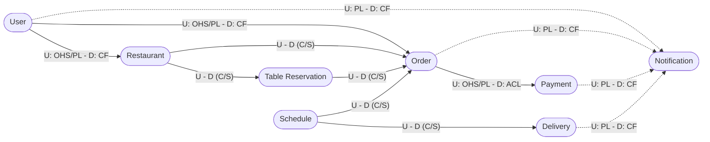

# Context Map

The context map shows every bounded context and the relationship between each pair of integrated contexts, using the
strategic DDD patterns: **U**/**D** mark the upstream and downstream side, **OHS** (Open Host Service) and **PL**
(Published Language) the upstream contract, **ACL** (Anticorruption Layer) and **CF** (Conformist) the downstream
strategy, **C/S** a Customer/Supplier relationship.

Each arrow goes from the upstream to the downstream context. Solid arrows are synchronous REST integrations, dashed
arrows are asynchronous Kafka integrations.

Each context is isolated in its own microservice with its own database. Contexts never share domain classes: the only
code they share is the `*-shared` module of the upstream service, which acts as the **Published Language** of that
context (DTOs, response types and notification payloads), exposed through an **Open Host Service** (the REST API
documented with OpenAPI, or the Kafka topic).

Two integration styles are used:

- **Synchronous (REST)** between the business contexts, routed through the API Gateway. Where the downstream context
  needs to protect its model, it calls the upstream one through an outbound adapter implementing a domain port, which
  acts as an Anticorruption Layer (e.g. `payment-service` calls `order-service` through `OrderServiceHttpClient` to
  mark an order as paid).
- **Asynchronous (Kafka)** only towards `Notification`. Every event follows the **event-carried state transfer**
  style: the payload contains everything `Notification` needs, so it never calls back into the source context.

### Relationships

| Upstream          | Downstream        | Pattern                 | Description                                                                                                                     |
|-------------------|-------------------|-------------------------|---------------------------------------------------------------------------------------------------------------------------------|
| User              | Restaurant, Order | OHS/PL - Conformist     | Identity and role (checked by the gateway's auth middleware) are taken as they are; downstream contexts only keep the user's id |
| Restaurant        | Order             | Customer/Supplier       | An order references the restaurant and its menu items by id (`RestaurantId`, `MenuItemId`)                                      |
| Restaurant        | Table Reservation | Customer/Supplier       | Reservations are bound to the tables configured by the manager                                                                  |
| Table Reservation | Order             | Customer/Supplier       | An accepted reservation enables the creation of a dine-in order (`Create Table Order`)                                          |
| Schedule          | Order             | Customer/Supplier       | `Available Time Table Generated` drives the `Choose Delivery Time` and `Choose Pickup Time` commands                            |
| Schedule          | Delivery          | Customer/Supplier       | `Drivers Assigned` starts the delivery run                                                                                      |
| Order             | Payment           | OHS/PL - ACL            | `Online Order Created`/`Table Order Created` trigger the payment; on success Payment marks the order as paid through its ACL    |
| User              | Notification      | PL - Conformist (Kafka) | Email confirmation after registration                                                                                           |
| Order             | Notification      | PL - Conformist (Kafka) | Order status changes                                                                                                            |
| Payment           | Notification      | PL - Conformist (Kafka) | Successful payment                                                                                                              |
| Delivery          | Notification      | PL - Conformist (Kafka) | Driver progress (planned)                                                                                                       |

`Notification` is deliberately **Conformist**: it imports the notification payloads straight from the upstream
`*-shared` modules, with no translation, because it has no domain model of its own to protect.

### User Context

Inbound events:

- None.

Outbound events (Kafka, topic `user_email_confirmation_topic`):

- `UserEmailConfirmationNotification`: a user registered and must confirm their email address. Carries the user id
  and the confirmation key.

### Restaurant Context

Inbound events:

- None.

Outbound events:

- None published on Kafka. `Restaurant Site Deployed` and `Configuration Updated` are exposed to downstream contexts
  through the REST API (Open Host Service).

### Table Reservation Context

Inbound events:

- None. It reads the table configuration from `Restaurant` through its REST API.

Outbound events:

- `Table Reservation Accepted`, `Table Reservation Modified`, `Table Reservation Canceled` (planned).

### Order Context

Inbound events:

- From `Schedule`: `Available Time Table Generated`, used to choose the delivery or pickup time.
- From `Table Reservation`: `Table Reservation Accepted`, used to create a dine-in order.
- From `Payment`: `Order Payed`, received as a REST call that marks the order as paid.

Outbound events (Kafka, topic `order_status_changed_topic`):

- `OrderStatusChangedNotification`: the status of an order changed. Carries the order id, restaurant id, customer id
  and the new status.

The other events (`OrderPlaced`, `OrderStatusAdvanced`, ...) are internal to the event-sourced `Order` aggregate and are
exposed to `Payment` only through the REST API.

### Schedule Context

Inbound events:

- From `Order`: `Delivery Order Confirmed`, `Pickup Order Confirmed`, to include the order in the plan.

Outbound events:

- `Available Time Table Generated`, `Deliveries Scheduled`, `Drivers Assigned` (planned).

### Delivery Context

Inbound events:

- From `Schedule`: `Drivers Assigned`, starting the delivery run.

Outbound events:

- `Driver Departed`, `Driver Arrived`, `Driver Returned`, notification-bound (planned).

### Payment Context

Inbound events:

- From `Order`: `Online Order Created`, `Table Order Created`, through the policy that requests the payment.

Outbound events (Kafka, topic `payment_success_topic`):

- `PaymentSuccessNotification`: a payment completed. Carries the payment id, the order id, the amount and the
  currency.

### Notification Context

Inbound events:

- From `User`: `UserEmailConfirmationNotification` (`user_email_confirmation_topic`).
- From `Order`: `OrderStatusChangedNotification` (`order_status_changed_topic`).
- From `Payment`: `PaymentSuccessNotification` (`payment_success_topic`).

Outbound events:

- None. Each event is turned into a notification sent to the interested user; every step of the consume/process
  pipeline is non-blocking, so a slow topic never stalls the others.
