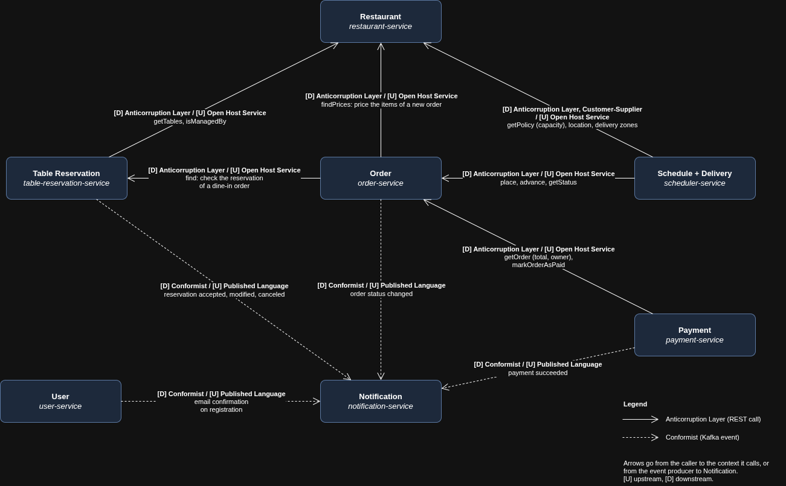

# Context Map

The context map shows how the bounded contexts integrate, using the strategic DDD patterns. The **upstream** [U]
context provides something and the **downstream** [D] one depends on it. An upstream exposes an **Open Host Service**,
a public API open to any client, whose data follows a **Published Language**, the `*-shared` modules. A downstream
either protects its model with an **Anticorruption Layer**, a port of its own whose adapter translates the upstream
model, or is a **Conformist** and takes the upstream model as it is. **Customer-Supplier** marks an upstream that
evolves to meet the needs of its downstream.

As in the code, arrows go from the caller to the context it calls (REST), or from the producer of an event to
Notification (Kafka); each label states which side is upstream and which downstream, followed by examples of the
operations used. Schedule and Delivery are drawn together because both live in `scheduler-service`.

- **Order → Restaurant**: [D] Anticorruption Layer / [U] Open Host Service. When an order is placed, Order prices
  its items from the restaurant's menus through its `MenuCatalog` port, and freezes the price in the order.
- **Table Reservation → Restaurant**: [D] Anticorruption Layer / [U] Open Host Service. Reservations are checked
  against the tables the manager configured, and only the restaurant's manager can see its reservations.
- **Schedule → Restaurant**: [D] Anticorruption Layer, Customer-Supplier / [U] Open Host Service. The scheduler reads
  the capacity policy, the restaurant's location and its delivery zones; Restaurant added these endpoints for the
  scheduler's needs.
- **Order → Table Reservation**: [D] Anticorruption Layer / [U] Open Host Service. A dine-in order for a reservation
  is accepted only if the reservation is an accepted one of the same customer at the same restaurant.
- **Schedule → Order**: [D] Anticorruption Layer / [U] Open Host Service. The scheduler places the order once the
  slot (and, for a delivery, the trip) is booked, and moves it to preparation when its time comes.
- **Payment → Order**: [D] Anticorruption Layer / [U] Open Host Service. Payment reads the order's total and owner
  before charging, then marks the order as paid.
- **User, Order, Payment, Table Reservation → Notification**: [D] Conformist / [U] Published Language, over Kafka.
  Each event carries everything Notification needs, and Notification uses the payload classes of the upstream
  `*-shared` modules as they are, since it has no domain model of its own to protect.

`User` is upstream of every context without any arrow: no service calls `user-service`. The API Gateway checks the
user's session and role and adds the user id to the request it forwards, and every context conforms to that id and
keeps nothing else of the user.

## Differences from the Event Storming

The [Event Storming](event-storming.md) was done before the implementation, and some integrations changed on the way:

- **Schedule became downstream of Order.** `scheduler-service` is the entry point for ordering: the customer books a
  slot and the scheduler places the order, instead of Schedule publishing a timetable for Order to use.
- **Schedule and Delivery were merged** into one service: a delivery order is accepted only if it fits a trip, so
  planning the trip is part of accepting the order.
- **Payment is started by the customer**, not by a policy reacting to the order's creation.
- **No events between business contexts.** Kafka is used only towards Notification, so the events planned between
  contexts (e.g. `Table Reservation Accepted` towards Order) became synchronous calls through an Anticorruption Layer.
