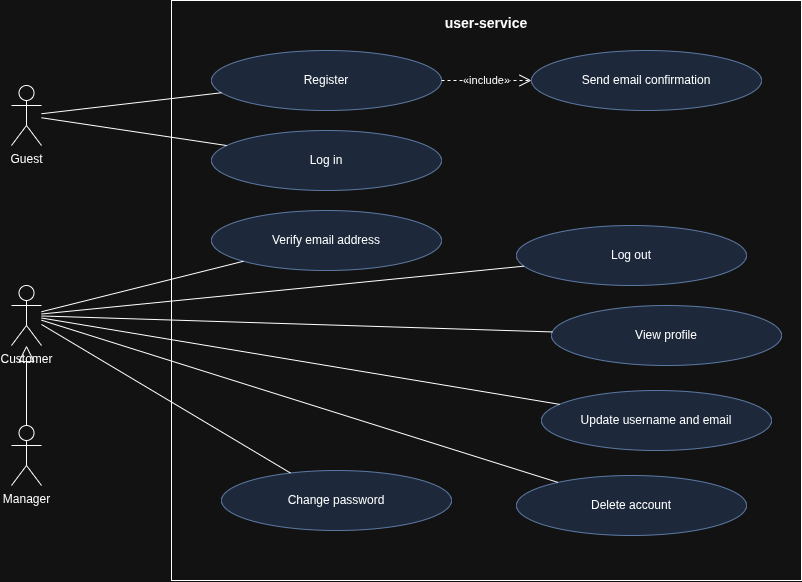
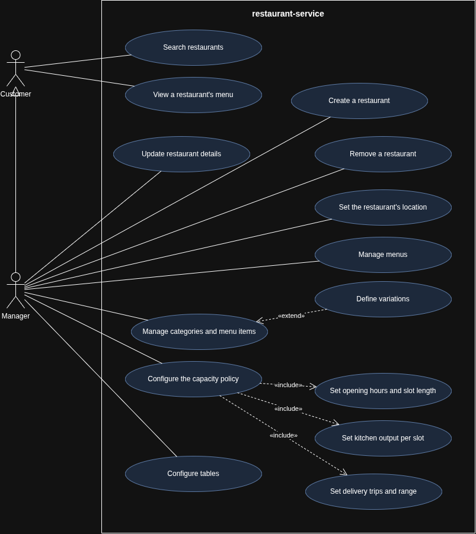
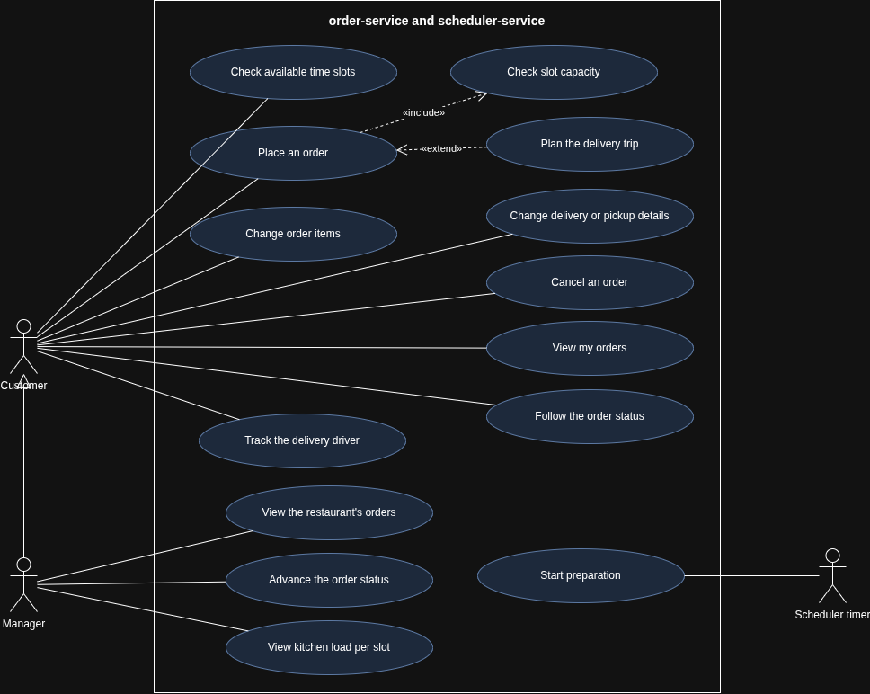
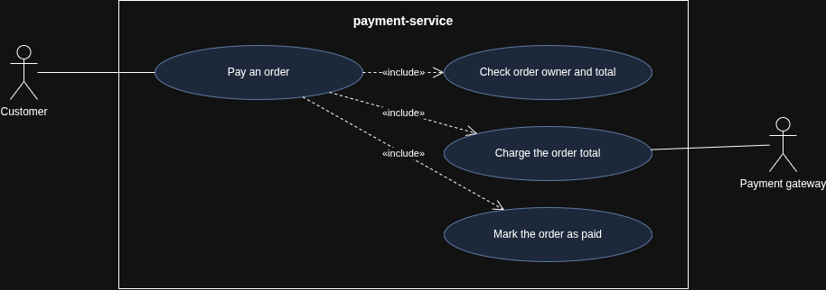
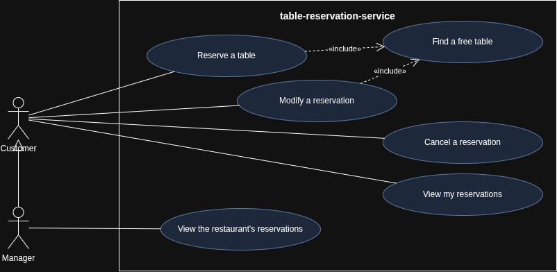

# Use Cases

The use case diagrams show, for each bounded context, which actors interact with it and what they can do. They
complement the [User Stories](User%20Stories.md), which specify a few of these use cases as acceptance criteria, and
the [Functional Requirements](functional-requirements.md), which state the behaviour behind them.

There is one diagram per bounded context, with the service that implements it as the system boundary. `Notification`
has no diagram: no actor triggers it, it only reacts to the events of the other contexts.

| Actor           | Kind     | Description                                                                                       |
|-----------------|----------|---------------------------------------------------------------------------------------------------|
| Guest           | Human    | A person who is not logged in                                                                     |
| Customer        | Human    | A logged-in user who orders food and reserves tables                                              |
| Manager         | Human    | A logged-in user who runs one or more restaurants; a specialisation of Customer, so every use case of a customer is also available to a manager |
| Scheduler timer | System   | The clock of `scheduler-service`, which starts the preparation of an order when its slot approaches |
| Payment gateway | External | The external provider that charges the customer                                                   |

The diagrams use the standard UML notation: a plain line associates an actor with a use case, a dashed arrow marked
«include» points to a use case that is always part of the base one, a dashed arrow marked «extend» points from a use
case that is added to the base one only under a condition, and a hollow triangle marks the generalisation from Manager
to Customer.

## User

A guest registers or logs in; every other use case requires a session. Registering always sends the email
confirmation, which the user then uses to verify their address.

## Restaurant

Customers search restaurants by name or address and browse their menus; everything else is restaurant configuration, reserved to the
manager who owns the restaurant. The capacity policy groups the settings that decide how many orders a restaurant can
take: opening hours and slot length, kitchen output per slot, and the number and range of delivery trips.

## Order and Schedule

The two contexts are drawn together because a customer places an order through `scheduler-service`, which checks the
capacity of the slot and, for a delivery, plans the trip before `order-service` creates the order (see
[Interactions](../02-Architecture%20and%20Implementation/interactions.md#choosing-a-time-slot-and-placing-an-order)).
The first transition of an order, into preparation, is started by the scheduler's timer; the following ones are
started by the manager.

## Payment

Paying has a single entry point. It always checks that the order belongs to the customer and is still unpaid, charges
the total computed by `order-service` through the external payment gateway, and marks the order as paid.

## Table Reservation

Reserving and modifying a reservation both need a free table that fits the party, read from the tables the manager
configured in the Restaurant context. Managers see the reservations of their restaurants.
