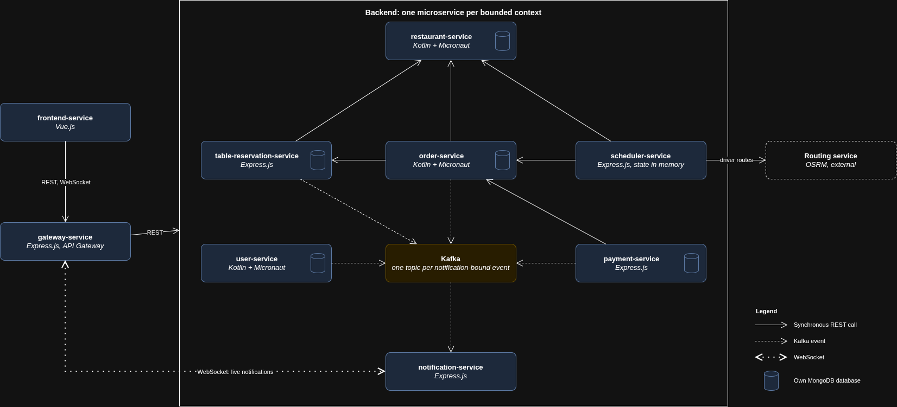

# General Architecture

The backend is a set of microservices, each one owning a single bounded context and, when it has persistent state, its
own MongoDB database. Clients reach them only through an API Gateway. Services call each other synchronously over
REST; Apache Kafka is used only to deliver events to `notification-service`, which pushes the resulting notifications
to the frontend over a WebSocket.

| Service                     | Stack              | Responsibility                                                       |
|-----------------------------|--------------------|----------------------------------------------------------------------|
| `gateway-service`           | Express.js         | Single entry point: routing, authentication, proxying                |
| `user-service`              | Kotlin + Micronaut | User accounts, authentication and authorization                      |
| `restaurant-service`        | Kotlin + Micronaut | Restaurants, menus, tables and capacity policy                       |
| `order-service`             | Kotlin + Micronaut | Order creation and status tracking, stored as an event log           |
| `scheduler-service`         | Express.js         | Time slots, delivery trips and driver tracking, between the customer and `order-service`; state in memory |
| `payment-service`           | Express.js         | Payment processing                                                   |
| `notification-service`      | Express.js         | Notifications to users and staff, from Kafka events, pushed live over a WebSocket |
| `table-reservation-service` | Express.js         | Table reservations against the restaurant's dining room              |
| `frontend-service`          | Vue.js             | User interface for customers and managers                            |

Arrows go from the caller to the service it calls, or from the producer of an event to Kafka.
`frontend-service` reaches the backend only through `gateway-service`: REST requests are routed to the service that
owns the path once the session is checked, and the WebSocket of live notifications is relayed to
`notification-service`, which no other service calls. `scheduler-service` keeps bookings and trips in memory, so it
has no database, and it asks an external routing service (OSRM) for the drivers' routes. The REST calls between
services and the patterns they follow are described in the [Context Map](../01-Domain%20Driven%20Design/context-map.md).

The internal structure of each service is described in [Hexagonal Architecture](hexagonal-architecture.md), the patterns applied across services in [Microservices Patterns](microservices-patterns.md), the run-time collaboration of the services in [Interactions](interactions.md), and the reasons behind this shape in [Architecture Decisions](architecture-decisions.md).
