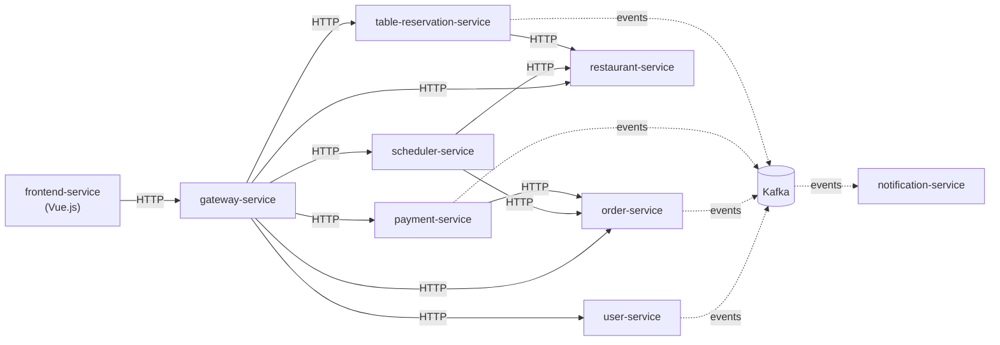

# General Architecture

The backend is a set of microservices, each one owning a single bounded context and its own MongoDB database. Clients
reach them only through an API Gateway. Services call each other synchronously over REST; Apache Kafka is used only
to deliver events to `notification-service`.

| Service                     | Stack              | Responsibility                                                       |
|-----------------------------|--------------------|----------------------------------------------------------------------|
| `gateway-service`           | Express.js         | Single entry point: routing, authentication, proxying                |
| `user-service`              | Kotlin + Micronaut | User accounts, authentication and authorization                      |
| `restaurant-service`        | Kotlin + Micronaut | Restaurants, menus, tables and capacity policy                       |
| `order-service`             | Kotlin + Micronaut | Order creation and status tracking, stored as an event log           |
| `scheduler-service`         | Express.js         | Time slots, delivery trips and driver tracking, between the customer and `order-service` |
| `payment-service`           | Express.js         | Payment processing                                                   |
| `notification-service`      | Express.js         | Notifications to users and staff, driven only by Kafka events        |
| `table-reservation-service` | Express.js         | Table reservations against the restaurant's dining room              |
| `frontend-service`          | Vue.js             | User interface for customers and managers                            |

Solid arrows are synchronous REST calls, dashed arrows are Kafka events. `frontend-service` reaches the backend only through `gateway-service`, and `notification-service` is reached only through Kafka.

The internal structure of each service is described in [Hexagonal Architecture](hexagonal-architecture.md), the patterns applied across services in [Microservices Patterns](microservices-patterns.md), the run-time collaboration of the services in [Interactions](interactions.md), and the reasons behind this shape in [Architecture Decisions](architecture-decisions.md).
