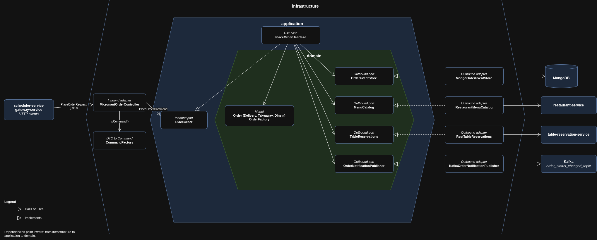

# Hexagonal Architecture

Every backend microservice of _Munchies_ is structured as a hexagonal (ports & adapters) architecture inside the DDD
layering. The package layout and the aggregates are described in
[Domain Model](../01-Domain%20Driven%20Design/domain-model.md); this page shows how ports and adapters are realised in
the code and how the dependency rule is checked.

The reference service is `order-service` (Kotlin + Micronaut), with the placement of an order as the example. It is
the use case with the most varied surroundings: it is called over HTTP, and it reaches a database, two other
microservices and a message broker, each through its own port. How the order is persisted (event sourcing) and read
(CQRS) is covered in [Microservices Patterns](microservices-patterns.md#5-event-sourcing-order-service); here the event
store is simply one of the outbound ports.

## Layers and the dependency rule

| Layer            | Content                                                                                                   | May depend on              |
|------------------|-----------------------------------------------------------------------------------------------------------|----------------------------|
| `domain`         | The `Order` aggregate and its events, `OrderFactory`, value objects, **outbound ports**                   | `commons` only             |
| `application`    | One **inbound port** per use case with its **Command**, the use case implementing it                      | `domain`                   |
| `infrastructure` | **Adapters**: REST controller, DTO-to-Command factories, MongoDB, REST clients, Kafka, DI wiring          | `application` and `domain` |

Dependencies point only inward. Inbound calls follow that direction (controller -> inbound port -> use case ->
domain). Outbound calls (persisting, pricing, reading a reservation, notifying) are inverted: the domain declares the
interface, the infrastructure implements it, and the adapter is injected into the use case at startup.

Each boundary has its own data type, so no layer sees the representation of the one outside it:

- a **DTO** (`PlaceOrderRequest`, from the `order-shared` module) enters the infrastructure layer: it is the published
  contract of the API;
- a **Command** (`PlaceOrderCommand`) enters the application layer: the infrastructure translates the DTO into it,
  turning strings into value objects and rejecting incomplete requests;
- the domain works only on its own model (`Order`, `OrderItem`, `MenuItemId`, `Price`), and its outbound ports speak
  the same language.



The nested hexagons are the three layers. On the left, the request enters as a DTO, is translated by
`CommandFactory`, and reaches the inbound port as a Command. In the middle, `PlaceOrderUseCase` builds the order
through the domain and uses four outbound ports. On the right, each port is implemented by an adapter that talks to one
external system. Solid arrows are calls, dashed arrows with a hollow triangle are `implements` relations. Every arrow
that crosses a layer boundary points inward, which is the dependency rule above; only the outbound adapters reach out,
to the systems they wrap.

## Ports

### Inbound ports (driving)

One interface per use case in `application/port/inbound` (`PlaceOrder`, `AdvanceOrderStatus`, `UpdateOrderItems`,
`UpdateDeliveryOrderInfo`, `UpdateTakeawayOrderInfo`, `DiscardOrder`, `PayOrder`, `GetOrderDetails`, `GetOrders`),
implemented by the use case; the controller depends only on these interfaces. Each takes a Command from
`application/port/inbound/command`, and the outcome is a sealed type, so every failure is part of the contract and the
controller must map it explicitly:

```kotlin
// application/port/inbound/PlaceOrder.kt
interface PlaceOrder {
    fun execute(command: PlaceOrderCommand): Result

    sealed interface Result {
        data class Success(val order: OrderDto) : Result
        sealed interface Failure : Result {
            data object EmptyItems : Failure
            data class UnknownItems(val menuItemIds: Set<MenuItemId>) : Failure
            data object MenuUnavailable : Failure
            data object ReservationNotFound : Failure
            // ...
        }
    }
}
```

The Command is a sealed hierarchy with one variant per kind of order, carrying only what that kind needs and already
expressed in value objects:

```kotlin
// application/port/inbound/command/PlaceOrderCommand.kt
sealed interface PlaceOrderCommand {
    val restaurantId: RestaurantId
    val customerId: CustomerId
    val items: List<RequestedItem>

    data class Delivery(/* ... */ val estimatedDeliveryTime: Long, val deliveryAddress: String, /* ... */)
    data class Takeaway(/* ... */ val pickupTime: Long, val customerName: String)
    data class DineIn(/* ... */ val tableNumber: Int, val numberOfGuests: Int)
    data class ReservedDineIn(/* ... */ val reservationId: String)
}
```

### Outbound ports (driven)

Declared in `domain/port`, one per external dependency:

| Outbound port                | What it abstracts                                                                              | Used by `PlaceOrder` |
|------------------------------|------------------------------------------------------------------------------------------------|----------------------|
| `OrderEventStore`            | Loading and appending the events of an order, with optimistic concurrency on the version      | yes                  |
| `MenuCatalog`                | The current price of menu items, owned by `restaurant-service`                                 | yes                  |
| `TableReservations`          | The table and guests of a customer's reservation, owned by `table-reservation-service`         | yes                  |
| `OrderNotificationPublisher` | Announcing a status change to `notification-service`                                           | yes                  |
| `OrderViewRepository`        | The read model of the orders (CQRS query side)                                                 | no                   |

The ports are expressed in domain terms, so nothing Mongo-, HTTP- or Kafka-specific crosses the boundary. The two
ports towards other microservices are the **Anticorruption Layers** of the [Context Map](../01-Domain%20Driven%20Design/context-map.md):
the domain states what it needs in its own words, and returns the failures it cares about as part of the result:

```kotlin
// domain/port/MenuCatalog.kt
interface MenuCatalog {
    fun findPrices(restaurantId: RestaurantId, menuItemIds: Set<MenuItemId>): PriceLookup

    sealed interface PriceLookup {
        data class Found(val prices: Map<MenuItemId, Price>) : PriceLookup
        data object RestaurantNotFound : PriceLookup
        data object Unavailable : PriceLookup
    }
}
```

`restaurant-service` thinks in menus, categories and decimal prices; `order-service` only asks for the price of a set
of items, in cents.

## Adapters

### Inbound (primary) adapter

`MicronautOrderController` (`infrastructure/adapter/inbound/web/controller`) implements the `OrderAPI` contract of
`order-shared`. For each endpoint it translates the DTO into a Command with the factories of `adapter/dto/factory`,
calls the matching inbound port and maps the sealed result into an HTTP response, or into an exception handled by
`ExceptionHandlers`. It holds no business rules:

```kotlin
// infrastructure/adapter/inbound/web/controller/MicronautOrderController.kt
override fun placeOrder(@Body request: PlaceOrderRequest): HttpResponse<PlaceOrderResponse> =
    when (val res = placeOrder.execute(request.toCommand())) {
        is PlaceOrder.Result.Success -> HttpResponse.ok(PlaceOrderResponse(result = res.order))
        is PlaceOrder.Result.Failure.EmptyItems -> throw ValidationException("Empty items")
        is PlaceOrder.Result.Failure.MenuUnavailable -> throw ServiceUnavailableException(MENU_UNAVAILABLE)
        // ... one branch per failure
    }

// infrastructure/adapter/dto/factory/CommandFactory.kt
fun PlaceOrderRequest.toCommand(): PlaceOrderCommand = when (orderType) {
    TAKEAWAY -> PlaceOrderCommand.Takeaway(
        restaurantId = RestaurantId(restaurantId),
        customerId = CustomerId(customerId),
        items = items.map { it.toRequestedItem() },
        pickupTime = pickupTime?.toLongOrNull()
            ?: throw IllegalArgumentException("Pickup time is required for takeaway orders"),
        customerName = customerName
            ?: throw IllegalArgumentException("Customer name is required for takeaway orders"),
    )
    // DELIVERY, DINE_IN ...
}
```

### Outbound (secondary) adapters

Each outbound port is implemented in `infrastructure/adapter/outbound/<technology or service>`:

| Port                         | Adapter                           | Package                | External system             |
|------------------------------|-----------------------------------|------------------------|-----------------------------|
| `OrderEventStore`            | `MongoOrderEventStore`            | `outbound/mongo`       | MongoDB                     |
| `OrderViewRepository`        | `MongoOrderViewRepository`        | `outbound/mongo`       | MongoDB                     |
| `MenuCatalog`                | `RestaurantMenuCatalog`           | `outbound/restaurant`  | `restaurant-service`        |
| `TableReservations`          | `RestTableReservations`           | `outbound/reservation` | `table-reservation-service` |
| `OrderNotificationPublisher` | `KafkaOrderNotificationPublisher` | `outbound/kafka`       | Kafka                       |

The adapters are where the translation happens. `RestaurantMenuCatalog` calls `restaurant-service` through a
declarative Micronaut client whose paths come from the `restaurant-shared` constants, decodes the responses with the
`restaurant-shared` classes, and turns them into the port's types:

```kotlin
// infrastructure/adapter/outbound/restaurant/RestaurantMenuCatalog.kt  (adapter, outer layer)
class RestaurantMenuCatalog(private val client: RestaurantServiceClient) : MenuCatalog {
    override fun findPrices(restaurantId: RestaurantId, menuItemIds: Set<MenuItemId>): PriceLookup =
        try {
            lookup(restaurantId.value, menuItemIds)   // menu list, then each menu until every item is priced
        } catch (e: HttpClientResponseException) {
            if (e.status == HttpStatus.NOT_FOUND) PriceLookup.RestaurantNotFound else unavailable(restaurantId, e)
        } catch (e: HttpClientException) {
            unavailable(restaurantId, e)
        }
    // "9.50" from the menu becomes Price(950) cents
}
```

Every transport or decoding failure becomes `Unavailable`, so the use case refuses the order instead of placing it with
made-up prices. `RestTableReservations` does the same towards `table-reservation-service`, keeping only the four facts
of a reservation the order needs (restaurant, table, guests, whether it is accepted). The Mongo adapters translate
between domain events and documents through `outbound/mongo/factory`, so the document classes never reach the domain.

## Dependency injection and composition root

Use cases are plain classes with no framework annotations: they receive their ports through the constructor, which
makes `PlaceOrderUseCase` a class that knows nothing about MongoDB, HTTP or Kafka:

```kotlin
// application/usecase/PlaceOrderUseCase.kt
class PlaceOrderUseCase(
    private val eventStore: OrderEventStore,
    private val menuCatalog: MenuCatalog,
    private val tableReservations: TableReservations,
    private val notificationPublisher: OrderNotificationPublisher,
) : PlaceOrder { /* ... */ }
```

For a reserved dine-in order it first resolves the table through `TableReservations`; it then prices the items through
`MenuCatalog`, builds the order with `OrderFactory`, appends the resulting events to the `OrderEventStore`, and
announces the new status through the `OrderNotificationPublisher`.

The binding is done in the infrastructure layer, in the _composition root_ `OrderBeans`, with the adapters towards
other microservices bound in `OrderOutboundBeans`:

```kotlin
// infrastructure/adapter/inbound/web/config/OrderBeans.kt
@Factory
class OrderBeans {
    @Singleton
    fun placeOrder(
        eventStore: OrderEventStore,
        menuCatalog: MenuCatalog,
        tableReservations: TableReservations,
        notificationPublisher: OrderNotificationPublisher,
    ): PlaceOrder = PlaceOrderUseCase(eventStore, menuCatalog, tableReservations, notificationPublisher)
}

// infrastructure/adapter/inbound/web/config/OrderOutboundBeans.kt
@Factory
class OrderOutboundBeans {
    @Singleton
    fun menuCatalog(client: RestaurantServiceClient): MenuCatalog = RestaurantMenuCatalog(client)

    @Singleton
    fun tableReservations(client: TableReservationServiceClient): TableReservations =
        RestTableReservations(client)
}
```

Micronaut injects the adapter bound to each port. `OrderBeans` also exposes the use cases grouped in `OrderServices`,
the single dependency of the controller. In `payment-service` (Express.js) the same role is played by `PaymentBeans`.

The same layout is used by every backend service, with the deviations listed in the project conventions:
`restaurant-service` keeps an older, finer-grained domain split with one coarse service interface, and the use cases of
`user-service` take domain objects built by the controller instead of a Command.

## Verification

### Architecture tests

The dependency rule is enforced automatically by the `architecture-rules` module with
[Konsist](https://docs.konsist.lemonappdev.com/). A service opts in by extending `ArchitectureKonsistTest`
(currently `user-service`, `restaurant-service` and `order-service`):

```kotlin
class OrderArchitectureKonsistTest : ArchitectureKonsistTest("order")
```

The base class defines the `domain`, `application` and `infrastructure` layers of the service and asserts:

```kotlin
domainLayer.dependsOn(commonsLayer)               // domain depends on nothing except commons
applicationLayer.dependsOn(domainLayer)
infrastructureLayer.dependsOn(applicationLayer, domainLayer)
```

A further rule requires every class with the `UseCase` suffix to reside in `application.usecase`. The check runs in the
`check` task, hence in the pre-push hook and in CI.

### Test pyramid

The style determines how each element is tested in `order-service`:

| Element                      | Test                         | Notes                                                                                     |
|------------------------------|------------------------------|-------------------------------------------------------------------------------------------|
| Domain model and factory     | Unit tests                   | Pure objects, no framework (`OrderUnitTest`, `OrderFactoryUnitTest`)                      |
| Use cases                    | Unit tests with mocked ports | e.g. `PlaceOrderUseCaseUnitTest` mocks `OrderEventStore`, `MenuCatalog` and the publisher |
| DTO-to-Command factories     | Unit tests                   | `CommandFactoryUnitTest`                                                                  |
| Controller                   | Unit tests                   | One per endpoint, e.g. `PlaceOrderControllerUnitTest`                                     |
| Outbound adapters            | Unit and integration tests   | `RestTableReservationsUnitTest`; `Mongo*IntegrationTest` against a real MongoDB           |
| Whole service                | Component tests              | HTTP calls against the running service; `restaurant-service` replaced by a fake           |
