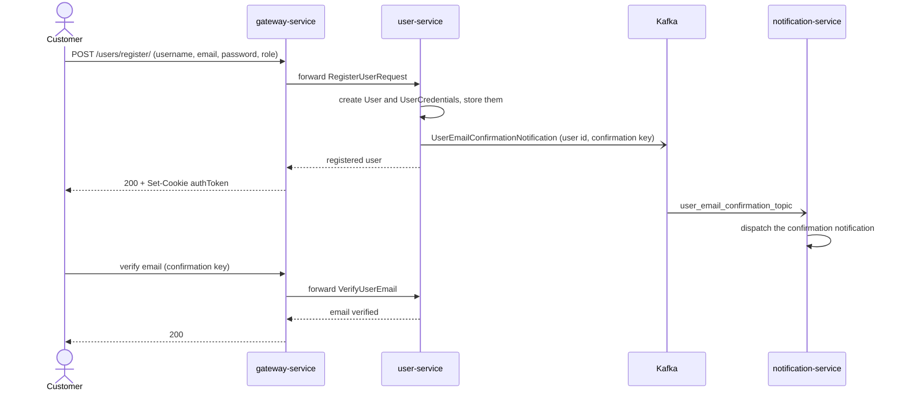
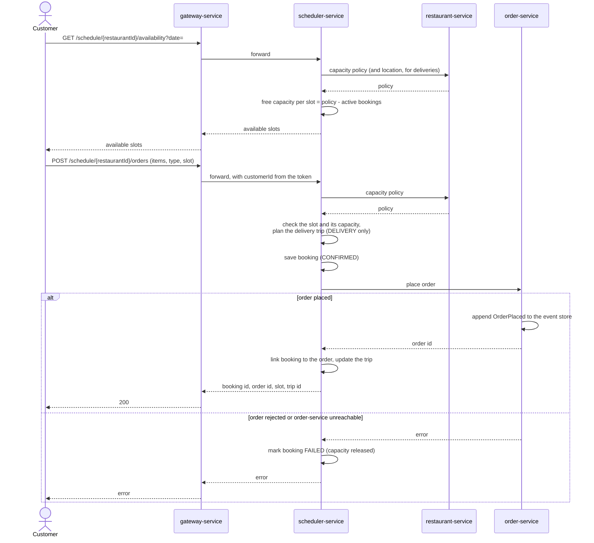
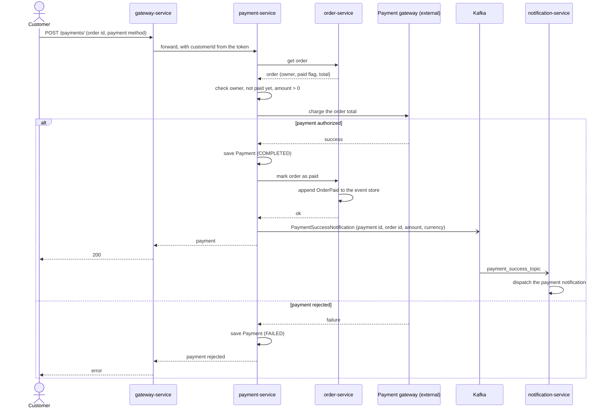
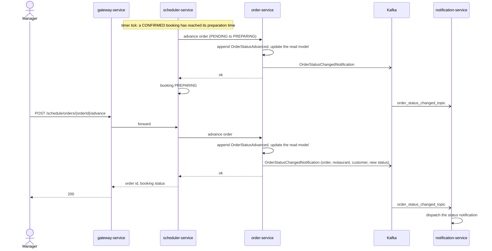
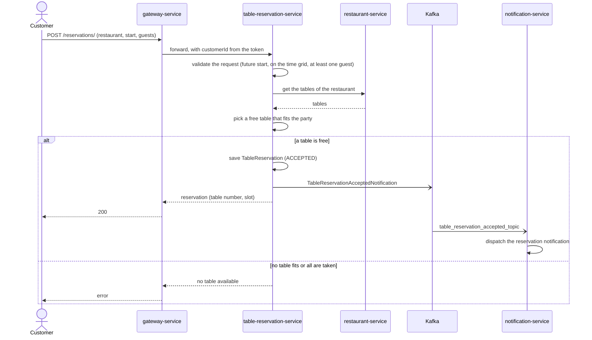

# Interactions

This page shows how the microservices collaborate at run time, through the main flows of the system. The static view,
which service exists and which one it may call, is in [General Architecture](general-architecture.md); the
patterns behind the flows are described in [Microservices Patterns](microservices-patterns.md).

All the flows follow the same rules:

- The frontend talks only to `gateway-service`. The gateway authenticates the request from the `authToken` cookie,
  checks the role the route requires, and writes the caller's id taken from the token into the forwarded request, so
  a client can never act on behalf of another user.
- Services call each other synchronously over REST, directly and not through the gateway, behind an outbound port of
  the caller.
- Kafka is used only towards `notification-service`. Publishing is the last step of a flow and never decides its
  outcome: the caller already has its answer when the event is sent.

In the diagrams, solid arrows are synchronous REST calls and dashed arrows are their responses; arrows marked
`Kafka` are asynchronous events. The login flow is shown with the API Gateway pattern in
[Microservices Patterns](microservices-patterns.md#1-api-gateway-gateway-service-expressjs).

| Flow                                                            | Services involved                                                              | Style                       |
|-----------------------------------------------------------------|--------------------------------------------------------------------------------|-----------------------------|
| [Registering a user](#registering-a-user)                       | gateway, user, notification                                                    | REST, then Kafka            |
| [Choosing a time slot and placing an order](#choosing-a-time-slot-and-placing-an-order) | gateway, scheduler, restaurant, order                  | REST, orchestrated          |
| [Paying an order](#paying-an-order)                             | gateway, payment, order, notification                                          | REST, then Kafka            |
| [Advancing an order](#advancing-an-order)                       | gateway, scheduler, order, notification                                        | REST or timer, then Kafka   |
| [Reserving a table](#reserving-a-table)                         | gateway, table-reservation, restaurant, notification                           | REST, then Kafka            |

## Registering a user

Registration is complete as soon as `user-service` has stored the user: the customer receives the token and can use
the system. The confirmation of the email address is a separate, later step, triggered by the notification.

## Choosing a time slot and placing an order

A customer does not place an order directly on `order-service`: the order goes through `scheduler-service`, which
decides whether the kitchen, and for a delivery the drivers, can take it in the requested slot.

`scheduler-service` is the orchestrator of this flow, and its two local steps are ordered to keep the two services
consistent without a distributed transaction:

- the booking is saved **before** the remote call, so two concurrent requests cannot both take the last capacity of a
  slot;
- if `order-service` rejects the order or cannot be reached, the booking is marked `FAILED`, which releases the
  capacity: this is the compensating action of the flow;
- the delivery trip is changed only **after** the order exists, so a failed placement never leaves a stop without an
  order.

A slot that is full is answered with a conflict, and the customer is asked to request the availability again and
choose another slot.

## Paying an order

The amount is never taken from the client: `payment-service` charges the total that `order-service` computed from the
menu prices, and the customer only chooses the payment method. An order that belongs to another customer, or that is
already paid, is refused before any money moves.

Once the payment is stored as `COMPLETED`, the two follow-up steps, marking the order as paid and publishing the event,
are best-effort and independent of each other. If `order-service` or the broker is unavailable, the failure is logged
and the customer still receives the successful payment: the payment is not rolled back, and no compensation or retry
is implemented yet. In that case the order stays unpaid in `order-service` although the payment exists, which is the
main consistency gap left in the system.

## Advancing an order

An order moves through `PENDING → PREPARING → READY → COMPLETED`, with `ON_THE_WAY` before `COMPLETED` for deliveries.
The first step is taken by the system, the others by the manager.

`scheduler-service` knows when each order must enter the kitchen: the start of its slot minus the preparation lead
time of the restaurant. A timer starts the preparation at that moment, so the manager does not have to. Every later
transition is requested by the manager and forwarded to `order-service`, which is the only owner of the order's state:
the scheduler never changes an order itself, it only asks.

Inside `order-service` each transition is an event appended to the order's stream, and the read model used by the
order lists is updated by the projector (see Event Sourcing and CQRS in
[Microservices Patterns](microservices-patterns.md#5-event-sourcing-order-service)).

## Reserving a table

The tables belong to the Restaurant context, so `table-reservation-service` reads them from `restaurant-service` at
every request and keeps only the reservations. Reading the free tables and storing the reservation are two separate
steps, so a concurrent request may take the same table in between: the repository detects it, and the next candidate
table is tried until one is stored or none is left.

Modifying and cancelling a reservation follow the same shape, and publish `TableReservationModifiedNotification` and
`TableReservationCanceledNotification`. As for payments, the event is published after the reservation is stored and is
not awaited: a slow or unreachable broker neither delays nor fails the answer to the customer.

## What the flows have in common

| Concern                    | How it is handled                                                                                                   |
|----------------------------|---------------------------------------------------------------------------------------------------------------------|
| Identity                   | Taken from the token by the gateway and written into the forwarded request; never trusted from the client body      |
| Ownership of data          | A service reads another context's data through its REST API at the moment it needs it, and does not keep a copy     |
| Consistency across services | Local step first, remote call second, compensating step on failure (placing an order); best-effort where the local result is already final (payment, notifications) |
| Notifications              | Published after the local state is durable, with a payload that carries everything the consumer needs               |
| Tracing                    | Calls and Kafka messages carry the `traceparent` header, so a flow is a single trace; `scheduler-service` is not instrumented yet |
