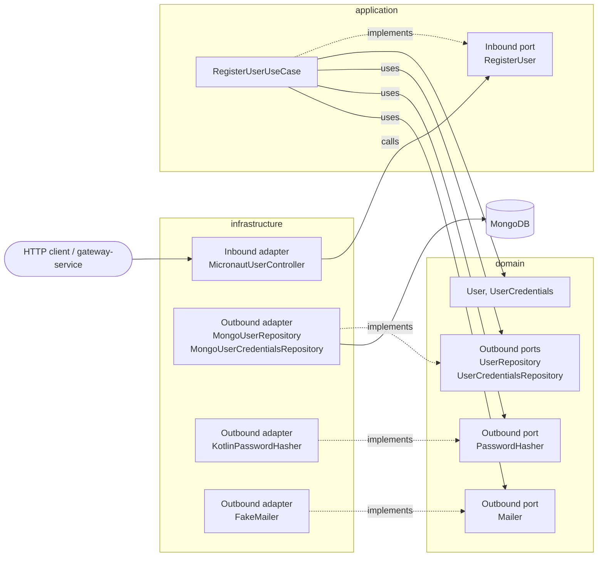

# Hexagonal Architecture

Every backend microservice of _Munchies_ is structured as a hexagonal (ports & adapters) architecture inside the DDD
layering. The package layout and the aggregates are described in
[Domain Model](../01-Domain%20Driven%20Design/domain-model.md); this page shows how ports and adapters are realised in
the code and how the dependency rule is checked.

The reference service is `user-service` (Kotlin + Micronaut). It persists the current state of its aggregates with
plain CRUD, so it shows the hexagon without any other pattern on top. `order-service`, which adds event sourcing and
CQRS, is covered in the dedicated sections.

## Layers and the dependency rule

| Layer            | Content                                                                            | May depend on              |
|------------------|------------------------------------------------------------------------------------|----------------------------|
| `domain`         | `User`, `UserCredentials`, value objects, **outbound ports**                       | `commons` only             |
| `application`    | One **inbound port** per use case, the use case implementing it                    | `domain`                   |
| `infrastructure` | **Adapters**: REST controller, MongoDB, in-memory, Kafka, hashing, mail, DI wiring | `application` and `domain` |

Dependencies point only inward. Inbound calls follow that direction (controller -> inbound port -> use case ->
domain). Outbound calls (persisting, hashing, sending mail) are inverted: the domain declares the interface, the
infrastructure implements it, and the adapter is injected into the use case at startup.



Solid arrows are calls, dashed arrows are `implements` relations.

## Ports

### Inbound ports (driving)

One interface per use case in `application/port/inbound` (`RegisterUser`, `LoginUser`, `GetUser`, `UpdateUserInfo`,
`UpdateUserPassword`, `VerifyUserEmail`, `DeleteUser`), implemented by the use case; the controller depends only on
these interfaces. The outcome is a sealed type, so every failure is part of the contract and the controller must map it
explicitly:

```kotlin
// user-service: application/port/inbound/RegisterUser.kt
interface RegisterUser {
    fun execute(user: User, credentials: UserCredentials): RegisterUserResult

    companion object {
        sealed interface RegisterUserResult {
            data class Success(val user: User) : RegisterUserResult
            data object UserIsAlreadyRegistered : RegisterUserResult
            data class Failure(val reason: String) : RegisterUserResult
        }
    }
}
```

The inputs are already domain objects: the controller builds `User` and `UserCredentials` from the request with
`UserDTOFactory.toDomain()`, so these use cases do not take a Command object.

### Outbound ports (driven)

Declared in `domain/port`, one per external dependency:

| Outbound port               | What it abstracts                                                         |
|-----------------------------|---------------------------------------------------------------------------|
| `UserRepository`            | CRUD persistence of `User`, plus `findByEmail` and `findByUsername`       |
| `UserCredentialsRepository` | CRUD persistence of `UserCredentials`, plus login attempts counters       |
| `PasswordHasher`            | Salt generation and password hashing                                      |
| `Mailer`                    | Sending the verification email                                            |
| `TimeProvider`              | Current time, so that login lockout and expiry are deterministic in tests |

The repositories extend the generic `Repository<Id, Entity>` of the `commons` module, which provides the CRUD
operations; the domain-specific queries are added on top. The ports are expressed in domain terms (`User`, `UserId`,
`MailerResult`), so nothing Mongo- or SMTP-specific crosses the boundary.

## Adapters

### Inbound (primary) adapter

`MicronautUserController` (`infrastructure/adapter/inbound/web/controller`) implements the `UserAPI` contract. For each
endpoint it validates the request, maps the DTO to domain objects
(`adapter/dto/factory`), calls the matching inbound port and translates the sealed result into an HTTP response, or
into an exception handled by `ExceptionHandlers`. It holds no business rules.

### Outbound (secondary) adapters

Each outbound port is implemented in `infrastructure/adapter/outbound/<technology>`:

| Port                        | Adapter                           | Package           |
|-----------------------------|-----------------------------------|-------------------|
| `UserRepository`            | `MongoUserRepository`             | `outbound/mongo`  |
| `UserRepository`            | `MemoryUserRepository`            | `outbound/memory` |
| `UserCredentialsRepository` | `MongoUserCredentialsRepository`  | `outbound/mongo`  |
| `UserCredentialsRepository` | `MemoryUserCredentialsRepository` | `outbound/memory` |
| `PasswordHasher`            | `KotlinPasswordHasher`            | `outbound/hash`   |
| `Mailer`                    | `FakeMailer`                      | `outbound/mail`   |

The Mongo adapters translate between domain objects and documents through `outbound/mongo/factory`, so the document
classes never reach the domain:

```kotlin
// domain/port/UserRepository.kt  (port, inner layer)
interface UserRepository : Repository<UserId, User> {
    fun findByEmail(email: String): User?
    fun findByUsername(username: String): User?
}

// infrastructure/adapter/outbound/mongo/repository/MongoUserRepository.kt  (adapter, outer layer)
@Singleton
class MongoUserRepository(
    private val repository: MongoCrudUserRepository,
) : UserRepository {
    override fun findById(id: UserId): User? = repository.findById(id.value).map {
        it.toNullableDomain()
    }.orElse(null)
    // ...
}
```

Two adapters implement the same port, the Mongo one and an in-memory one, and the use cases are identical with both.
The in-memory adapters are what allows the BDD tests to run with no database.

## Dependency injection and composition root

Use cases are plain classes with no framework annotations: they receive their ports through the constructor, which
makes `RegisterUserUseCase` a class that knows nothing about Mongo, SMTP or hashing algorithms:

```kotlin
// application/usecase/RegisterUserUseCase.kt
class RegisterUserUseCase(
    private val userRepository: UserRepository,
    private val credentialsRepository: UserCredentialsRepository,
    private val hasher: PasswordHasher,
    private val mailer: Mailer,
) : RegisterUser { /* ... */ }
```

The binding is done in a single place of the infrastructure layer, the _composition root_ `UserBeans`:

```kotlin
// infrastructure/adapter/inbound/web/config/UserBeans.kt
@Factory
class UserBeans {
    @Singleton
    fun registerUser(
        userRepository: UserRepository,
        userCredentialsRepository: UserCredentialsRepository,
        hasher: PasswordHasher,
        mailer: Mailer,
    ): RegisterUser = RegisterUserUseCase(userRepository, userCredentialsRepository, hasher, mailer)
}
```

Micronaut injects the adapter bound to each port. `UserBeans` also exposes the use
cases grouped in `UserServices`, the single dependency of the controller. In `payment-service` (Express.js) the same
role is played by `PaymentBeans`.

## Verification

### Architecture tests

The dependency rule is enforced automatically by the `architecture-rules` module with
[Konsist](https://docs.konsist.lemonappdev.com/). A service opts in by extending `ArchitectureKonsistTest`
(currently `user-service` and `restaurant-service`):

```kotlin
class UserArchitectureKonsistTest : ArchitectureKonsistTest("user")
```

The base class defines the `domain`, `application` and `infrastructure` layers of the service and asserts:

```kotlin
domainLayer.dependsOn(commonsLayer)               // domain depends on nothing except commons
applicationLayer.dependsOn(domainLayer)
infrastructureLayer.dependsOn(applicationLayer, domainLayer)
```

A further rule requires every class with the `UseCase` suffix to reside in `application.usecase`. The check runs in the
`check` task, hence in the pre-push hook and in CI.

### Test pyramid

The style determines how each element is tested in `user-service`:

| Element                    | Test                                     | Notes                                                                             |
|----------------------------|------------------------------------------|-----------------------------------------------------------------------------------|
| Domain model and factories | Unit tests                               | Pure objects, no framework (`UserFactoryTest`)                                    |
| Use cases                  | Unit tests with mocked ports             | e.g. `RegisterUserUseCaseTest` mocks `UserRepository`, `PasswordHasher`, `Mailer` |
| Use cases                  | BDD (Cucumber) on the in-memory adapters | Feature files in `src/test/resources/features`, wired by `TestServicesFactory`    |
| Controller                 | Unit tests                               | `MicronautUserControllerTest`                                                     |
| Mongo adapters             | Integration tests                        | `Mongo*RepositoryIntegrationTest` against a real MongoDB                          |
| Whole service              | Component tests                          | HTTP calls against the running service; other microservices mocked                |
