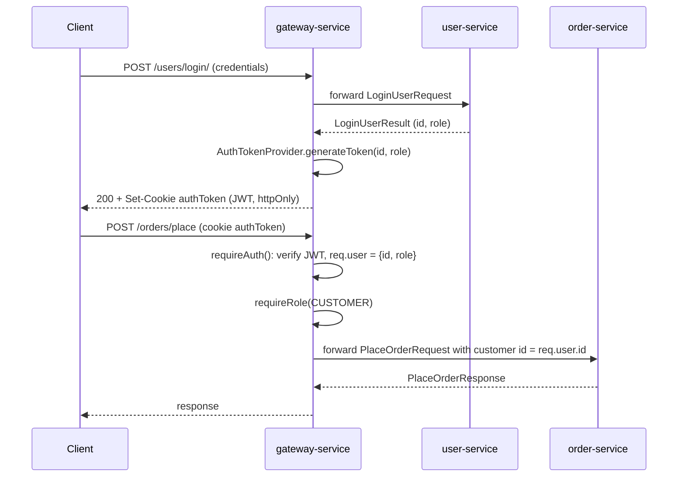

# Microservices Patterns

_Munchies_ is a restaurant management system split into independent microservices, each one owning a single domain and
its own MongoDB database.
Services are implemented with Kotlin + Micronaut or Express.js and are exposed to the frontend through a single API
Gateway.

Services collaborate synchronously over REST. Asynchronous communication through Apache Kafka is confined to the
`notification-service`, which reacts to events published by the other services. The whole system is packaged in Docker
containers and runs on Kubernetes, with Docker Compose files for local integration.

This section lists the microservices patterns applied in the project, following the taxonomy of Chris Richardson's
_Microservices Patterns_. The internal structure of each service is described separately in
[Hexagonal Architecture](hexagonal-architecture.md).

| Pattern                    | Technology                                | Where                                    |
|----------------------------|-------------------------------------------|------------------------------------------|
| API Gateway                | Express.js, JWT in an HTTP-only cookie    | `gateway-service`                        |
| Event-Driven Architecture  | Apache Kafka (`kafkajs`, Micronaut Kafka) | `notification-service` and its producers |
| Observability              | Prometheus, Loki, Alloy, Grafana          | every service, `observability/`          |
| Database per Service       | MongoDB, one instance per service         | every service                            |
| Event Sourcing             | MongoDB append-only collection            | `order-service`                          |
| CQRS                       | Projector + read-model collection         | `order-service`                          |
| Service Discovery          | Kubernetes Services and DNS               | Helm chart, `k8s/`                       |
| Externalized Configuration | Environment variables, Helm values        | every service                            |
| Service per Container      | Docker, Kubernetes, Helm, HPA             | every service                            |

## Patterns

### 1. API Gateway — _gateway-service_ (Express.js)

`gateway-service` is the single entry point of the backend for `frontend-service`. It holds no business logic and has
no `domain` or `application` layer: it only authenticates, authorizes and forwards requests to `user-service`,
`restaurant-service` and `order-service`.

**Routes from shared contracts.** Each route is a class extending the API contract published by the target service in
its `-shared` module. For example, `PlaceOrderRoute` extends
`PlaceOrderAPI` from `munchies-order-service-shared`, and takes from it the path, the HTTP method, the required role and
the request/response (de)serializers. Path and payload of the gateway therefore cannot drift from the service they
proxy: a change in the contract breaks the gateway build.

```typescript
export class PlaceOrderRoute
    extends PlaceOrderAPI<PlaceOrderResponse | ErrorResponse>
    implements SimpleRoute<PlaceOrderResponse> {
    constructor() {
        super();
        this.path = this.getPath();
        this.method = this.getMethod();
        this.authRole = this.getRequiredAuthRole();
    }

    // forward(): parses the body, adds the caller's id taken from the token, calls ORDER_SERVICE_URL + path
}
```

`applyRoutes()` registers all the routes of the three services and builds, for each one, a chain of Express
middlewares: request logging, then `requireAuth()` and `requireRole(role)` when the contract declares a role, then the
forwarding handler.

**Authentication and authorization.** Authentication is centralized in the gateway. `user-service` only checks the
credentials; the gateway issues the token, validates it on every request and enforces the role. Downstream services
receive requests that are already authenticated and never handle tokens.



On login, the gateway issues a JWT signed with the `JWT_SECRET` key, carrying the user id and role, valid for 7 days:

```typescript
// middleware/token.ts
generateToken(id
:
UUIDEntityId, role
:
AuthRole
):
GenerateTokenResult
{
    if (!this.secret) return new GenerateTokenFailure("Secret is missing");
    const nowSeconds = Math.floor(Date.now() / 1000);
    const payload: TokenClaims = {
        sub: id.value,
        [ID_CLAIM]: id.value,
        [ROLE_CLAIM]: role.name,
        exp: nowSeconds + 60 * 60 * 24 * 7,
        iat: nowSeconds,
    };
    return new GenerateTokenSuccess(jwt.sign(payload, this.secret));
}
```

**Forwarding.** All upstream calls go through a single `axios` client with a 10 s timeout, which logs method, URL and
status but never the payload, since it may contain credentials or personal data. Upstream `4xx`/`5xx` responses are
returned to the client with their original status code and `ErrorResponse` body.

### 2. Event-Driven Architecture — _notification-service_ with Apache Kafka

Event-driven communication is confined to `notification-service`: it is the only service that consumes Kafka topics and
reacts to them, and it has no `application` layer. The other
services stay REST-based and add a single, narrow Kafka producer for each event that is notification-bound.

| Topic                           | Producer          | Event                               | Payload                                          |
|---------------------------------|-------------------|-------------------------------------|--------------------------------------------------|
| `user_email_confirmation_topic` | `user-service`    | `UserEmailConfirmationNotification` | user id, confirmation key                        |
| `payment_success_topic`         | `payment-service` | `PaymentSuccessNotification`        | payment id, order id, amount, currency           |
| `order_status_changed_topic`    | `order-service`   | `OrderStatusChangedNotification`    | order id, restaurant id, customer id, new status |

**Event-carried state transfer.** Each payload carries everything the consumer needs, so `notification-service` never
calls back into the producing service.

**Shared message schemas.** Topic names, consumer group ids and payload classes are defined once, in the `-shared`
module of the producer (e.g. `OrderStatusChangedNotificationInfo` and `OrderStatusChangedNotification` in
`order-shared`), with JSON (de)serialization. The Kotlin producer and the TypeScript consumer use the same compiled
definition, so the schema is not duplicated by hand.

**Consumers.** `notification-service` starts one consumer per topic, each with its own consumer group. Consumers are
started independently: a startup failure on one topic is logged and does not prevent the others from starting. Each
consumer parses the message with the shared `...FromJson` function and forwards the event to `NotificationController`,
the single place where dispatching is handled. The whole pipeline is asynchronous, so a slow message on one topic does
not block the others.

**Producers.** On the producer side the event is published behind an outbound port, e.g. `OrderNotificationPublisher`
implemented by `KafkaOrderNotificationPublisher` in `order-service`, and `PaymentNotificationPublisher` implemented by
`KafkaPaymentNotificationPublisher` in `payment-service`.

At the moment `NotificationController` only logs each event and increments the `notifications_received_total` metric;
the actual channels (email, SMS, WebSocket push to the frontend) are not implemented yet and will be plugged into its
`handle*`
methods.

### 3. Observability — Health checks, Prometheus, Loki, Grafana

Observability covers three of the observability patterns: **health check API**, **application metrics** and **log
aggregation**. The monitoring stack lives in `observability/` and is installed together with the services by
`./gradlew deploy`.

**Health check API.** Every service exposes `/health`, which the Helm chart and the manifests under `k8s/` use as the
Kubernetes `readinessProbe`: a
pod receives traffic only when it reports itself as ready. For the Micronaut services, `micronaut-commons` adds
`MongoHealthIndicator`, which pings MongoDB, because Micronaut only provides a health indicator for the reactive Mongo
driver. As a result, `/health` also reflects the database connection.

**Application metrics.** Each service exposes Prometheus metrics, and Prometheus discovers them through pod annotations
(`prometheus.io/scrape`, `path`, `port`) added by the Helm chart. No service knows where Prometheus is.

| Service                                               | Library                          | Endpoint      |
|-------------------------------------------------------|----------------------------------|---------------|
| `user-service`, `order-service`, `restaurant-service` | Micrometer + Prometheus registry | `/prometheus` |
| `gateway-service`, `payment-service`                  | `prom-client`                    | `/metrics`    |
| `notification-service`                                | `prom-client`                    | `/metrics`    |

The two stacks publish request latency under the same name and labels (`http_server_requests_seconds`, with `method`,
`uri` and `status`), so a single query covers every service. `uri` contains the route template, not the concrete path,
to keep the number of series bounded. `notification-service` has no business HTTP traffic and publishes
`notifications_received_total` by notification type instead. `kube-state-metrics` and cAdvisor add replica, HPA and
per-pod CPU data.

**Log aggregation.** Services only write structured JSON logs to stdout. Grafana Alloy discovers the pods of the
application namespaces, tails their logs through the Kubernetes API and pushes them to Loki, labelled with `namespace`,
`pod`, `container`, `app` and `level`.

**Dashboards.** Grafana is provisioned with the Prometheus and Loki datasources and three dashboards: _Services_ (rate,
errors, latency), _Scaling_ (ready replicas, HPA desired vs current replicas, CPU against requests) and _Logs_. Together
with the `loadtest/` k6 job, they turn a load test into time series to check scaling behaviour.

Distributed tracing, exception tracking and audit logging are not implemented.

### 4. Database per Service — MongoDB

Each service owns a dedicated MongoDB instance, and no other service accesses it:

- on Kubernetes, the Helm chart creates for each service (`mongodb.enabled: true`) its own MongoDB `StatefulSet` and
  `PersistentVolumeClaim` in the service's namespace, e.g. `order-mongodb.order-service.svc.cluster.local`;
- in Docker Compose, each service has its own Mongo container (`munchies-order-mongo`, `munchies-user-mongo`, ...);
- each service reads only its own `MONGODB_URI`.

When a service needs data owned by another one, it goes through that service's REST API, behind an outbound port. For
example, `payment-service` marks an order as paid through `OrderServiceClient`, implemented by `OrderServiceHttpClient`
calling `order-service`; it does not write the order collection.

The PVCs are annotated with `helm.sh/resource-policy: keep`, so uninstalling a service does not delete its data unless
explicitly requested (`./gradlew undeploy -PwipeData=true`).

### 5. Event Sourcing — _order-service_

Event sourcing is used only in `order-service`, on the `Order` aggregate; every other service persists its current
state with plain CRUD.

The state of an order is never saved as a whole: each command produces domain events (`OrderPlaced`,
`OrderStatusAdvanced`, `OrderPaid`, `OrderItemsUpdated`, `DeliveryInfoUpdated`, `TakeawayInfoUpdated`,
`OrderCancelled`), which are appended to the order's stream in the `order_events` collection through the
`OrderEventStore` port. To execute a command, the use case loads the stream, rebuilds the aggregate by replaying it,
and appends the new events with the version it read. A unique index on (order id, sequence) rejects concurrent appends,
which are reported as `ConcurrentOrderModificationException` (optimistic concurrency).

The design of the aggregate and of its events is described in the dedicated Event Storming / CQRS section.

### 6. CQRS — _order-service_

On top of the event store, `order-service` separates the write side from the read side:

- **command side**: command use cases depend only on `OrderEventStore` (`order_events` collection);
- **query side**: `GetOrders` and `GetOrderDetails` depend only on `OrderViewRepository`, which reads the denormalized
  `OrderView` documents of the `order_views` collection;
- **projection**: after every successful append, `MongoOrderEventStore` publishes an in-process `OrderEventsAppended`
  event, and `OrderViewProjector` folds the new events into the view. The projector is the only writer of the read
  model; if it detects a gap in the sequence, it rebuilds the view from the full stream.

The wiring of the two sides is kept separate in `OrderBeans` and `OrderProjectionBeans`. More details are given in the
dedicated Event Storming / CQRS section.

### 7. Service Discovery — Kubernetes DNS

No dedicated service registry is used: discovery is delegated to the platform.

- Each service runs in its own Kubernetes namespace and is exposed by a `Service` resource. Kubernetes keeps track of
  the pods behind it (third-party registration) and balances the requests among the replicas created by the HPA
  (server-side discovery).
- Callers address services by their stable DNS name, e.g.
  `http://order-service.order-service.svc.cluster.local:8080`, or `kafka-0.kafka-headless.kafka.svc.cluster.local:9092`
  for the broker.
- These names are not hard-coded: they are injected as environment variables (`USER_SERVICE_URL`,
  `RESTAURANT_SERVICE_URL`, `ORDER_SERVICE_URL`, `KAFKA_BOOTSTRAP_SERVERS`, `MONGODB_URI`).

In Docker Compose the same variables point to the Compose service names (`http://order-service:8080`), resolved by the
Docker network DNS. The code is identical in the two cases.

### 8. Externalized Configuration — Helm values

Everything that depends on the deployment is supplied from outside the image, through environment variables:
addresses of the other services, of Kafka and of MongoDB, log format (`LOG_FORMAT=json`), port.

- **Micronaut services** read them in `application.yml` through placeholders with a local default, e.g.
  `uri: ${MONGODB_URI:mongodb://localhost:27017/orders}`.
- **Express services** read them from `process.env` (e.g. `ORDER_SERVICE_URL` in `OrderServiceHttpClient`), and return
  an explicit error when a required one is missing.
- **On Kubernetes**, the values are kept in `helm/values/<service>.yaml`, which overrides only what differs from the
  documented defaults of the generic chart (`helm/munchies-service/values.yaml`).
- **In Docker Compose**, they are kept in the `environment` section of `config/service/docker-compose.yml`.

The same image therefore runs unchanged on a laptop, in Compose and on the cluster.

### 9. Service per Container — Docker and Kubernetes

Each service is packaged as its own Docker image (`<name>-service:latest`) by the Gradle build: the Micronaut plugin for
the Kotlin services, a generated Dockerfile for the Express ones. Each instance runs in its own container.

On Kubernetes, all services are deployed with the same generic Helm chart, `helm/munchies-service`. It replaced the
manifests under `k8s/` that were almost identical copies of each other. The chart renders:

- a `Deployment` with resource requests and limits, readiness probe and Prometheus annotations;
- a `Service`;
- optionally, a `HorizontalPodAutoscaler`, enabled for `gateway-service`, `user-service`, `restaurant-service` and
  `order-service` (1 to 4 replicas, target 60% CPU, with fast scale-up and damped scale-down);
- optionally, the dedicated MongoDB of the service.

`./gradlew deploy` deploys Kafka first and then every service, each in its own namespace; `-Pservice=<name>` deploys a
single one. The services not yet migrated to the chart (`payment-service`, `notification-service`,
`table-reservation-service`) and Kafka are still deployed from the manifests under `k8s/`.
