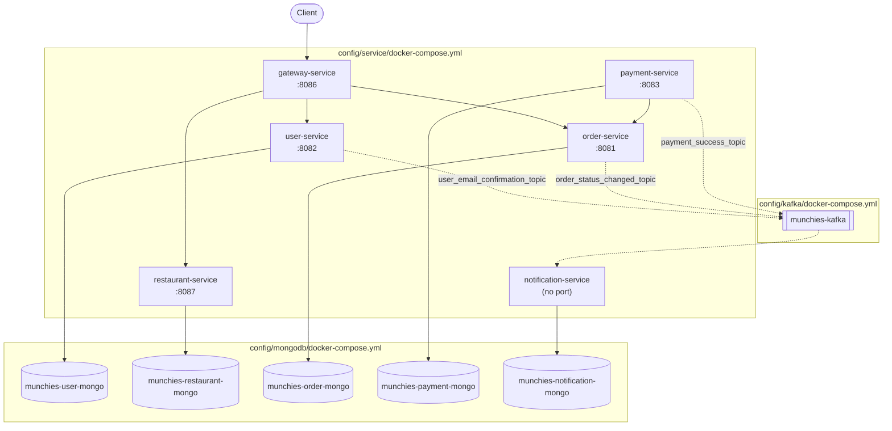

# Deployment with Docker Compose

The whole backend can be started on a single machine with Docker Compose: every microservice, its MongoDB and the
Kafka broker run as separate containers on the same Docker network.

Docker Compose is used mainly for development: it brings up the complete system locally with one command, to run and
debug the services together. The production deployment runs on Kubernetes, which adds what Compose does not provide,
such as autoscaling and the monitoring stack, and is described in a separate section. The two setups use the same
images and the same environment variables.

## Building the images

Each service is packaged in its own image by the Gradle build, through the convention plugins in `build-logic`. The
build context of every image is generated in `<service>/build/docker/main`, which is the `build.context` used by
Compose.

| Stack              | Gradle task                           | Base image               | Content of the image                                                                                                                                |
|--------------------|---------------------------------------|--------------------------|-----------------------------------------------------------------------------------------------------------------------------------------------------|
| Kotlin + Micronaut | `dockerfile` + `buildLayers`          | `eclipse-temurin:21-jre` | Dependencies, project libraries, application and resources copied as separate layers; started with `java -jar application.jar`                      |
| Express.js         | `dockerCreate` (generated Dockerfile) | `node:<version>-alpine`  | Sources, `package.json`/lock, `tsconfig.json` and the `-shared` tarballs from `build/libs`; built with `npm run build` and started with `npm start` |

The Micronaut image is split into layers (third-party libraries, project libraries, application), so a rebuild after a
code change only replaces the application layer. The Express image also includes the local `.tgz` tarballs of the
`-shared` modules it depends on (e.g. `munchies-order-service-shared`), since they are not published to a registry.

`composeBuild` depends on these tasks for every service module, Kotlin or JavaScript, so starting Compose always runs
on freshly built images.

## Container split

The stack is described by three Compose files under `config/`, one per kind of component. They are loaded together as a
single Compose project, so services in one file can depend on containers defined in another.



Solid arrows are REST calls or database connections, dashed arrows are Kafka messages.

### `config/service` — the microservices

One container per microservice, named `munchies-<name>-service` and built from the image described above. Every
container listens on port `8080` internally; only the port needed for local access is published on the host:

| Container                       | Host port | Depends on (must be healthy)                          |
|---------------------------------|-----------|-------------------------------------------------------|
| `munchies-gateway-service`      | `8086`    | `user-service`, `restaurant-service`, `order-service` |
| `munchies-user-service`         | `8082`    | Kafka, `munchies-user-mongo`                          |
| `munchies-restaurant-service`   | `8087`    | Kafka, `munchies-restaurant-mongo`                    |
| `munchies-order-service`        | `8081`    | Kafka, `munchies-order-mongo`                         |
| `munchies-payment-service`      | `8083`    | Kafka, `munchies-payment-mongo`, `order-service`      |
| `munchies-notification-service` | none      | Kafka, `munchies-notification-mongo`                  |

`notification-service` publishes no port, since it exposes no API and only receives messages from Kafka.

The common parts of the definitions are written once as YAML anchors and merged into each service:

- `x-service-common`: the shared network and the `host.docker.internal` host;
- `x-kafka-env` and `x-kafka-dependency`: the broker address (`KAFKA_BOOTSTRAP_SERVERS=munchies-kafka:9092`) and the
  dependency on a healthy broker;
- `x-micronaut-healthcheck`: the healthcheck of the Micronaut services.

### `config/mongodb` — one database per service

One `mongo:7.0` container per service (`munchies-<name>-mongo`), each with its own named volume
(`mongo_<name>_data`). Each service receives only the URI of its own database (e.g.
`MONGODB_URI=mongodb://munchies-order-mongo:27017/order-service`), so no service can reach another service's data.
Each database is also published on a distinct host port (`27018`–`27024`) to inspect it locally.

### `config/kafka` — the message broker

A single `apache/kafka:4.3.1` broker in KRaft mode (broker and controller in the same process, no ZooKeeper). The
services reach it at `munchies-kafka:9092` on the Compose network. Topics are created automatically on first use.

## Service discovery and configuration

The containers reach each other through the DNS of the Compose network, using the service or container name. The
addresses are passed as environment variables, the same ones used on Kubernetes, so the images are identical in the two
environments:

```yaml
gateway-service:
  environment:
    USER_SERVICE_URL: http://user-service:8080
    RESTAURANT_SERVICE_URL: http://restaurant-service:8080
    ORDER_SERVICE_URL: http://order-service:8080
```

## Startup order and healthchecks

`depends_on` with `condition: service_healthy` makes Compose start a container only after its dependencies report
themselves healthy, so the stack comes up in the order databases and broker, then services, then gateway:

| Component          | Healthcheck                                                          |
|--------------------|----------------------------------------------------------------------|
| MongoDB            | `mongosh --eval "db.adminCommand('ping')"`                           |
| Kafka              | `kafka-broker-api-versions.sh --bootstrap-server localhost:9092`     |
| Micronaut services | `curl --fail http://localhost:8080/health`                           |
| `gateway-service`  | `wget http://localhost:8080/health` (the Alpine image has no `curl`) |

The Kafka healthcheck queries the broker API instead of only checking that the port is open: the port accepts
connections before the KRaft controller has finished electing itself, and services starting at that moment would fail
to create their topics. For the Micronaut services, `/health` also includes the MongoDB check provided by
`MongoHealthIndicator`, so a service is healthy only when its database is reachable.

`payment-service` and `notification-service` do not define a healthcheck yet; `payment-service` waits for
`order-service`, which it calls to mark orders as paid.

## Running the stack

The stack is driven by Gradle through the `com.avast.gradle.docker-compose` plugin, configured in `build-logic` with
the three Compose files:

```bash
./gradlew composeUp               # build the images, then start every container
./gradlew composeDown             # stop and remove the containers, keeping the volumes
./gradlew composeDown -Preset     # also remove the MongoDB volumes
```

`composeUp` builds the images first and then waits until the published ports are open. Data survives a `composeDown`:
volumes are removed only when `-Preset` is passed.

For deploying on a host, `scripts/deploy.sh` wraps the same cycle: it pulls the latest code (or clones the repository),
runs `composeDown` and `composeUp`, and then polls the `/health` endpoint of every published service until it answers
`200`.
