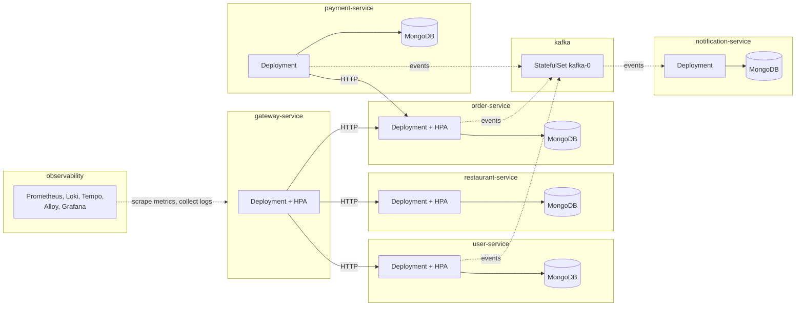
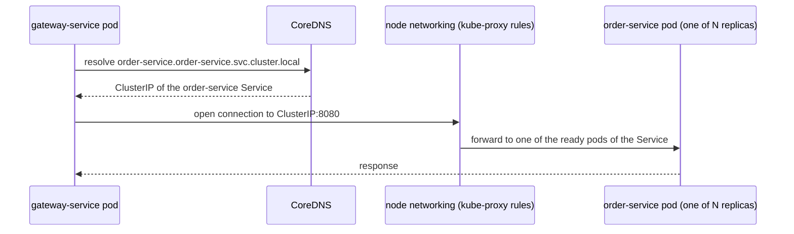

# Deployment on Kubernetes

Kubernetes is the production deployment of Munchies. It runs images built by the same Gradle tasks, with the same environment
variables, as [Docker Compose](docker-compose.md), and adds what Compose cannot provide: per-service isolation, self-healing,
horizontal autoscaling and an always-on monitoring stack. The cluster used throughout the project is a single-node
Minikube.

This page describes the deployment from the architecture side: how the system is laid out in the cluster, how each
pod is configured, and how scaling is tied to service level objectives. The Gradle automation that builds the images
and applies the resources is covered in the SPE report ([Deployment](../../spe/04-deployment.md)); the scaling
behaviour is verified under real load in the [Scaling Benchmark](scaling-benchmark.md).

## Cluster layout

Every microservice runs in its own namespace, named after the service, and every service that stores data has its own
MongoDB in that namespace (`gateway-service`, which stores nothing, has none). The bounded
context boundary of the code is therefore also a boundary in the infrastructure: a service's database is reachable
only through that service, and each one can be deployed, scaled or removed on its own.



The diagram leaves out `table-reservation-service`, which is deployed the same way as `payment-service` but is still a
stub, and draws the observability links for one namespace only: the stack scrapes and collects from every application
namespace.

Services find each other through Kubernetes DNS (`<service>.<namespace>.svc.cluster.local`), passed to each pod as an
environment variable, as described in [Service discovery](#service-discovery) below. The `Service` in front of each
Deployment balances requests across however many replicas the autoscaler is currently running, so callers never need
to know how many there are.

| Workload | Deployed from | Own MongoDB | Autoscaled |
|---|---|---|---|
| `gateway-service` | Helm chart `helm/munchies-service` | no | yes |
| `user-service` | Helm chart | yes | yes |
| `restaurant-service` | Helm chart | yes | yes |
| `order-service` | Helm chart | yes | yes |
| `payment-service` | manifests under `k8s/` | yes | no |
| `notification-service` | manifests under `k8s/` | yes | no |
| `table-reservation-service` | manifests under `k8s/` | yes | no |
| Kafka | manifest under `k8s/kafka/` | n/a | no |
| Observability stack | community Helm charts, `observability/values/` | n/a | no |

Kafka and the observability stack are infrastructure, not services: they keep
their data in their own storage (messages, metrics, logs, traces), not in MongoDB.

## Service discovery

In a cluster the instances of a service are not fixed: the autoscaler adds and removes replicas, and a restarted pod
comes back with a new IP address. A caller therefore cannot be configured with the address of a pod; it needs a way to
find, at the moment of the call, an instance that is currently running and healthy. This is the problem the **Service
Discovery** pattern solves.

Munchies does not implement this pattern itself: there is no service registry such as Eureka or Consul, and no
discovery client in any service. It relies on the discovery that Kubernetes provides to every workload, which Chris
Richardson's catalogue lists as _platform-provided service discovery_. This section describes how that mechanism
works, and how it maps onto the parts of the pattern.

### How a call reaches a pod

Each Deployment is fronted by a Kubernetes `Service` with a stable name and a stable virtual IP address (the
_ClusterIP_). The `Service` selects its pods by label (`app: <service>`), so it always stands for the set of replicas
running at that moment. A call from `gateway-service` to `order-service` goes through these steps:



1. The gateway takes the address of `order-service` from the `ORDER_SERVICE_URL` environment variable:
   `http://order-service.order-service.svc.cluster.local:8080`, i.e. `<service>.<namespace>.svc.cluster.local`.
2. The cluster DNS server, CoreDNS, resolves that name to the ClusterIP of the `Service`. The ClusterIP does not change
   for the lifetime of the `Service`, however many times its pods are replaced.
3. The ClusterIP is not the address of any pod. When a connection is opened to it, rules that `kube-proxy` maintains on
   every node forward it to one of the pods currently registered behind the `Service`, chosen at random.
4. That pod answers. The gateway never learns which replica it talked to, nor how many replicas exist.

### How pods are registered

The list of pods behind each `Service` is kept by Kubernetes itself, in `EndpointSlice` objects stored by the API
server. A controller of the control plane watches the pods matching the `Service`'s selector and keeps that list up to
date:

- a pod is added only once its **readiness probe** succeeds (`GET /health`, every 5 seconds, see
  [Pod configuration](#pod-configuration)); for the Micronaut services this also requires MongoDB to be reachable;
- a pod is removed when its probe starts failing, and when it is deleted, for example during a scale-in or a rollout.

No service registers itself, sends heartbeats or deregisters on shutdown: registration is done for it, from outside.

### Mapping onto the pattern

| Element of the pattern | Typical dedicated implementation (e.g. Eureka) | Munchies on Kubernetes |
|---|---|---|
| Service registry | a registry server the services call | the API server, which stores `Service` and `EndpointSlice` objects; CoreDNS answers name lookups from it |
| Registration | **self registration**: a client library in each service registers it and sends heartbeats | **third-party registration**: the control plane registers each pod from its readiness probe |
| Health of an instance | heartbeats sent by the instance | readiness probe on `/health`, the same check used for rollouts and autoscaling |
| Discovery | **client-side**: the caller queries the registry and picks an instance | **server-side**: the caller uses a DNS name, and the node's networking picks the instance |
| Load balancing | inside the client library | `kube-proxy` rules, once per connection |

### The names used in the cluster

| Caller | Target | Name | Notes |
|---|---|---|---|
| `gateway-service` | `user-service`, `restaurant-service`, `order-service` | `<service>.<namespace>.svc.cluster.local:8080` | ClusterIP `Service`, balanced across the replicas |
| `payment-service` | `order-service` | `order-service.order-service.svc.cluster.local:8080` | same |
| each service | its own MongoDB | e.g. `order-mongodb.order-service.svc.cluster.local:27017` | the manifests under `k8s/` use the short form (`payment-mongodb`), which resolves within the caller's own namespace |
| producers, `notification-service` | Kafka | `kafka-0.kafka-headless.kafka.svc.cluster.local:9092` | headless `Service` (see [Stateful components](#stateful-components)) |
| Prometheus, Alloy | every application pod | Kubernetes API, `pod` role | see below |
| clients outside the cluster | `gateway-service` | `NodePort` on the Minikube node | not discovery, only exposure |

Two cases differ from the ClusterIP path described above:

- **Kafka** is reached through a _headless_ `Service` (`clusterIP: None`), whose DNS name resolves directly to the IP of
  the broker pod instead of a virtual IP. Kafka clients need this: after the first connection, the broker tells them
  which broker to talk to by its advertised address (`KAFKA_ADVERTISED_LISTENERS`, set to the same name), and they then
  connect to that broker directly. Load balancing across brokers is done by Kafka's own protocol, not by Kubernetes.
- **Prometheus and Alloy** need every pod, not one of them, so they query the Kubernetes API for the list of pods and
  scrape or tail each one. This is the only place where **client-side** discovery is used, and the registry they query
  is again Kubernetes.

### Where the names come from

No address is written in the code. Every name above is passed to the pod as an environment variable (`USER_SERVICE_URL`,
`RESTAURANT_SERVICE_URL`, `ORDER_SERVICE_URL`, `MONGODB_URI`, `KAFKA_BOOTSTRAP_SERVERS`), set in
`helm/values/<service>.yaml` or in the manifests under `k8s/`. In [Docker Compose](docker-compose.md) the same
variables point to the Compose service names (`http://order-service:8080`), resolved by Docker's embedded DNS server,
which plays the same role as CoreDNS. The service code is identical in both environments: for it, another service is
only a URL.

### Why the platform's discovery and not a registry

- **It is already there.** Every Kubernetes cluster runs CoreDNS and `kube-proxy`. A registry would be one more
  always-on component, with its own availability to look after, on a single-node cluster that is already short of
  memory.
- **It is independent of the language.** Munchies has Kotlin and Node.js services. A registry needs a client library
  in every service, one per stack, while a DNS name works unchanged in both.
- **It has a single notion of health.** The readiness probe that decides whether a pod receives traffic is the same
  one that gates rollouts and new replicas created by the autoscaler. With a registry, the registry's heartbeats and
  Kubernetes' probes could disagree about the same pod.
- **The code stays unaware of it.** Services contain no discovery code at all, which keeps them consistent with the
  hexagonal layout: an outbound adapter is configured with a URL and nothing else.

### Trade-offs

- **Tied to the platform.** Discovery works only inside the cluster, or inside the Compose network. Outside them, for
  example a service started from the IDE, addresses have to be configured by hand.
- **Simple load balancing.** `kube-proxy` picks a pod at random for each new connection; it does not take the load of
  the pods into account, and does not retry a failed request on another replica. A client-side discovery library or a
  service mesh could add these, at the cost of more components.
- **Removal is not instantaneous.** A pod is taken out of the `Service` only after its readiness probe has failed
  several times in a row (three by default, checked every 5 seconds), so a pod that stops answering may still receive
  requests for up to about 15 seconds. Together with the missing graceful shutdown (see [Limitations](#limitations)),
  this is where requests can be lost while the set of replicas changes.

## Pod configuration

The generic chart gives every service the same pod configuration, with per-service overrides in
`helm/values/<service>.yaml`; the manifests under `k8s/` replicate it by hand.

**Resource requests and limits.** Each service container requests `100m` CPU and `128Mi` of memory and is limited to
`500m` and `512Mi`. The requests are what the scheduler reserves on the node, and they are also the baseline the
autoscaler measures against: "60% CPU utilization" means 60% of the `100m` request. The limits stop a single
misbehaving pod from starving the others on the shared node.

**Readiness probe.** Kubernetes sends traffic to a pod only once `GET /health` succeeds, checked every 5 seconds. This
is what makes scaling safe: a new replica joins the `Service` only when it can actually answer, and a replica that
stops answering is taken out of rotation. For the Micronaut services the health endpoint also checks MongoDB, through
a custom `MongoHealthIndicator` (the default one only covers the reactive driver; see the SPE report), so a pod whose
database is unreachable is not considered ready.

**Graceful shutdown.** When a pod is removed, by a rollout or a scale-in, Kubernetes takes it out of the `Service`'s
endpoints and sends it `SIGTERM` at the same time, and the first change takes a moment to reach every node: a
connection opened in that moment still reaches a process that is exiting. The chart can delay `SIGTERM` with a
`preStop` sleep (`shutdown.preStopSleepSeconds`, off by default), so that the pod is out of the `Service` before it
stops; the service must then handle `SIGTERM` by finishing the requests in progress instead of exiting at once.
`gateway-service` does both, with a 10 s sleep; the other services do not yet.

**Metrics annotations.** Pods are annotated with `prometheus.io/scrape`, `path` and `port`, so Prometheus discovers
them without any service knowing where Prometheus runs (`/prometheus` for Micronaut, `/metrics` for Express). The one
exception is `table-reservation-service`, a stub whose manifest has no annotations yet.

## Stateful components

**MongoDB**, one per service, runs as a single-replica `StatefulSet` with its own `PersistentVolumeClaim`. The claim is
annotated with `helm.sh/resource-policy: keep`, so redeploying or uninstalling a service does not delete its data;
`./gradlew undeploy -PwipeData=true` removes it explicitly. Unlike the services, the database pods also have a liveness
probe, so a hung `mongod` is restarted.

**Kafka** runs as a single broker in KRaft mode (no ZooKeeper), a one-replica `StatefulSet` behind a headless `Service`
(`clusterIP: None`). The headless service gives the broker a stable name,
`kafka-0.kafka-headless.kafka.svc.cluster.local:9092`, which is what Kafka clients need: they talk to a specific broker,
not to a load-balanced address.

The stateful services are not scaled horizontally: while the stateless services can be replicated freely because all their state lives in
MongoDB, the stateful ones would need a MongoDB replica set and a multi-broker Kafka cluster to do the same, which a
single-node Minikube cannot meaningfully host, so we decided not to scale them.

## Autoscaling and service level objectives

### Service level indicators and objectives

Scaling is meant to protect what the user experiences, so the objectives are expressed on the user-facing side:

| Service level indicator (SLI) | How it is measured | Service level objective (SLO) |
|---|---|---|
| Request latency | 95th percentile of request duration, measured by the client (k6) and server-side by the `http_server_requests_seconds` histogram in Prometheus | p95 below 800 ms |
| Error rate | Share of failed requests (status 4xx/5xx or no response) | below 1% |
| Availability during scaling | Requests failed while replicas are added or removed | no loss attributable to scaling |

The first two are the thresholds of the k6 load test (`p(95)<800`, error rate below 1%), so a benchmark run passes or
fails on the SLOs themselves; the third is checked from the run's record of failures against its scaling timeline (see
the [Scaling Benchmark](scaling-benchmark.md#against-the-service-level-objectives)).

### Scaling on CPU as a leading indicator

The autoscaler does not act on latency directly: that would need a custom-metrics adapter feeding Prometheus data back
to Kubernetes, which the project does not install. It scales on CPU instead, using `metrics-server`. For `gateway-service`
CPU is a good leading indicator: its own work (checking tokens, routing) is CPU-bound, and CPU saturates before latency
degrades, so scaling on CPU adds capacity before the latency SLO is at risk. The
[Scaling Benchmark](scaling-benchmark.md) checks that this holds in practice. For the Micronaut services, which spend
part of every request waiting on MongoDB, CPU is a weaker signal: their latency can grow while CPU stays low. They use
the same autoscaler, but the benchmark does not cover them.

The `HorizontalPodAutoscaler` is a template of the generic chart, enabled for `gateway-service`, `user-service`,
`restaurant-service` and `order-service`:

| Setting | Value | Reason |
|---|---|---|
| Target | 60% average CPU of the request | Leaves headroom: scaling starts while the pods still have spare capacity, since new pods take seconds to become ready |
| Replicas | 1 to 4 | The floor keeps the service available; the ceiling keeps four replicas plus their databases within the memory of the single-node cluster |
| Scale-up | up to 2 pods every 30 s, no stabilization window | React fast: under-provisioning is what breaks the latency SLO |
| Scale-down | 1 pod every 30 s, 30 s stabilization window | Remove capacity gradually, so a short dip in load does not cause the service to flap |

The scale-down window is deliberately short: the Kubernetes default is 5 minutes, which is the safer choice in
production but would make every benchmark take most of an hour.

The values in the table are the chart's defaults. `gateway-service`, the service the benchmark loads, overrides three
of them in `helm/values/gateway-service.yaml`: a floor of 2 replicas, a ceiling of 8 and a scale-up step of 4 pods. It
also raises its CPU limit to one core, since a pod under load uses close to a full core and the default `500m` would
throttle it. The floor is the gateway's because it is the entry point of every request: a single replica would be a
single point of failure, and the benchmark showed that under a sudden peak it is overloaded for as long as the
autoscaler takes to react. Under load the autoscaler goes from the floor to the ceiling in two steps, about 30 seconds
apart (see the [Scaling Benchmark](scaling-benchmark.md#final-configuration)).

## Observability

`./gradlew deploy` also installs the monitoring stack in the `observability` namespace: Prometheus for metrics, Loki and
Alloy for logs, Tempo for traces, and Grafana with provisioned dashboards. The _Scaling_ dashboard plots ready replicas,
the autoscaler's desired against current replicas, and per-pod CPU against the request, which is how a scaling event is
observed over time. The stack is described in detail under Observability in
[Microservices Patterns](../03-Architecture%20and%20Implementation/microservices-patterns.md).

## Deploying

```bash
minikube start --memory=3800 --cpus=4
minikube addons enable metrics-server

./gradlew deploy                              # Kafka, every service, the observability stack
./gradlew deploy -Pservice=order-service      # a single service
./gradlew k8sInfo                             # pods currently running
./gradlew undeploy                            # tear down, keeping the databases' volumes
./gradlew undeploy -PwipeData=true            # tear down and delete the volumes too
```

## Limitations

- **Two services are not deployed.** `frontend-service` and `scheduler-service` have neither a Helm values file nor
  manifests.
- **Images are local.** The chart uses `:latest` images loaded into Minikube (`pullPolicy: Never`), not the images
  published by CI, so a deployment is not tied to a released version.
- **No liveness probe on the services.** A pod that hangs while still answering `/health` is not restarted; only the
  databases have a liveness probe.
- **Graceful shutdown only on the gateway.** The other services have no `preStop` sleep and do not handle `SIGTERM`,
  so a replica removed during scale-in can drop the requests it is answering, and new connections can still be routed
  to it until its endpoint is removed. Before the gateway had it, the benchmark measured this loss during scale-in.
- **Load is balanced per connection.** kube-proxy picks a pod when a connection is opened, so keep-alive connections
  opened before a scale-up stay on the old pods, and the new replicas take load only as clients reconnect. In the
  benchmark this kept the original replicas overloaded through the peak while the others were ready, and made p95
  latency miss its objective. The gateway now closes each client connection after 20 requests, which spreads the load
  onto new replicas within seconds; its own connections to the services behind it are not rebalanced, nor are those
  between other services. Balancing per request with a layer 7 proxy would cover all of them.
- **Three services are not autoscaled.** `payment-service`, `notification-service` and `table-reservation-service`
  still use hand-written manifests without an autoscaler.
