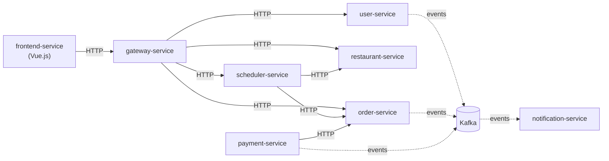

# Software Architecture And Platforms

This report describes the architecture of _Munchies_: how the domain was modelled, how it was split into
microservices, which architectural and microservices patterns were applied, and how the system is deployed and scaled
on Kubernetes. It also presents an agent-based component built on top of the platform.

The engineering process behind the project (build automation, version control, quality assurance and CI/CD) is
covered in the [SPE report](../spe/index.md) and is not repeated here.

## Members

- Alessandro Agosta ([Agostax0](https://github.com/Agostax0))
- Norbert Gabos ([Norby99](https://github.com/Norby99))
- Emiliano Rattini ([emirattini](https://github.com/emirattini))

## Scenario

_Munchies_ is an online food ordering platform where customers order their favourite food and managers create and
run their restaurants. Customers browse the closest restaurants, order from their menus, customize each dish and
choose when the food should be ready. An order can be delivered at home, picked up as takeaway, or eaten at the
restaurant, in which case the customer can also reserve a table.

Managers can create and manage multiple restaurants: their business hours, their menus and the variations available
for each dish.

## Architecture at a glance

The backend is a set of microservices, each one owning a single bounded context and its own MongoDB database. Clients
reach them only through an API Gateway. Services call each other synchronously over REST; Apache Kafka is used only
to deliver events to `notification-service`.

| Service                     | Stack              | Responsibility                                                       |
|-----------------------------|--------------------|----------------------------------------------------------------------|
| `gateway-service`           | Express.js         | Single entry point: routing, authentication, proxying                |
| `user-service`              | Kotlin + Micronaut | User accounts, authentication and authorization                      |
| `restaurant-service`        | Kotlin + Micronaut | Restaurants, menus, business hours and dish availability             |
| `order-service`             | Kotlin + Micronaut | Order creation and status tracking, stored as an event log           |
| `scheduler-service`         | Express.js         | Delivery scheduling, between the customer and `order-service`        |
| `payment-service`           | Express.js         | Payment processing                                                   |
| `notification-service`      | Express.js         | Notifications to users and staff, driven only by Kafka events        |
| `table-reservation-service` | Express.js         | Table reservations (stub)                                            |
| `frontend-service`          | Vue.js             | User interface for customers and managers                            |

`table-reservation-service` is still a stub. `scheduler-service` has routes in the gateway but is not yet part of the
Docker Compose or Kubernetes deployments.

## Main architectural decisions

- **Domain-Driven Design and hexagonal architecture.** Each service owns a bounded context. Inside it, the code is
  split into domain, application and infrastructure layers, with ports and adapters at the boundaries. The layout is
  the same in both stacks, and architecture tests check it. See [Domain Model](01-Domain%20Driven%20Design/domain-model.md)
  and [Hexagonal Architecture](03-Architecture%20and%20Implementation/hexagonal-architecture.md).
- **Database per service.** No service reads another service's database. In Kubernetes, each service and its database
  also share their own namespace, so the boundary exists in the infrastructure too.
- **Synchronous REST, asynchronous only for notifications.** Business interactions go over REST, behind the API
  Gateway. Events bound to `notification-service` go through Kafka, one topic per event. Each event carries all the
  data the consumer needs (event-carried state transfer), so `notification-service` never calls back into the
  service that sent it.
- **Event sourcing and CQRS where they pay off.** Only the `Order` aggregate, whose history of status changes matters,
  is stored as an append-only event log, and it has a separate read model. Every other service stores its current
  state with plain CRUD.
- **Kubernetes driven by service level objectives.** The production deployment autoscales on indicators chosen against
  explicit service level objectives (p95 latency and error rate). An observability stack collects metrics, logs
  and traces from every service. See [Microservices Patterns](03-Architecture%20and%20Implementation/microservices-patterns.md)
  and [Deployment on Kubernetes](03-Deployment/kubernetes.md).

## Technology stack

The technologies that shape the architecture are listed below. The complete list, including build and CI/CD tooling,
is in the [SPE report](../spe/index.md#technology-stack).

**Services**

- [Kotlin](https://kotlinlang.org/) and [Micronaut](https://micronaut.io/)
- [Node.js](https://nodejs.org/), [TypeScript](https://www.typescriptlang.org/) and [Express.js](https://expressjs.com/)
- [Vue.js](https://vuejs.org/)
- [Kotlin Multiplatform](https://kotlinlang.org/docs/multiplatform.html), for the `-shared` contract modules

**Data and messaging**

- [MongoDB](https://www.mongodb.com/), one database per service
- [Apache Kafka](https://kafka.apache.org/), for notification events

**Platform**

- [Docker](https://www.docker.com/) and [Docker Compose](https://docs.docker.com/compose/)
- [Kubernetes](https://kubernetes.io/) ([Minikube](https://minikube.sigs.k8s.io/)) and [Helm](https://helm.sh/)

**Observability**

- [Prometheus](https://prometheus.io/), [Loki](https://grafana.com/oss/loki/), [Tempo](https://grafana.com/oss/tempo/),
  [Alloy](https://grafana.com/oss/alloy/) and [Grafana](https://grafana.com/oss/grafana/)

**API documentation**

- [OpenAPI](https://www.openapis.org/), published in the
  [OpenAPI specs](https://norby99.github.io/munchies/openapi/index.html)

## Structure of the report

1. **Domain Driven Design**: Requirements ([Business](01-Domain%20Driven%20Design/business-requirements.md), [Functional](01-Domain%20Driven%20Design/functional-requirements.md), [Non-functional](01-Domain%20Driven%20Design/non-functional-requirements.md)), [User Stories](01-Domain%20Driven%20Design/User%20Stories.md),
   [Glossary](01-Domain%20Driven%20Design/glossary.md) and [Domain Model](01-Domain%20Driven%20Design/domain-model.md).
2. **Architecture and Implementation**:
   [Hexagonal Architecture](03-Architecture%20and%20Implementation/hexagonal-architecture.md),
   [Microservices Patterns](03-Architecture%20and%20Implementation/microservices-patterns.md) and
   [Testing](02-Implementation/testing.md).
3. **Deployment**: [Docker Compose](03-Deployment/docker-compose.md), [Kubernetes](03-Deployment/kubernetes.md) and the
   [Scaling Benchmark](03-Deployment/scaling-benchmark.md) that checks autoscaling against the service level
   objectives.
4. **Agent-Based Architecture**: the [Capacity Agent](04-Agent-Based%20Architecture/capacity-agent.md), an autonomous
   agent that decides how many orders a restaurant accepts per time slot.
