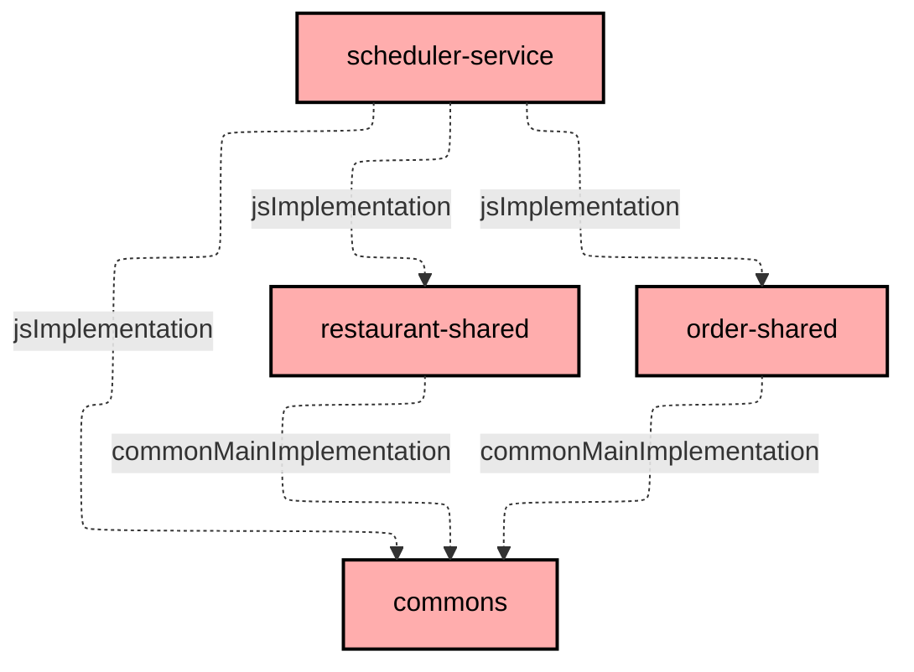

# Scheduler Service

Express + TypeScript service that turns a restaurant's capacity policy into bookable slots,
books takeaway, delivery and dine-in orders into them (placing the order in order-service),
groups deliveries into driver trips and advances each order when its preparation is due.
Bookings and trips are kept in memory: a restart forgets them.

## Module dependency graph

<!--region graph-->

<!--endregion-->

## Contracts with the other services

The outbound adapters in `src/main/ts/infrastructure/outbound/` use the contracts published by
the Kotlin shared modules, consumed as local tarballs (`build/libs/*.tgz`, see `package.json`):

| Adapter                         | Shared module       | Path constant                                                  | Classes                                                                          |
|---------------------------------|---------------------|----------------------------------------------------------------|----------------------------------------------------------------------------------|
| `httpOrderClient.ts`            | `order-shared`      | `OrderServiceConfig` (`PLACE_ORDER_PATH`, `ADVANCE_ORDER_STATUS_PATH`, `GET_ORDER_PATH`) | `PlaceOrderRequest`, `AdvanceOrderStatusRequest`, `PlaceOrderResponse`, `GetOrderDetailsResponse` |
| `httpRestaurantPolicyClient.ts` | `restaurant-shared` | `RestaurantServiceConfig.CAPACITY_POLICY_PATH`                 | `GetCapacityPolicyResponse`, `CapacityPolicyDto`                                 |
| `httpRestaurantLocation.ts`     | `restaurant-shared` | `RestaurantServiceConfig.RESTAURANT_LOCATION_PATH`             | `GetRestaurantLocationResponse`, `GeoPointDto`                                   |

The domain ports in `src/main/ts/domain/ports/` do not depend on these classes: only the
adapters translate between the wire contract and the domain.

## Build and test

The module is part of the Gradle build (`express-server` convention plugin), which packs the
shared modules into `build/libs/` before running `npm install`:

```bash
./gradlew :scheduler-service:build   # pack the shared modules, npm install, tsc
./gradlew :scheduler-service:test    # build, then vitest
```

Once `build/libs/` exists, the npm scripts work on their own too (`npm test`, `npm run dev`,
`npm run build`). The `specs` step of the convention plugin is disabled: the scheduler has no
tsoa controllers, hence no generated OpenAPI spec.

`analysis-scala/` (offline kitchen capacity analysis, Scala.js, built with sbt) is a `file:`
dev dependency that nothing in `src/` imports yet: npm only links it, so neither the Gradle
build nor the Docker image needs sbt. Run it with `npm run analyze:scala`.

## Configuration

Every setting is an environment variable with a default; see `.env.example` and
`src/main/ts/config.ts`. Slots and opening hours are computed in the process's local time, so
`TZ` must be the restaurants' zone (`Europe/Rome` in Compose and on Kubernetes).

## Docker and deployment

The image is produced by the convention plugin, like the other Express services:

```bash
./gradlew :scheduler-service:dockerCreate   # build/docker/main/ (Dockerfile, sources, tarballs)
./gradlew :scheduler-service:dockerBuild    # image scheduler-service:latest
```

- **Docker Compose**: `config/service/docker-compose.yml` builds from
  `scheduler-service/build/docker/main` (`./gradlew composeUp` runs `dockerCreate` first).
- **Kubernetes**: deployed with the generic chart `helm/munchies-service` and
  `helm/values/scheduler-service.yaml` (`./gradlew deploy -Pservice=scheduler-service`), in the
  `scheduler-service` namespace, reached by the gateway through `SCHEDULER_SERVICE_URL`. It runs
  a single replica with the `Recreate` strategy and no autoscaling: with the bookings in memory,
  two pods would hold two separate ledgers and could overbook a slot.
