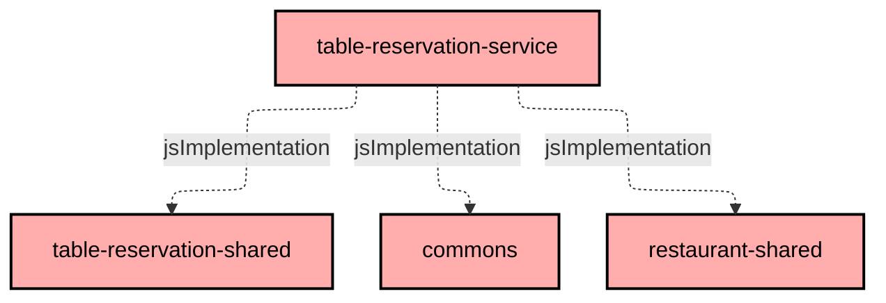

# `:table-reservation-service:service`

Books tables at restaurants. A customer asks for a table for a number of guests at an arrival
time; the service accepts the reservation at once when a table is free, and refuses it otherwise.
There is no approval step by the restaurant.

Express.js + TypeScript, laid out as `domain/`, `application/`, `infrastructure/` like
`payment-service` (see the root `CLAUDE.md`, "Service Internal Structure").

## Booking rules

- **Fixed duration.** The customer chooses when they arrive, not how long they stay. Every
  reservation lasts `RESERVATION_DURATION_MINUTES` (120 by default).
- **15-minute grid.** The arrival time must be in the future and fall on a quarter of an hour
  (19:00, 19:15, ...). The grid step is not configurable: stored reservations are indexed by it.
- **One table per party.** Tables are never joined. Among the free tables with enough seats, the
  smallest is taken, so large tables stay available for large parties.
- **Tables come from `restaurant-service`.** The manager configures them there
  (`PUT /restaurants/{restaurantId}/tables/`); this service reads them over REST on every booking
  and keeps no copy.
- **Changes are the customer's.** Only the customer who made a reservation can modify or cancel
  it, and only before it starts. A modified reservation keeps its table when that table still
  fits and is free.
- **Opening hours are not checked.** A table can be reserved at any future time.

A reservation is `ACCEPTED` or `CANCELED`. `REQUESTED` exists only inside a request, before a
table is assigned, and is never stored or returned.

### Double booking

Two requests for the last free table can arrive at the same time, possibly on different replicas.
The guard is in MongoDB, not in the application: each accepted reservation stores one `occupancy`
key per 15-minute step it covers (`<table>@<step start>`), and a unique partial index on
`{ restaurantId, occupancy }`, limited to `ACCEPTED` reservations, rejects the second writer. The
service then tries the next suitable table, and answers 409 when none is left.

## API

All paths are under `/reservations/`. Responses use the common envelope `{ result, code }`.
Through the gateway the caller's identity always comes from the token; the `customerId` and
`managerId` values below are filled in by the gateway, never by the client.

| Method  | Path                         | Purpose                                              |
|---------|------------------------------|------------------------------------------------------|
| `POST`  | `/reservations/`             | Reserve a table. Answers 201 with the reservation.   |
| `GET`   | `/reservations/`             | List reservations, ordered by start.                 |
| `GET`   | `/reservations/{id}/`        | Read one reservation.                                |
| `PUT`   | `/reservations/{id}/`        | Change the arrival time and/or the number of guests. |
| `PATCH` | `/reservations/{id}/cancel/` | Cancel, freeing the table.                           |

Request bodies (dates are ISO-8601 strings):

- `POST`: `{ restaurantId, customerId, start, numberOfGuests }`
- `PUT`: `{ customerId, start, numberOfGuests }`
- `PATCH`: `{ customerId }`

The list takes query parameters: `customerId` for a customer's own reservations, or
`restaurantId` together with `managerId` for a restaurant's reservations, in which case the
manager must manage that restaurant. `GET /reservations/{id}/` accepts an optional `customerId`
and answers 404 when the reservation belongs to someone else.

A reservation is returned as
`{ id, restaurantId, customerId, start, end, numberOfGuests, tableNumber, status }`.

| Status | Meaning                                                                                 |
|--------|-----------------------------------------------------------------------------------------|
| 400    | Malformed body, arrival time in the past or off the grid, fewer than one guest.         |
| 403    | The reservation belongs to another customer, or the restaurant to another manager.      |
| 404    | Restaurant or reservation not found.                                                    |
| 409    | No table available, or the reservation is canceled or has already started.              |
| 503    | `restaurant-service` could not be reached; the request can be retried.                  |

The request and response types live in `table-reservation-shared`. The OpenAPI document is
generated into `build/openapi/openapi.yaml`; it lists the endpoints and status codes, but its
schemas are empty because tsoa cannot read the Kotlin-generated types.

The service also exposes `GET /health` and `GET /metrics` (Prometheus).

## Notifications

After a reservation is accepted, modified or canceled, the service publishes one Kafka event for
`notification-service`, on `table_reservation_accepted_topic`, `table_reservation_modified_topic`
or `table_reservation_canceled_topic`. Each event carries the whole reservation, so the consumer
never calls back. Publishing is best-effort: it is not awaited, and a failure is logged without
failing the request.

## Configuration

| Variable                       | Default | Purpose                                                              |
|--------------------------------|---------|----------------------------------------------------------------------|
| `PORT`                         | 8080    | HTTP port.                                                           |
| `MONGODB_URI`                  | unset   | Reservation database. Unset: reservations are kept in memory.        |
| `RESTAURANT_SERVICE_URL`       | unset   | Base URL of `restaurant-service`. Unset: bookings answer 503.        |
| `KAFKA_BOOTSTRAP_SERVERS`      | unset   | Kafka broker. Unset: notifications are not sent (logged as errors).  |
| `RESERVATION_DURATION_MINUTES` | 120     | Length of a reservation; a positive multiple of 15.                  |
| `OTEL_EXPORTER_OTLP_ENDPOINT`  | unset   | Trace collector. Unset: tracing is off.                              |
| `LOG_LEVEL`                    | `info`  | pino log level.                                                      |

When `MONGODB_URI` is set but the database cannot be reached, the service refuses to start. The
in-memory store is for local runs and tests only: it is lost on restart and not shared between
replicas.

## Running and testing

From the repository root:

```sh
./gradlew :table-reservation-service:build   # compile, generate the OpenAPI document
./gradlew :table-reservation-service:test    # unit and HTTP-level tests
```

`config/service/docker-compose.yml` runs the service on port 8085, with its database from
`config/mongodb/docker-compose.yml` on port 27022.

The MongoDB integration tests, which include the concurrent double-booking case, are not part of
a Gradle task. They run from this directory against a database of your choice and are skipped
when the variable is missing:

```sh
MONGODB_TEST_URI=mongodb://localhost:27022/table-reservation-test npm run integrationTest
```

## Module dependency graph

<!--region graph-->

<!--endregion-->
